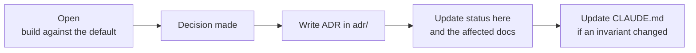

# Open decisions

> **Area:** Delivery
> **Source:** MVP Architecture v0.1 §14 ([source](../_source/mvp-architecture-v0.1.md))
> **Status:** Draft v0.1 · **Owner:** Aman
> **Used by:** [/CLAUDE.md](../../CLAUDE.md), [backend/app/domain/ai_agent/CLAUDE.md](../../backend/app/domain/ai_agent/CLAUDE.md), [backend/app/domain/cart/CLAUDE.md](../../backend/app/domain/cart/CLAUDE.md), [backend/app/domain/consent/CLAUDE.md](../../backend/app/domain/consent/CLAUDE.md), [infra/CLAUDE.md](../../infra/CLAUDE.md)

## Summary

Ten topics are still undecided. Each has a suggested default; build against the default until the decision is made, then record the outcome as an ADR and update the status here and in the affected docs.

## Decisions

| Topic | Question | Suggested default | Status | Affects docs |
|---|---|---|---|---|
| LLM provider | Which model for tool calling in English + Hinglish, at what cost per order? | Benchmark two candidates on 50 scripted conversations; Gemini on Vertex uses the GCP credit | Open | [llm-provider.md](../ai-agent/llm-provider.md), [evaluation.md](../ai-agent/evaluation.md), [tech-stack.md](../architecture/tech-stack.md), [cost-tracking.md](../observability/cost-tracking.md) |
| Supabase tier | Free tier pausing and size caps vs a live pilot | Free for dev, paid for the pilot café | Open | [tech-stack.md](../architecture/tech-stack.md), [environments.md](../infra/environments.md) |
| Menu size | Full menu in prompt vs search tool | Full available menu in prompt until it exceeds a token budget | Open | [prompt-context.md](../ai-agent/prompt-context.md), [tools.md](../ai-agent/tools.md), [ADR 0005](../adr/0005-full-menu-in-prompt.md) |
| Tax and pricing | GST inclusive or exclusive per café? Service charge? | Café setting, computed only in the cart service | Open | [cart-and-confirmation.md](../backend/cart-and-confirmation.md), [owner-console.md](../frontend/owner-console.md), [admin.md](../api/admin.md) |
| Order edits | How long can a customer edit/cancel? | Until PREPARING | Open | [order-lifecycle.md](../backend/order-lifecycle.md), [cart-and-confirmation.md](../backend/cart-and-confirmation.md) |
| Feedback timing | Minutes after SERVED | 30, configurable per café | Open | [feedback.md](../backend/feedback.md), [background-jobs.md](../backend/background-jobs.md) |
| Consent re-ask | After a "No" | Not within 30 days | Open | [consent.md](../retention/consent.md) |
| Bill / payment | UPI link now or later? | MVP: "Request bill" → staff; UPI link after discovery | Open | [human-handoff.md](../backend/human-handoff.md), [purpose-and-scope.md](../product/purpose-and-scope.md), [feature-priority.md](../product/feature-priority.md) |
| Pilot number | New dedicated number vs café's existing number | Dedicated number (see integration plan) | Open | [number-health.md](../whatsapp/number-health.md), [whatsapp/README.md](../whatsapp/README.md), [platform-admin.md](../frontend/platform-admin.md) |
| Realtime reliability on phones | Panel in a background tab may miss alerts | WhatsApp backup alert to staff number after 60 s | Open | [realtime-and-alerts.md](../frontend/realtime-and-alerts.md), [background-jobs.md](../backend/background-jobs.md), [templates.md](../whatsapp/templates.md) |

## How a decision gets closed

The process follows [CONVENTIONS.md](../CONVENTIONS.md) §4: doc first, invariant second, ADR for real trade-offs.

## Rules / invariants

- Until a decision is closed, code follows the suggested default.
- Tax and service charge are computed only in the cart service, whatever the decision.
- A closed decision always gets an ADR.

## Open questions

- §6.11 says "never ask again within N days after a No"; the 30-day default here is the proposed value of N.

## Related

- [risks.md](risks.md)
- [build-order.md](build-order.md)
- [../adr/README.md](../adr/README.md)
