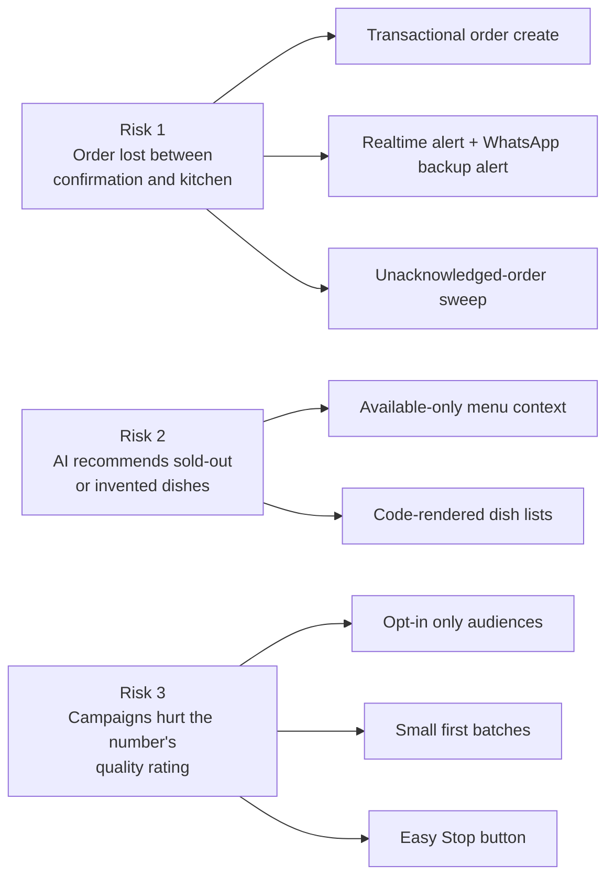

# Risks

> **Area:** Delivery
> **Source:** MVP Architecture v0.1 §14 (top risks), with mitigation detail from §6.6, §6.8, §6.12, §6.15, §6.17 ([source](../_source/mvp-architecture-v0.1.md))
> **Status:** Draft v0.1 · **Owner:** Aman
> **Used by:** [/CLAUDE.md](../../CLAUDE.md)

## Summary

Three risks could sink the pilot: a lost order, the AI recommending dishes that don't exist or are sold out, and campaigns damaging the WhatsApp number's quality rating. Each has mitigations built into the design rather than added later.

## Risk to mitigation

Each risk on the left maps to the mitigations named in §14; the sections below say where each one is designed.

## Risk 1 — an order lost between confirmation and the kitchen

| Mitigation | How | Doc |
|---|---|---|
| Transactional create | Order, order items with price snapshot, `order_status_events (PLACED)` and `expected_ready_at` written in one transaction; `UNIQUE (cart_id, cart_version)` blocks double orders | [cart-and-confirmation.md](../backend/cart-and-confirmation.md), [constraints-and-indexes.md](../database/constraints-and-indexes.md) |
| Realtime + backup alert | Realtime INSERT on `orders` plays a sound and highlights the card; a `new_order_alert` utility template goes to a staff WhatsApp number if the order stays unacknowledged in `PLACED` > 60 s | [realtime-and-alerts.md](../frontend/realtime-and-alerts.md), [templates.md](../whatsapp/templates.md) |
| Unacknowledged-order sweep | `overdue_sweep` every minute re-alerts unacknowledged orders and waiter calls; alert on orders in `PLACED` unacknowledged > 2 min | [background-jobs.md](../backend/background-jobs.md), [logging-and-metrics.md](../observability/logging-and-metrics.md) |

## Risk 2 — the AI recommending sold-out or invented dishes

| Mitigation | How | Doc |
|---|---|---|
| Available-only context | The prompt builder reads only `is_available = true` items every turn; sold-out takes effect on the next turn; confirmation re-checks availability | [prompt-context.md](../ai-agent/prompt-context.md), [menu-management.md](../backend/menu-management.md) |
| Code-rendered dish lists | The AI returns `suggested_item_ids`; guardrails check each id exists and is available; names and prices are rendered from the database as a list message | [guardrails.md](../ai-agent/guardrails.md), [interactive-messages.md](../whatsapp/interactive-messages.md), [ADR 0001](../adr/0001-ai-talks-code-decides.md) |

## Risk 3 — campaigns hurting the number's quality rating

| Mitigation | How | Doc |
|---|---|---|
| Opt-in only | Audiences query only `OptedIn`; each send re-checks the recipient is still opted in; marketing templates are rejected without consent | [consent.md](../retention/consent.md), [outbound-sender.md](../whatsapp/outbound-sender.md) |
| Small first batches | Start a new number with small audiences (size not defined in the source); the throttled `campaign-send` queue rate matches the number's throughput, and recipients over the daily limit are `DEFERRED` to the next day | [campaigns.md](../retention/campaigns.md), [async-messaging.md](../infra/async-messaging.md) |
| Easy Stop button | Every campaign template carries a "Stop offers" button; STOP is checked before anything else in the router | [consent.md](../retention/consent.md), [conversation-router.md](../backend/conversation-router.md) |
| Monitoring | `quality_and_limits` reads quality rating and messaging tier daily; alert when quality rating drops | [number-health.md](../whatsapp/number-health.md) |

The monitoring row is not named in §14's risk list; it comes from §6.17 and §11.

## Rules / invariants

- Never weaken a mitigation above without an ADR.
- The 30-order evening dry run in build step 6 must exercise risk 1 and risk 2 before the pilot.

## Open questions

- "Small first batches" has no size defined in the source.
- Realtime reliability on phones is tracked in [open-decisions.md](open-decisions.md).

## Related

- [open-decisions.md](open-decisions.md)
- [build-order.md](build-order.md)
- [../architecture/design-principles.md](../architecture/design-principles.md)
