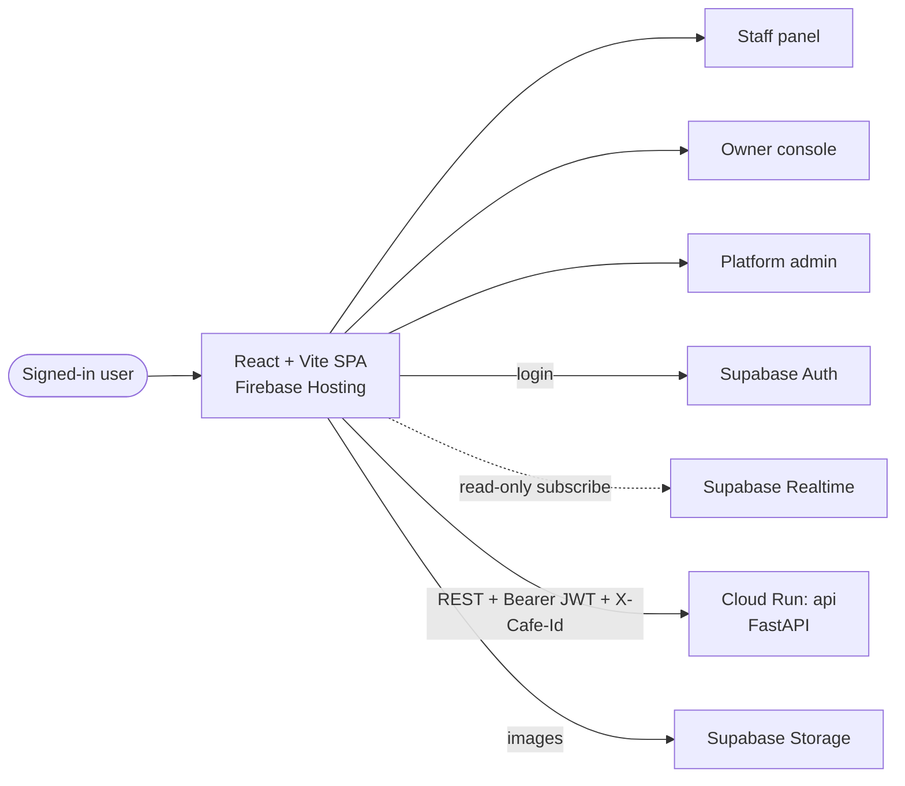

# Frontend

> **Area:** Frontend
> **Source:** MVP Architecture v0.1 §2, §3.2, §4, §5.2, §5.3, §6.8, §6.14, §10, §12 ([source](../_source/mvp-architecture-v0.1.md))
> **Status:** Draft v0.1 · **Owner:** Aman
> **Used by:** [`frontend/CLAUDE.md`](../../frontend/CLAUDE.md), [`frontend/src/features/CLAUDE.md`](../../frontend/src/features/CLAUDE.md), [`/CLAUDE.md`](../../CLAUDE.md)

## Summary

The frontend is **one React + Vite (TypeScript) single-page app** with three role-based areas: the **Staff panel**, the **Owner console** and the **Platform admin**. It is a static Vite build served by **Firebase Hosting** behind a CDN. Customers never use it — they only talk to the system on WhatsApp. The SPA talks to Supabase directly for exactly two things, **login** and **realtime reads**; every write goes through the FastAPI `api` service.

## Principles

| # | Principle | Why | Source |
|---|---|---|---|
| 1 | One SPA, three areas selected by role | Staff, owners and platform admins share login, API client and components, but each sees only its own area | §2, §3.2 |
| 2 | Supabase Auth for login only | Staff, owner and platform-admin logins; customers are `customers` rows, not Auth users | §2, §6.14 |
| 3 | Supabase Realtime for **reads** only | Live order feed and waiter-call alerts; RLS limits rows to the user's member cafés | §5.3 (5), §7 RLS |
| 4 | Every write through FastAPI | A status change must also send a WhatsApp message and write an audit row; there are no write policies for the `authenticated` role | §5.3 (5), §10 |
| 5 | Supabase anon key only | The service-role key never leaves Secret Manager and the backend | §6.14, §10 |
| 6 | Tenant from membership, never from input | The SPA sends the selected café in `X-Cafe-Id`; the API checks it against `staff_memberships` | §5.3 (6), §6.14 |
| 7 | Phone/tablet first for staff | The Staff panel runs on a phone or tablet during service; the owner console runs in a browser | §5.1 |
| 8 | Mask personal data | Phone numbers are masked in the staff panel | §10 |

## Areas at a glance

| Area | Users | Feature folders | Doc |
|---|---|---|---|
| Staff panel | `staff`, `manager`, `owner` | `orders`, `waiter`, `chat`, `menu`, `redeem` | [staff-panel.md](staff-panel.md) |
| Owner console | `owner`; `manager` for menu and analytics | `campaigns`, `customers`, `analytics`, `settings` (plus `menu` for manager edits) | [owner-console.md](owner-console.md) |
| Platform admin | `platform_admin` | `platform` | [platform-admin.md](platform-admin.md) |

Look at the arrows: only the API arrow carries writes; Auth, Realtime and Storage are login, read and image paths.

## Docs in this folder

| File | What it covers |
|---|---|
| [app-structure.md](app-structure.md) | Folder responsibilities, route map, role guard, data-access rules |
| [staff-panel.md](staff-panel.md) | Live orders board, waiter/bill queue, human-mode chat, sold-out toggle, redeem, customer quick view |
| [owner-console.md](owner-console.md) | Menu, CSV import, tables and QR, staff, settings, templates, campaigns, customers, consents, analytics, weekly report |
| [platform-admin.md](platform-admin.md) | Café onboarding, templates, health, costs, AI conversation review, audit log |
| [realtime-and-alerts.md](realtime-and-alerts.md) | Realtime subscriptions, sound/vibration alerts, WhatsApp backup alert, reconnection |

## Rules / invariants

- The SPA **never** writes to Supabase tables directly. All writes call the FastAPI `api` service.
- The SPA uses the Supabase **anon key** only; no service-role key in the bundle, env files or logs.
- Every staff/owner API request carries `Authorization: Bearer <Supabase JWT>` and `X-Cafe-Id`; the server decides access from the membership, not from anything else the SPA sends.
- Prices, totals and order state shown in the SPA come from the API or Realtime rows; the SPA does not compute money.
- Customer phone numbers are shown masked in the Staff panel.

## Open questions

- Route paths are **(proposed)** — the source defines areas and features but not SPA URLs. See [app-structure.md](app-structure.md).
- How the SPA lists a user's memberships for the café picker is not defined in the source (see [app-structure.md](app-structure.md#open-questions)).

## Related

- [../architecture/container-view.md](../architecture/container-view.md) · [../architecture/design-principles.md](../architecture/design-principles.md)
- [../api/README.md](../api/README.md) · [../security/auth-and-tenant-isolation.md](../security/auth-and-tenant-isolation.md)
- [../database/row-level-security.md](../database/row-level-security.md)
- [../infra/deployment.md](../infra/deployment.md) (Firebase Hosting)
- [../product/roles-and-permissions.md](../product/roles-and-permissions.md)
- Context files: [`frontend/CLAUDE.md`](../../frontend/CLAUDE.md), [`frontend/src/features/CLAUDE.md`](../../frontend/src/features/CLAUDE.md)
