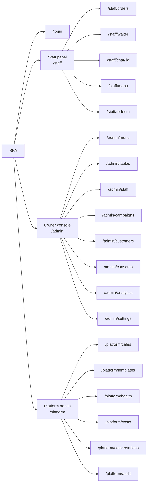
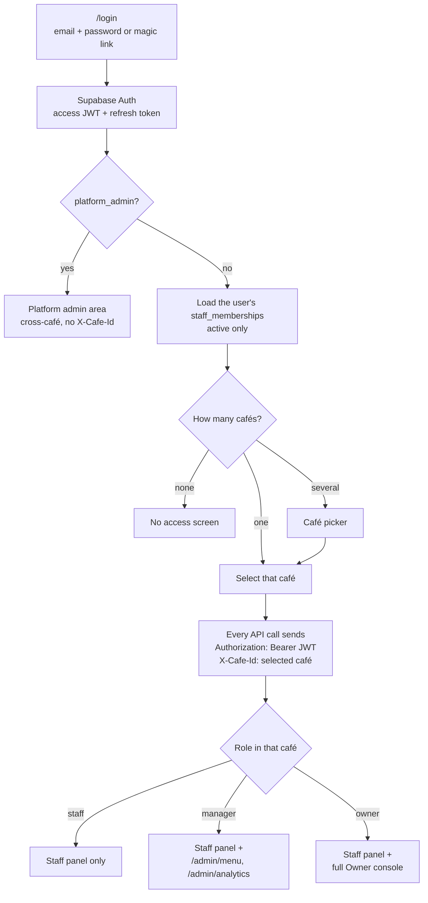
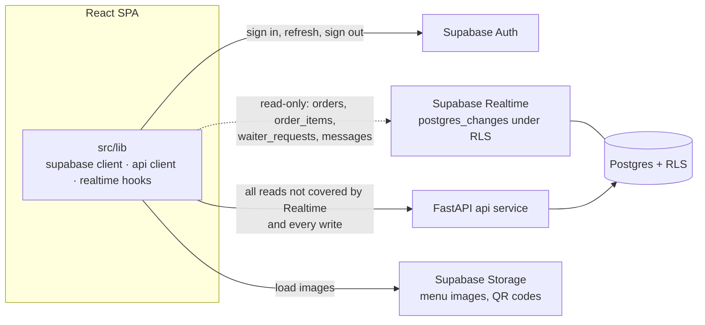

# Frontend app structure

> **Area:** Frontend
> **Source:** MVP Architecture v0.1 §2, §4, §5.2, §5.3, §6.14, §7 (RLS), §12 ([source](../_source/mvp-architecture-v0.1.md))
> **Status:** Draft v0.1 · **Owner:** Aman
> **Used by:** [`frontend/CLAUDE.md`](../../frontend/CLAUDE.md), [`frontend/src/features/CLAUDE.md`](../../frontend/src/features/CLAUDE.md)

## Summary

How the SPA is laid out on disk, which routes exist in each role area, how a signed-in user is guarded into the right area, and which backend each part of the app is allowed to talk to. The folder layout follows §12 of the source; `src/components/` is an addition. Route paths are **(proposed)** because the source names features but not URLs.

## Folder responsibilities

| Folder | Responsibility | Notes |
|---|---|---|
| `frontend/public/` | Static assets copied as-is into the Vite build (icons, alert sounds if bundled) | Served by Firebase Hosting |
| `frontend/src/app/` | Routes, role-based layout, route guards, café picker | One layout per area: Staff, Owner, Platform |
| `frontend/src/components/` | Shared, presentational UI (buttons, cards, tables, dialogs) | **Addition** to the §12 layout; no data fetching here |
| `frontend/src/lib/` | Supabase client, API client, realtime hooks, sound alerts | The only place that knows about JWTs, `X-Cafe-Id` and Realtime channels |
| `frontend/src/features/orders/` | Live orders board, order cards, status buttons | Staff |
| `frontend/src/features/waiter/` | Waiter / bill queue, ack and resolve | Staff |
| `frontend/src/features/chat/` | Human-mode chat view, reply, takeover / release | Staff |
| `frontend/src/features/menu/` | Two-tap sold-out toggle; menu editing for `manager`+ | Staff + Owner console |
| `frontend/src/features/redeem/` | Enter an offer code against an order | Staff |
| `frontend/src/features/campaigns/` | Campaign wizard, preview, schedule, report | Owner |
| `frontend/src/features/customers/` | Customer list and profile; staff quick view | Owner (+ staff quick view) |
| `frontend/src/features/analytics/` | Sales, items, prep, feedback, customers; weekly report export | Owner / `manager`+ |
| `frontend/src/features/settings/` | Hours, tone, feedback delay, tax; tables and QR; staff accounts; consent register | Owner |
| `frontend/src/features/platform/` | Onboarding, templates, health, costs, AI review, audit | Platform admin |

Where tables/QR, staff accounts and the consent register live (under `settings/` or their own folder) is an implementation choice; the source lists only the nine feature folders above plus `platform/`.

## Route map (proposed)

All paths below are **(proposed)**.

Each area's routes mirror the API route group of the same name (`/staff/*`, `/admin/*`, `/platform/*`), which keeps screen-to-endpoint mapping obvious.

| Route (proposed) | Area | Min role | Screen doc |
|---|---|---|---|
| `/login` | — | none | this doc |
| `/staff/orders`, `/staff/waiter`, `/staff/chat/:id`, `/staff/menu`, `/staff/redeem` | Staff panel | `staff` | [staff-panel.md](staff-panel.md) |
| `/admin/menu`, `/admin/analytics` | Owner console | `manager` | [owner-console.md](owner-console.md) |
| `/admin/tables`, `/admin/staff`, `/admin/campaigns`, `/admin/customers`, `/admin/consents`, `/admin/settings` | Owner console | `owner` | [owner-console.md](owner-console.md) |
| `/platform/*` | Platform admin | `platform_admin` | [platform-admin.md](platform-admin.md) |

## Role guard

Read the guard as a convenience, not a control: the SPA hides what a role cannot use, but the API re-checks JWT, membership and role on every request and returns `403` if the client got it wrong.

- The role comes from `staff_memberships (user_id, cafe_id, role)`; one person can belong to several cafés, so the role is per selected café.
- Switching café changes `X-Cafe-Id`, re-evaluates the role and re-subscribes Realtime.
- A `401` from the API (expired or invalid JWT) triggers a token refresh, then a return to `/login` if refresh fails.
- A `403` (no membership, wrong role, deactivated membership) shows a "no access" state; it is never retried silently.

## Data-access rules

The dashed Realtime edge is the only direct database path, and it is read-only; RLS has `SELECT` policies on four tables and no `INSERT`, `UPDATE` or `DELETE` policies for `authenticated`.

| Need | Path | Never |
|---|---|---|
| Log in, refresh session | Supabase Auth | Custom auth in the API |
| Live updates on orders, items, waiter calls, human-mode messages | Supabase Realtime, filtered by RLS to member cafés | Polling as the primary mechanism |
| Initial lists, profiles, analytics, settings | FastAPI `api` | Direct table `SELECT` outside the four RLS tables |
| Any create, update, delete, status change, send | FastAPI `api` | Supabase client writes |
| Menu images, QR images | Supabase Storage | — |

## Rules / invariants

- Only `src/lib/` talks to Supabase or the API; features call `lib` hooks and clients.
- The API client always attaches the Bearer JWT and `X-Cafe-Id` for `/staff/*` and `/admin/*`; it never puts `cafe_id` in a request body.
- No Supabase write calls anywhere in the SPA.
- UI role checks only hide controls; the API is the authority.

## Open questions

- **Route paths** are all **(proposed)**.
- **Membership list for the café picker.** The source gives RLS `SELECT` only on `orders`, `order_items`, `waiter_requests` and `messages`, and defines no API endpoint that returns the caller's memberships. Either an endpoint (for example a `/me`-style call) or an RLS read policy on `staff_memberships` is needed **(proposed)**. Track in [../delivery/open-decisions.md](../delivery/open-decisions.md).
- **How `platform_admin` is identified.** `staff_memberships` is per café; the source does not say where the platform-wide role is stored. See [../security/auth-and-tenant-isolation.md](../security/auth-and-tenant-isolation.md).

## Related

- [README.md](README.md) · [staff-panel.md](staff-panel.md) · [owner-console.md](owner-console.md) · [platform-admin.md](platform-admin.md) · [realtime-and-alerts.md](realtime-and-alerts.md)
- [../api/README.md](../api/README.md) · [../security/auth-and-tenant-isolation.md](../security/auth-and-tenant-isolation.md) · [../database/row-level-security.md](../database/row-level-security.md)
- [../product/roles-and-permissions.md](../product/roles-and-permissions.md)
- Context files: [`frontend/CLAUDE.md`](../../frontend/CLAUDE.md), [`frontend/src/features/CLAUDE.md`](../../frontend/src/features/CLAUDE.md)
