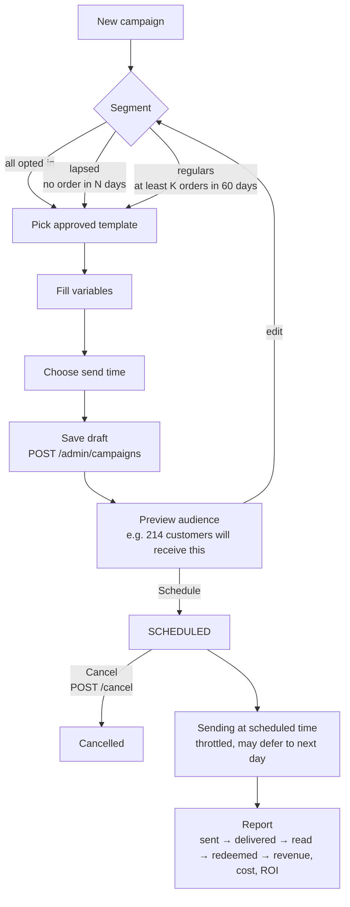

# Owner console

> **Area:** Frontend
> **Source:** MVP Architecture v0.1 §3.2, §4, §6.11, §6.12, §6.15, §6.16, §6.17, §8.3 ([source](../_source/mvp-architecture-v0.1.md))
> **Status:** Draft v0.1 · **Owner:** Aman
> **Used by:** [`frontend/CLAUDE.md`](../../frontend/CLAUDE.md), [`frontend/src/features/CLAUDE.md`](../../frontend/src/features/CLAUDE.md)

## Summary

The Owner console is where the café owner runs the business side: menu, tables and QR codes, staff accounts, café settings, campaigns, customers, the consent register, analytics and the weekly report. It is the screen that proves the retention value — "you now own your customer list" and "42 people came back and spent ₹X". Most screens are `owner` only; menu management and analytics are open to `manager`.

## Screens

| Screen | What the owner does | Feature folder |
|---|---|---|
| Menu management | Create and edit categories and items: price, tags, spice, prep time, image, availability | `menu` |
| CSV import | Upload a menu CSV to create or update items in bulk | `menu` |
| Tables & QR generator | Create tables, download each table's QR code | `settings` |
| Staff accounts | Invite staff, set role, deactivate instantly | `settings` |
| Settings | Hours, tone, feedback delay, tax | `settings` |
| Templates | Read the café's approved WhatsApp templates (created by the platform admin) | `campaigns` |
| Campaigns | Create → preview audience count → schedule → report | `campaigns` |
| Customers | Searchable list and profile page | `customers` |
| Consent register | View current consent per customer; export | `customers` |
| Analytics | Sales, items, prep, feedback, customers | `analytics` |
| Weekly report | Export the weekly summary (CSV / one-page) | `analytics` |

### Menu management (`manager`+)

- CRUD on `/admin/menu/categories` and `/admin/menu/items`; item edit is `PUT /admin/menu/items/{id}`.
- Fields from `menu_items`: name, description, price, veg flag, spice level, tags, allergens, protein, calories, prep minutes, image, availability.
- Images go to Supabase Storage; the item stores `image_path`.
- Every change writes `audit_log`. Changes reach the AI on the next turn because the available menu is read per turn.

### CSV import

- `POST /admin/menu/import`. The source lists CSV import as "owner / platform".
- The console should show a summary of created / updated / rejected rows before the owner leaves the screen **(proposed)**.

### Tables & QR generator

- CRUD `/admin/tables`; `GET /admin/tables/{id}/qr` returns the QR for one table. Generated QR codes live in Supabase Storage.
- Each QR starts the WhatsApp conversation that the router recognises as "Hi, I'm at Table N", which opens or refreshes the table session.

### Staff accounts

- CRUD `/admin/staff`: invite and manage staff, set role (`staff`, `manager`, `owner`).
- Per-person logins, no shared accounts. The owner can deactivate staff instantly (`staff_memberships.active`).

### Settings

- `GET`/`PUT /admin/settings`: hours, tone (used in the AI system prompt), feedback delay (default 30 min after `SERVED`), tax (GST inclusive or exclusive, computed only in the cart service).

### Templates (read-only)

- `GET /admin/templates`: approved templates for this café, with category and status. Owners pick from these in the campaign wizard; they do not create or submit templates.

### Campaigns

Look at the preview step: the owner sees the audience count — opted-in and in segment, minus opted-out — before anything is scheduled.

- Only three MVP segments: all opted-in, lapsed (no order in N days), regulars (≥ K orders in 60 days).
- The report (`GET /admin/campaigns/{id}/report`) shows the funnel, revenue and cost from `v_campaign_funnel`.

### Customers

- List: `GET /admin/customers` (searchable). Profile: `GET /admin/customers/{id}`.
- Profile fields (customer intelligence, §6.16): name, **masked number**, first and last visit, visit count, total spend, favourite dishes, consent status, feedback, campaigns received and redeemed, segment label (new, regular, lapsed). Backed by `v_customer_profile`.

### Consent register

- `GET /admin/consents` and the export at `/admin/consents` · `/export`.
- Shows each customer's current state (latest row per customer and type) with `status`, `wording_version`, `source` (`order_flow`, `counter_qr`, `feedback_flow`) and `created_at`. Read-only: consent is changed only by the customer.

### Analytics (`manager`+)

| Tab | Endpoint | Backing view (by name) |
|---|---|---|
| Sales | `GET /admin/analytics/sales` | `v_daily_sales` — orders, revenue, AOV by day / hour |
| Items | `GET /admin/analytics/items` | `v_item_performance` — top and bottom dishes |
| Prep | `GET /admin/analytics/prep` | `v_prep_times` — placed→ready, overdue % |
| Feedback | `GET /admin/analytics/feedback` | `v_feedback_summary` — avg rating, low-rating comments |
| Customers | `GET /admin/analytics/customers` | `v_customer_profile` |

Views are refreshed nightly (`refresh_views`), so analytics are up to yesterday unless a view is a plain (non-materialised) view. Cancelled orders are excluded from revenue.

### Weekly report export

- `GET /admin/reports/weekly` (JSON / CSV). Generated by the `weekly_report` job on Monday 09:00 from `v_daily_sales`, `v_item_performance` and `v_campaign_funnel`.

## Screen → endpoints → min role

| Screen | Endpoints | Min role |
|---|---|---|
| Menu management | CRUD `/admin/menu/categories`, `/admin/menu/items` | `manager` |
| CSV import | `POST /admin/menu/import` | `owner` |
| Tables & QR | CRUD `/admin/tables`, `GET /admin/tables/{id}/qr` | `owner` |
| Staff accounts | CRUD `/admin/staff` | `owner` |
| Settings | `GET`/`PUT /admin/settings` | `owner` |
| Templates | `GET /admin/templates` | `owner` |
| Campaigns | `POST /admin/campaigns` · `/preview` · `/schedule` · `/cancel`, `GET /admin/campaigns/{id}/report` | `owner` |
| Customers | `GET /admin/customers`, `GET /admin/customers/{id}` | `owner` |
| Consent register | `GET /admin/consents` · `/export` | `owner` |
| Analytics | `GET /admin/analytics/{sales,items,prep,feedback,customers}` | `manager` |
| Weekly report | `GET /admin/reports/weekly` | `owner` |

## Rules / invariants

- The console never sends a campaign directly; it creates, previews, schedules or cancels, and the worker sends.
- Campaign audiences are opted-in customers only; the console never offers a way to message non-consenting customers.
- Phone numbers are masked on customer screens.
- `cafe_id` comes from `X-Cafe-Id` + membership; no screen lets an owner pick data from another café.
- Money shown (revenue, spend, prices) comes from the API, never computed in the browser.

## Open questions

- **Campaign sub-paths.** §8.3 writes `/admin/campaigns` · `/preview` · `/schedule` · `/cancel`; the exact shape (e.g. per-campaign `{id}` sub-paths) is not spelled out. See [../api/admin.md](../api/admin.md).
- **CSV import role.** §6.15 says "owner / platform"; §8.3 has no "(manager)" note, so it is treated as `owner`. No platform-side import endpoint exists.
- **Number health for owners.** `quality_and_limits` "stores for the owner and platform screens", but §8.3 has no owner endpoint for quality rating or messaging tier.
- **Campaign cancel semantics.** The source does not say whether cancel works only before `campaign_start` or also stops in-flight sends, nor names the campaign status values beyond draft and `SCHEDULED`.
- **Weekly report access for managers.** `/admin/reports/weekly` has no `manager` note, so it is `owner` only.
- **Import result summary** is **(proposed)**.

## Related

- [app-structure.md](app-structure.md) · [staff-panel.md](staff-panel.md) · [platform-admin.md](platform-admin.md)
- [../api/admin.md](../api/admin.md)
- [../retention/campaigns.md](../retention/campaigns.md) · [../retention/consent.md](../retention/consent.md) · [../retention/redemption.md](../retention/redemption.md)
- [../backend/menu-management.md](../backend/menu-management.md) · [../backend/customers.md](../backend/customers.md)
- [../database/analytics-views.md](../database/analytics-views.md)
- Context files: [`frontend/CLAUDE.md`](../../frontend/CLAUDE.md), [`frontend/src/features/CLAUDE.md`](../../frontend/src/features/CLAUDE.md)
