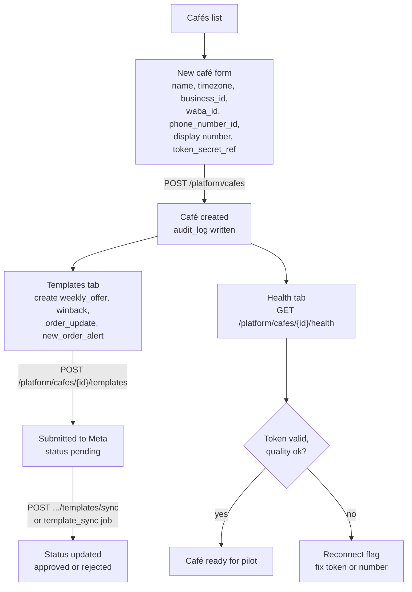

# Platform admin

> **Area:** Frontend
> **Source:** MVP Architecture v0.1 §3.1, §3.2, §4, §6.16, §6.17, §8.4, §10, §11 ([source](../_source/mvp-architecture-v0.1.md))
> **Status:** Draft v0.1 · **Owner:** Aman
> **Used by:** [`frontend/CLAUDE.md`](../../frontend/CLAUDE.md), [`frontend/src/features/CLAUDE.md`](../../frontend/src/features/CLAUDE.md)

## Summary

The Platform admin area is for **us**, the platform operator — not for café owners. It onboards a café's WhatsApp number, manages templates and their Meta status, shows token, quality and limit health, shows WhatsApp + AI cost per order and per campaign, lets us review AI conversations and reads the audit log. It is the only area with **cross-café scope**, so it is kept apart from the owner role and **every action is audited**. Use it sparingly.

## Screens

| Screen | What it does | Endpoint |
|---|---|---|
| Café onboarding | Register a café: Meta IDs (business, WABA, `phone_number_id`), token secret ref, display number | `POST /platform/cafes` |
| Templates | Create templates on the café's WABA; sync status with Meta | `POST /platform/cafes/{id}/templates`, `POST /platform/cafes/{id}/templates/sync` |
| Health | Token validity, quality rating, messaging tier, webhook errors per café; "Reconnect" flag | `GET /platform/cafes/{id}/health` |
| Costs | WhatsApp + AI cost per order and per campaign | `GET /platform/costs` |
| AI conversation review | Transcripts filtered to fallbacks and low ratings | `GET /platform/conversations` |
| Audit log | Who changed what, across cafés | `GET /platform/audit` |

### Café onboarding

- Captures the `cafes` fields: `name`, `timezone`, `business_id`, `waba_id`, `phone_number_id` (unique — it is how inbound webhooks resolve the tenant), `display_phone_number`, `onboarding_model`, `token_secret_ref`, `status`.
- The token itself lives in Secret Manager; the screen only records the **reference** (`token_secret_ref`). The token is never typed into or shown by the SPA.
- Embedded Signup is out of scope for the MVP (Phase 2), so onboarding is a manual form.

Follow the two branches out of "Café created": templates need Meta approval time, so they are submitted early, while health confirms the token and number work.

### Templates + status sync

- Lists each café's `templates` with `name`, `language`, `category`, `status`, `quality`.
- Template status is kept in sync with Meta by the `template_sync` job (webhook + daily); the screen's **Sync** button calls the sync endpoint on demand.
- Approval takes time, so `weekly_offer`, `winback`, `order_update` and `new_order_alert` are submitted during build step 1.

### Health

- Token validity from the daily `token_health` debug-token check; a failing token shows the **"Reconnect"** flag and raises an alert.
- Quality rating and messaging tier from `quality_and_limits` (daily + webhooks).
- Webhook errors per café (what counts as a "webhook error" is not detailed in the source).

### Costs

- Backed by `v_unit_costs`: WhatsApp cost per message (from the `pricing` object on status webhooks, stored on `messages`) and AI cost per turn (`ai_usage`).
- Per order = sum over the conversation that produced it. Per campaign: WhatsApp cost, delivered, redeemed, revenue → cost per redeemed visit and revenue ÷ cost.

### AI conversation review

- Transcripts across cafés, filtered to turns with `ai_usage.fallback_used` and conversations with low feedback ratings.
- Used to tune prompts and guardrails; read-only.

### Audit log

- `audit_log (actor, cafe_id, action, entity, before, after, at)` across cafés, filterable by café, actor and action.
- Includes status changes, sold-out flips, cancellations, campaigns, redemptions and platform-admin actions.

## Screen → endpoints

| Screen | Endpoints | Role |
|---|---|---|
| Café onboarding | `POST /platform/cafes` | `platform_admin` |
| Templates | `POST /platform/cafes/{id}/templates`, `POST /platform/cafes/{id}/templates/sync` | `platform_admin` |
| Health | `GET /platform/cafes/{id}/health` | `platform_admin` |
| Costs | `GET /platform/costs` | `platform_admin` |
| AI conversation review | `GET /platform/conversations` | `platform_admin` |
| Audit log | `GET /platform/audit` | `platform_admin` |

## Rules / invariants

- Only `platform_admin` can open this area; café owners never see other cafés.
- Every platform-admin action writes `audit_log`.
- Secrets (tokens, App Secret, 2FA PINs) are never entered into or displayed by the SPA; only secret references are.
- Platform screens do not send messages to customers.

## Open questions

- **Listing cafés.** §8.4 has `POST /platform/cafes` but no `GET /platform/cafes` list or update endpoint; the cafés list screen needs one **(proposed)**.
- **Template listing per café.** Only create and sync are listed for platform; how the platform screen reads templates (reuse `/admin/templates` or a platform `GET`) is undefined.
- **How the token gets into Secret Manager** (who creates the secret that `token_secret_ref` points to) is not described.
- **First owner account.** `/admin/staff` is owner-only; the source does not say how the first owner of a newly onboarded café is invited — likely a platform action **(proposed)**.
- **Whether reads are audited.** "Every action audited" for `platform_admin`; whether viewing transcripts counts as an action is not stated.

## Related

- [app-structure.md](app-structure.md) · [owner-console.md](owner-console.md)
- [../api/platform.md](../api/platform.md)
- [../whatsapp/templates.md](../whatsapp/templates.md) · [../whatsapp/number-health.md](../whatsapp/number-health.md)
- [../observability/cost-tracking.md](../observability/cost-tracking.md) · [../ai-agent/evaluation.md](../ai-agent/evaluation.md)
- [../security/security-controls.md](../security/security-controls.md)
- Context files: [`frontend/CLAUDE.md`](../../frontend/CLAUDE.md), [`frontend/src/features/CLAUDE.md`](../../frontend/src/features/CLAUDE.md)
