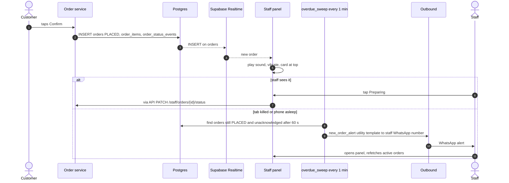
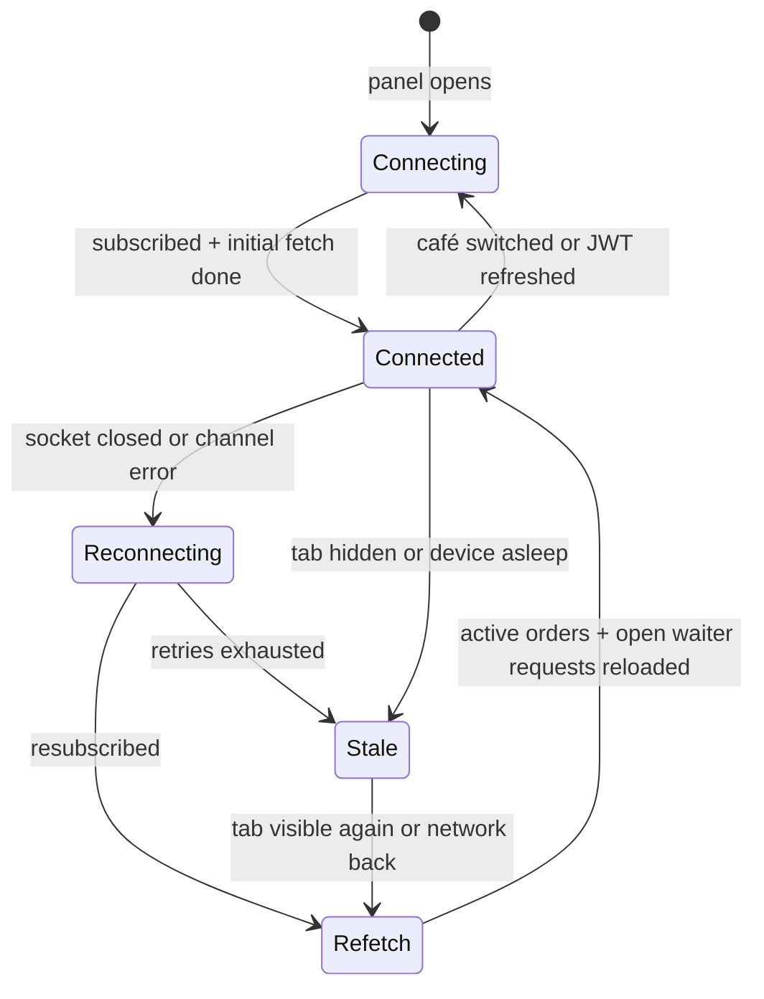

# Realtime and alerts

> **Area:** Frontend
> **Source:** MVP Architecture v0.1 §2, §5.2, §6.6, §6.8, §6.9, §6.10, §6.14, §6.17, §7 (RLS), §11, §14 ([source](../_source/mvp-architecture-v0.1.md))
> **Status:** Draft v0.1 · **Owner:** Aman
> **Used by:** [`frontend/CLAUDE.md`](../../frontend/CLAUDE.md), [`frontend/src/features/CLAUDE.md`](../../frontend/src/features/CLAUDE.md), [`supabase/CLAUDE.md`](../../supabase/CLAUDE.md)

## Summary

The Staff panel learns about new orders, status changes, waiter calls and human-mode messages through **Supabase Realtime (Postgres Changes)**, limited by RLS to the user's member cafés. A new order or waiter call plays a **sound and vibration**. Because phones can kill a background browser tab, a **WhatsApp backup alert** (`new_order_alert` utility template to a staff number) goes out if an order sits unacknowledged in `PLACED` for more than 60 seconds. Losing an order between confirmation and the kitchen is a top risk, and this is one of its mitigations.

## Subscriptions

| Table | Events used | Why | Screen |
|---|---|---|---|
| `orders` | `INSERT`, `UPDATE` | New order alert; status and overdue changes from other devices | Live orders board |
| `order_items` | `INSERT` | Items of a new order | Live orders board |
| `waiter_requests` | `INSERT`, `UPDATE` | "Table 5 needs help" alert; ack / resolve from other devices | Waiter / bill queue |
| `messages` | `INSERT` | Inbound customer messages while `mode = human` | Human-mode chat |

- Channel type: `postgres_changes`, opened with the user's JWT.
- RLS `SELECT` policy on these four tables: `cafe_id IN (SELECT cafe_id FROM staff_memberships WHERE user_id = auth.uid())`. These are the only tables with frontend read policies, and there are no write policies.
- The subscription is **read-only**. Initial state always comes from the API (`GET /staff/orders?status=active`, `GET /staff/waiter-requests?status=open`, `GET /staff/conversations/{id}/messages`); Realtime only delivers changes after that.
- The panel subscribes for the café selected in `X-Cafe-Id` and re-subscribes on café switch.

## New-order alert, including the backup path

The `alt` block is the point: Realtime is the primary path, and the scheduled sweep is the safety net that does not depend on the browser being alive.

- `overdue_sweep` runs **every 1 minute**, so the backup lands roughly 60–120 s after the order was placed.
- The same sweep re-alerts **waiter calls** unacknowledged for more than 60 s, with a `new_order_alert`-style utility template to the staff number.
- Separately, monitoring alerts on waiter requests unacknowledged > 60 s and on orders in `PLACED` unacknowledged > 2 min (see [../observability/logging-and-metrics.md](../observability/logging-and-metrics.md)).

## Sound and vibration

- Triggered by a Realtime `INSERT` on `orders` or `waiter_requests` for the selected café.
- New order: sound, vibrate, card at the top of the board. Waiter call: alert "Table 5 needs help" + sound.
- Implemented in `src/lib/` (sound alerts) so every staff screen gets it, not only the orders board.
- Low ratings (1 or 2) should also "alert manager in panel" (§6.10) — see open questions.

## Connection lifecycle (proposed)

The source states the background-tab risk but not how the panel recovers. The behaviour below is **(proposed)**.

The key transition is `Stale → Refetch`: after any gap, the panel reloads from the API rather than trusting that it saw every Realtime event.

- **On resume (proposed):** when the tab becomes visible or the network returns, refetch `GET /staff/orders?status=active` and `GET /staff/waiter-requests?status=open`, then replay alerts for anything new that is still `PLACED` or `PENDING`.
- **Visible state (proposed):** show a "reconnecting" banner while not `Connected`, so staff know alerts may be delayed.
- **Token refresh (proposed):** the access JWT is short-lived; refresh it and re-authenticate the Realtime channel before it expires.

## Rules / invariants

- Realtime is read-only and RLS-limited to member cafés; the SPA never writes through Supabase.
- Initial state comes from the API; Realtime events are deltas, never the sole source.
- The backup WhatsApp alert is sent by the backend sweep, never by the browser.
- Alerts are per selected café; switching café drops the old subscription.

## Open questions

- **"Acknowledged" for orders.** The backup fires when an order "stays unacknowledged in `PLACED`" for 60 s, but the source does not define acknowledgement — moving to `PREPARING`, or a separate acknowledge action on the card. Waiter requests have an explicit `ACKNOWLEDGED` status; orders do not.
- **Staff WhatsApp number.** Where the staff number for backup alerts is configured is not specified (not in the §8.3 settings list).
- **Template for waiter-call backup.** §6.9 says "`new_order_alert`-style"; whether it is the same template or a separate one is undefined.
- **60 s vs 2 min.** The backup alert uses 60 s; the monitoring alert for `PLACED` uses 2 min. Both are intentional per the source but worth confirming.
- **Low-rating manager alert.** §6.10 says a 1–2 rating alerts the manager in the panel, but `feedback` has no Realtime policy; the delivery path is undefined.
- **Subscribed tables.** §6.8 subscribes to `orders` and `waiter_requests`; §7 RLS also covers `order_items` and `messages`. This doc uses all four.
- **Connection lifecycle and refetch-on-resume** are **(proposed)**. Track in [../delivery/open-decisions.md](../delivery/open-decisions.md).

## Related

- [staff-panel.md](staff-panel.md) · [app-structure.md](app-structure.md)
- [../database/row-level-security.md](../database/row-level-security.md)
- [../backend/background-jobs.md](../backend/background-jobs.md) · [../backend/order-lifecycle.md](../backend/order-lifecycle.md) · [../backend/human-handoff.md](../backend/human-handoff.md)
- [../whatsapp/templates.md](../whatsapp/templates.md) · [../delivery/risks.md](../delivery/risks.md)
- Context files: [`frontend/CLAUDE.md`](../../frontend/CLAUDE.md), [`supabase/CLAUDE.md`](../../supabase/CLAUDE.md)
