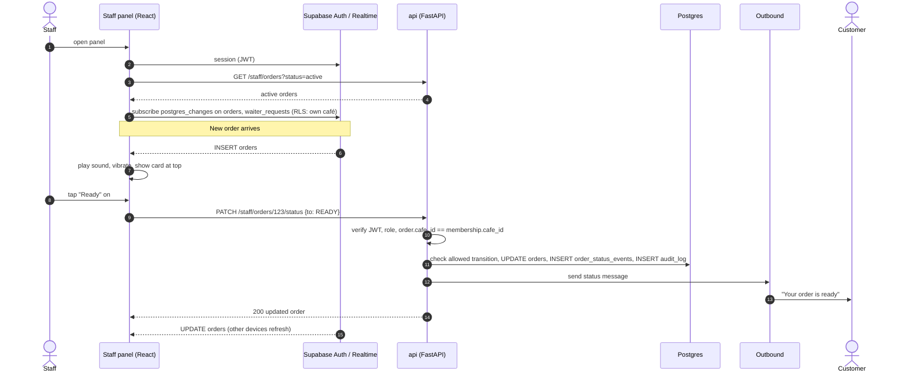
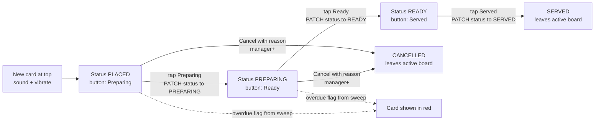

# Staff panel

> **Area:** Frontend
> **Source:** MVP Architecture v0.1 §3.2, §4, §6.7, §6.8, §6.9, §6.12, §6.15, §8.2, §10 ([source](../_source/mvp-architecture-v0.1.md))
> **Status:** Draft v0.1 · **Owner:** Aman
> **Used by:** [`frontend/CLAUDE.md`](../../frontend/CLAUDE.md), [`frontend/src/features/CLAUDE.md`](../../frontend/src/features/CLAUDE.md)

## Summary

The Staff panel is what waiters and kitchen staff use during service, on a **phone or tablet first**. It shows live orders with a sound and vibration alert, lets staff move orders through Preparing → Ready → Served, handles waiter and bill calls, lets staff reply to a customer in human mode, flips dishes to sold-out in two taps and redeems offer codes. It is a P0 feature: the pilot can't run without it.

## Live orders and status changes (§6.8)

Note the split: the panel *reads* through Realtime but *writes* through the API, and every other open device converges through the Realtime `UPDATE`.

**Staff alerts.** The primary alert is a sound and vibration in the panel. A browser tab can be killed in the background on phones, so there is a backup: a `new_order_alert` utility template to a staff WhatsApp number if an order stays unacknowledged in `PLACED` for more than 60 seconds (checked by the overdue sweep). Details in [realtime-and-alerts.md](realtime-and-alerts.md).

## Screens

### Live orders board

- New orders arrive via Realtime `INSERT orders`: **play sound, vibrate, show the card at the top**.
- Each card shows order number, table label, items with notes, total, status and time since placed (from `orders`, `order_items`).
- **Overdue in red.** "Overdue" is a flag, not a state: `now > expected_ready_at` and not `READY`, set by the `overdue_sweep` job. The card reads `orders.overdue`.
- Status buttons: **Preparing**, **Ready**, **Served**, one at a time according to the current state. **Cancel** (with reason) shows only for `manager`+.
- Other devices update from Realtime `UPDATE orders`; tapping a button never optimistically assumes success — the card changes on the API `200` or on the Realtime update.

Each button maps one-to-one to an allowed transition in the [order lifecycle](../backend/order-lifecycle.md); the panel never offers a transition the API would reject.

| Card state | Button | API call | Customer hears (inside 24-h window) | Other effects |
|---|---|---|---|---|
| `PLACED` | Preparing | `PATCH /staff/orders/{id}/status` → `PREPARING` | "The kitchen has started on your order" | Customer edits/cancels now blocked |
| `PREPARING` | Ready | `PATCH /staff/orders/{id}/status` → `READY` | "Your order is ready and on its way" | — |
| `READY` | Served | `PATCH /staff/orders/{id}/status` → `SERVED` | — | Feedback task scheduled (+30 min) |
| `PLACED`, `PREPARING` | Cancel (`manager`+) | `POST /staff/orders/{id}/cancel` with reason | "Your order has been cancelled" + reason | Audit row; excluded from analytics revenue |

### Waiter / bill queue

- Lists open requests from `GET /staff/waiter-requests?status=open`; new ones arrive via Realtime `INSERT waiter_requests` with an alert "Table 5 needs help" + sound.
- `reason = BILL` requests (the "Request bill" button) share the same queue.
- **Acknowledge** → `POST /staff/waiter-requests/{id}/ack` (`ACKNOWLEDGED`, records who). **Resolve** → `POST /staff/waiter-requests/{id}/resolve` (`RESOLVED`, conversation returns to bot mode).
- If not acknowledged within 60 s, the sweep sends a `new_order_alert`-style utility template to the staff number.

### Human-mode chat

- Opened from a waiter request or a conversation in human mode. Loads `GET /staff/conversations/{id}/messages`; new inbound messages arrive via Realtime on `messages` (RLS-limited).
- While `mode = human`, the bot is silent and inbound messages are only stored and shown here.
- **Reply** → `POST /staff/conversations/{id}/reply` (sent in the same WhatsApp thread through the outbound service, so the 24-hour rule still applies).
- **Take over** / **Release** → `POST /staff/conversations/{id}/takeover` / `/release`. Idle timeout (e.g. 20 min, `human_mode_timeout`) also returns mode to bot.

### Sold-out toggle

- Two taps: tap the dish, confirm sold-out (or back in stock). Calls `PATCH /staff/menu/items/{id}/availability`.
- Takes effect on the next AI turn (the available menu is read per turn); items already in carts are caught at the confirmation re-check.
- Price, tags, spice, prep time and image edits are **not** here — they are `manager`+ in the [owner console](owner-console.md).

### Redeem code

- Staff types the code the customer shows from the offer message and picks the order. Calls `POST /staff/redeem` with `code` and `order_id`.
- The API checks the code is valid, not used and not expired, then records `redeemed_at` and links the order. The panel shows the result, e.g. "Redeemed: 20% off Tuesday special".

### Customer quick view

- `GET /staff/customers/{id}`: name, past orders, notes, **masked number**.
- Staff can see a customer's name and past orders; they cannot export data or see analytics.

## Screen → endpoints → realtime → min role

| Screen | Endpoints | Realtime tables | Min role |
|---|---|---|---|
| Live orders board | `GET /staff/orders?status=active`, `PATCH /staff/orders/{id}/status` | `orders`, `order_items` | `staff` |
| Cancel order | `POST /staff/orders/{id}/cancel` | `orders` | `manager` |
| Waiter / bill queue | `GET /staff/waiter-requests?status=open`, `POST /staff/waiter-requests/{id}/ack`, `POST /staff/waiter-requests/{id}/resolve` | `waiter_requests` | `staff` |
| Human-mode chat | `GET /staff/conversations/{id}/messages`, `POST /staff/conversations/{id}/reply`, `POST /staff/conversations/{id}/takeover`, `POST /staff/conversations/{id}/release` | `messages` | `staff` |
| Sold-out toggle | `PATCH /staff/menu/items/{id}/availability` | — | `staff` |
| Redeem code | `POST /staff/redeem` | — | `staff` |
| Customer quick view | `GET /staff/customers/{id}` | — | `staff` |

## Layout notes

- Phone/tablet first: large tap targets, one-column card list on phones, two or three columns on tablets.
- The orders board is the default staff route; waiter calls show a badge and alert on every staff screen.
- Sound needs a user gesture before the browser allows playback; the panel should ask staff to tap once to "enable alerts" at the start of a shift **(proposed)**.

## Rules / invariants

- Every button is a call to the API; no direct Supabase writes.
- Status buttons follow the lifecycle exactly: Preparing from `PLACED`, Ready from `PREPARING`, Served from `READY`. Cancel is `manager`+.
- Overdue is shown from `orders.overdue`; the panel never computes it as authoritative.
- Phone numbers are always masked.
- A staff action that messages a customer (status change, reply, cancel) is never sent from the browser; the API's outbound service sends it.

## Open questions

- **What "acknowledged" means for an order** in `PLACED` (for the 60-second backup alert) is not defined: moving to `PREPARING`, or a separate acknowledge tap. See [realtime-and-alerts.md](realtime-and-alerts.md#open-questions).
- **Who may cancel from `PLACED`.** §6.7 says "customer cancels / staff cancels", while §4 and §8.2 put cancelling at `manager`+. This doc follows §8.2.
- **"Notes"** on the customer quick view have no column in the §7 data model.
- **"Enable alerts" tap** for audio autoplay is **(proposed)**.

## Related

- [realtime-and-alerts.md](realtime-and-alerts.md) · [app-structure.md](app-structure.md) · [owner-console.md](owner-console.md)
- [../api/staff.md](../api/staff.md)
- [../backend/order-lifecycle.md](../backend/order-lifecycle.md) · [../backend/human-handoff.md](../backend/human-handoff.md) · [../backend/menu-management.md](../backend/menu-management.md)
- [../retention/redemption.md](../retention/redemption.md)
- Context files: [`frontend/CLAUDE.md`](../../frontend/CLAUDE.md), [`frontend/src/features/CLAUDE.md`](../../frontend/src/features/CLAUDE.md)
