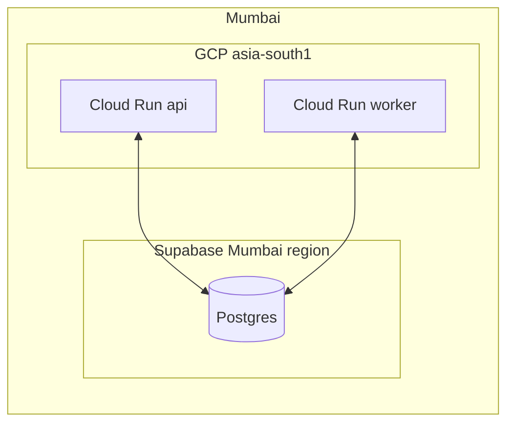

# Infrastructure

> **Area:** Infra
> **Source:** MVP Architecture v0.1 §2, §5.2, §9, §6.17, §12 ([source](../_source/mvp-architecture-v0.1.md))
> **Status:** Draft v0.1 · **Owner:** Aman
> **Used by:** [`/CLAUDE.md`](../../CLAUDE.md), [`infra/CLAUDE.md`](../../infra/CLAUDE.md)

## Summary

The MVP runs on Google Cloud in `asia-south1` (Mumbai) with Supabase in its Mumbai region. One backend image is deployed as two Cloud Run services (`api` public, `worker` internal), connected by Pub/Sub, Cloud Tasks and Cloud Scheduler, with secrets in Secret Manager and the SPA on Firebase Hosting. This folder describes those resources; whether they are provisioned with Terraform or gcloud scripts is still open.

## Documents in this folder

| Doc | What it covers |
|---|---|
| [deployment.md](deployment.md) | The §9 deployment diagram, Cloud Run sizing, Firebase Hosting, Artifact Registry, cost shape |
| [environments.md](environments.md) | `dev` vs `prod`: GCP and Supabase projects, Meta apps, scaling, tiers |
| [async-messaging.md](async-messaging.md) | Pub/Sub `wa-inbound` + DLQ, Cloud Tasks queues, Cloud Scheduler jobs |
| [iam-and-secrets.md](iam-and-secrets.md) | `api-sa`, `worker-sa`, `invoker-sa` and Secret Manager contents |
| [ci-cd.md](ci-cd.md) | GitHub Actions pipeline to Artifact Registry, Cloud Run and Firebase Hosting |

## Region alignment

Both compute and database sit in Mumbai because every inbound message touches the database several times, so cross-region latency adds up (§2).

- Cloud Run, Pub/Sub, Cloud Tasks and Cloud Scheduler: `asia-south1`.
- Supabase project (Postgres, Auth, Realtime, Storage): Mumbai region.
- Meta Cloud API and the LLM provider are external; their location is not under our control.

## Repo layout

| Folder | Holds |
|---|---|
| `infra/environments/dev/` | Resource definitions and variables for the `dev` GCP project |
| `infra/environments/prod/` | Resource definitions and variables for the `prod` GCP project |
| `.github/workflows/` | CI/CD workflows ([ci-cd.md](ci-cd.md)) |
| `supabase/migrations/` | Database schema ([../database/migrations.md](../database/migrations.md)) |

Per §12, `infra/` holds "Terraform or gcloud scripts" for Cloud Run, Pub/Sub, Tasks, Scheduler, IAM and secrets.

## Rules / invariants

- Keep every GCP resource in `asia-south1` and the Supabase project in Mumbai.
- `prod` and `dev` never share a GCP project, Supabase project or Meta app.
- No secret values in `infra/` or in the repo; only Secret Manager names.

## Open questions

- IaC tool: Terraform vs gcloud scripts ([../delivery/open-decisions.md](../delivery/open-decisions.md)).

## Related

- [../architecture/container-view.md](../architecture/container-view.md) · [../architecture/tech-stack.md](../architecture/tech-stack.md)
- [../security/README.md](../security/README.md) · [../observability/README.md](../observability/README.md)
- Context file: [`infra/CLAUDE.md`](../../infra/CLAUDE.md)
