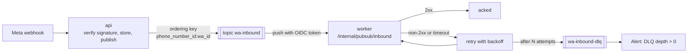
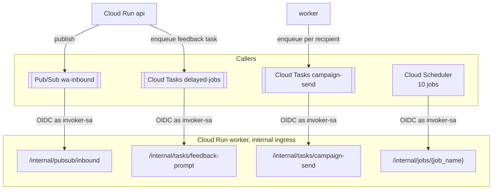

# Async messaging: Pub/Sub, Cloud Tasks, Cloud Scheduler

> **Area:** Infra
> **Source:** MVP Architecture v0.1 §5.2, §5.3, §6.2, §6.10, §6.12, §6.17, §8.5, §11 ([source](../_source/mvp-architecture-v0.1.md))
> **Status:** Draft v0.1 · **Owner:** Aman
> **Used by:** [`infra/CLAUDE.md`](../../infra/CLAUDE.md), [`backend/app/api/CLAUDE.md`](../../backend/app/api/CLAUDE.md), [`backend/app/core/CLAUDE.md`](../../backend/app/core/CLAUDE.md)

## Summary

Three GCP services move work from `api` to `worker` and schedule it over time. Pub/Sub `wa-inbound` carries every inbound webhook event, ordered per customer. Cloud Tasks carries throttled campaign sends and delayed jobs. Cloud Scheduler fires the periodic sweeps. All three call internal `worker` endpoints with an OIDC token for `invoker-sa`; none of those endpoints is reachable from the public internet.

## Pub/Sub: `wa-inbound`

Every event either ends acked by the worker or parked in the DLQ with an alert; nothing is silently dropped.

| Setting | Value | Source |
|---|---|---|
| Topic | `wa-inbound` | §5.2 |
| Publisher | `api` (`api-sa`, Pub/Sub publisher) | §9 |
| Delivery | Push to `worker` `/internal/pubsub/inbound`, authenticated with an OIDC token for `invoker-sa` | §6.2, §8.5 |
| Ordering key | `{phone_number_id}:{wa_id}` | §5.3 |
| Retries | Exponential backoff on non-2xx | §6.2 |
| Dead-letter topic | `wa-inbound-dlq` after N attempts | §6.2 |
| Alert | Pub/Sub DLQ depth > 0 | §11 |

Notes:

- **Ordering.** The key gives one-at-a-time delivery per customer per café number. Message ordering must be enabled on the subscription for the key to have any effect **(proposed setup detail)**. The Postgres advisory lock is the second layer ([../database/constraints-and-indexes.md](../database/constraints-and-indexes.md#per-conversation-advisory-lock)).
- **Status events.** Status webhooks (sent / delivered / read / failed) also carry a recipient `wa_id`, so they share the customer's ordering key **(proposed)**. Template and quality updates have no customer; they can use a per-number key **(proposed)**.
- **Ack deadline.** The push request stays open while the worker handles the whole turn, including an AI call bounded by a ~12 s timeout (§6.2). The subscription's acknowledgement deadline must exceed the worst-case turn, or Pub/Sub will redeliver while the first attempt is still running **(proposed: 60 s)**.
- **N attempts.** The source leaves N open **(proposed: 5)**.
- **Duplicates are safe.** A redelivered message hits the `messages.wamid` primary key and is acked without a second reply.

## Cloud Tasks queues

| Queue | Target | Purpose | Rate | Source |
|---|---|---|---|---|
| `campaign-send` | `/internal/tasks/campaign-send` | One task per campaign recipient: re-check consent and daily limit, send one template | Queue rate = the café number's throughput | §6.12 |
| `delayed-jobs` | `/internal/tasks/feedback-prompt` (and other delayed jobs) | `feedback_prompt` +30 min after SERVED (configurable per café) | Default | §6.10, §6.17 |

- Both `api` and `worker` can enqueue (Cloud Tasks enqueuer on `api-sa` and `worker-sa`, §9). `worker` enqueues campaign sends; the feedback task is created when an order becomes SERVED, which happens on the `api` path (`PATCH /staff/orders/{id}/status`).
- Tasks call `worker` with an OIDC token for `invoker-sa`.
- Because a café's number has a throughput limit and a daily messaging tier, `campaign-send` is the throttle; the daily cap is handled in code (recipient → `DEFERRED`, resumed by `campaign_resume`).
- If several cafés share one queue, the queue rate limits them collectively; per-café queues may be needed as cafés are added **(proposed)**.

## Cloud Scheduler jobs

All call `worker` at `/internal/jobs/{job_name}` with an OIDC token for `invoker-sa` (§8.5).

| Job | Cadence | What it does |
|---|---|---|
| `overdue_sweep` | Every 1 min | Flags orders past `expected_ready_at`, sends one delay message, re-alerts unacknowledged orders and waiter calls (> 60 s) |
| `human_mode_timeout` | Every 5 min | Returns idle human-mode conversations to bot mode |
| `campaign_start` | Every 5 min | Starts campaigns whose `scheduled_at` has passed |
| `campaign_resume` | Daily 10:00 local | Re-queues DEFERRED recipients |
| `token_health` | Daily | Debug-token check per café; alerts and flags "Reconnect" |
| `quality_and_limits` | Daily (plus webhooks) | Reads quality rating and messaging tier, stores for owner and platform screens |
| `template_sync` | Daily (plus webhooks) | Keeps template status in sync with Meta |
| `refresh_views` | Nightly | Refreshes materialised analytics views |
| `weekly_report` | Monday 09:00 | Generates the owner's weekly summary |
| `prune_webhook_events` | Daily | Deletes raw webhook logs older than 30 days |

Not on Scheduler: `feedback_prompt` and `campaign_send` (Cloud Tasks), and `data_deletion` (on request or Meta callback; run through `delayed-jobs` or inline **(proposed)**).

"Local" times are the café's timezone. With all pilot cafés in India, Scheduler jobs can be set in `Asia/Kolkata` **(proposed)**; cafés in other timezones would need per-café logic inside the job.

## Topology

Every arrow into the worker carries an `invoker-sa` OIDC token, verified by `core/internal_auth.py`.

## Rules / invariants

- Every internal endpoint verifies the OIDC token (issuer, audience, `invoker-sa` identity) before doing anything.
- Handlers are idempotent: Pub/Sub, Tasks and Scheduler may all deliver more than once.
- Always publish inbound events with the `{phone_number_id}:{wa_id}` ordering key.
- Alert on any message in `wa-inbound-dlq`.

## Open questions

- N (max delivery attempts) and the ack deadline.
- One shared `campaign-send` queue vs one per café number.
- How `data_deletion` is triggered.

## Related

- [deployment.md](deployment.md) · [iam-and-secrets.md](iam-and-secrets.md)
- [../backend/inbound-pipeline.md](../backend/inbound-pipeline.md) · [../backend/background-jobs.md](../backend/background-jobs.md) · [../api/internal.md](../api/internal.md)
- [../observability/logging-and-metrics.md](../observability/logging-and-metrics.md)
- Context files: [`infra/CLAUDE.md`](../../infra/CLAUDE.md), [`backend/app/api/CLAUDE.md`](../../backend/app/api/CLAUDE.md)
