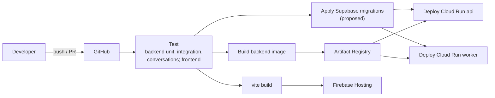
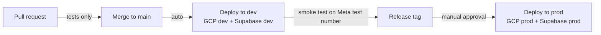

# CI/CD

> **Area:** Infra
> **Source:** MVP Architecture v0.1 §9, §12, §13 ([source](../_source/mvp-architecture-v0.1.md))
> **Status:** Draft v0.1 · **Owner:** Aman
> **Used by:** [`infra/CLAUDE.md`](../../infra/CLAUDE.md), [`/CLAUDE.md`](../../CLAUDE.md), [`backend/tests/CLAUDE.md`](../../backend/tests/CLAUDE.md)

## Summary

Code lives on GitHub. GitHub Actions tests and builds the backend image, pushes it to Artifact Registry and deploys it to Cloud Run as both `api` and `worker`; the SPA is built with Vite and deployed to Firebase Hosting. Database migrations and environment promotion are additions to the source and are marked **(proposed)**. Workflows live in `.github/workflows/`.

## Pipeline

Tests gate everything; the schema is migrated before the new image takes traffic, and `api` and `worker` deploy from the same image.

## Job stages

| Stage | Runs on | Does | Gate | Status |
|---|---|---|---|---|
| Test (backend) | Every push and PR | `backend/tests/unit` (cart totals, transitions, guardrails, 24 h guard), `integration` (webhook signature, dedupe, tenant isolation), `conversations` (scripted chats incl. Hinglish) | All green | Source §9, §12 |
| Test (frontend) | Every push and PR | Type check, lint, tests | All green | **(proposed)** |
| Migration check | Every PR | Apply `supabase/migrations/` to a throwaway database, run integration tests against it | Applies cleanly | **(proposed)** |
| Build image | Merge to `main` | Build the single backend image from `backend/Dockerfile`, tag with commit SHA | Build succeeds | Source §9 |
| Push image | After build | Push to Artifact Registry | — | Source §9 |
| Build SPA | Merge to `main` | `vite build` | Build succeeds | Source §9 |
| Migrate DB | Before deploy | Apply pending migrations to the target Supabase project | Applies cleanly | **(proposed)** |
| Deploy backend | After migrate | Deploy the same image digest to Cloud Run `api` and `worker` | Health check `/health` passes | Source §9 |
| Deploy SPA | After build | Deploy to Firebase Hosting | — | Source §9 |

## Environment promotion (proposed)

`main` always reflects `dev`; `prod` moves only on a tagged release with an approval.

- Each environment's deploy job uses that environment's GCP project, Supabase project and Firebase site ([environments.md](environments.md)).
- The same image digest built for `dev` is promoted to `prod`; nothing is rebuilt for production.
- CI authenticates to GCP without long-lived JSON keys, for example via Workload Identity Federation, using a dedicated deployer identity separate from `api-sa` / `worker-sa`.
- Infrastructure changes (`infra/environments/{dev,prod}`) are applied by a separate, manually triggered job until the IaC tool is chosen.

## Rules / invariants

- Nothing deploys without passing tests, including the cross-café tenant isolation test.
- `api` and `worker` always run the same image.
- Migrations run before the backend that depends on them, and are backward compatible with the running version.
- No secret values in workflow files; CI reads deployment credentials from GitHub environment secrets or federated identity.

## Open questions

- Branch and release model (trunk + tags as above, or an `env/prod` branch).
- Whether prod migrations are automatic or a manual step.
- IaC tool: Terraform vs gcloud scripts ([../delivery/open-decisions.md](../delivery/open-decisions.md)).

## Related

- [deployment.md](deployment.md) · [environments.md](environments.md) · [iam-and-secrets.md](iam-and-secrets.md)
- [../database/migrations.md](../database/migrations.md)
- [../delivery/build-order.md](../delivery/build-order.md)
- Context files: [`infra/CLAUDE.md`](../../infra/CLAUDE.md), [`backend/tests/CLAUDE.md`](../../backend/tests/CLAUDE.md)
