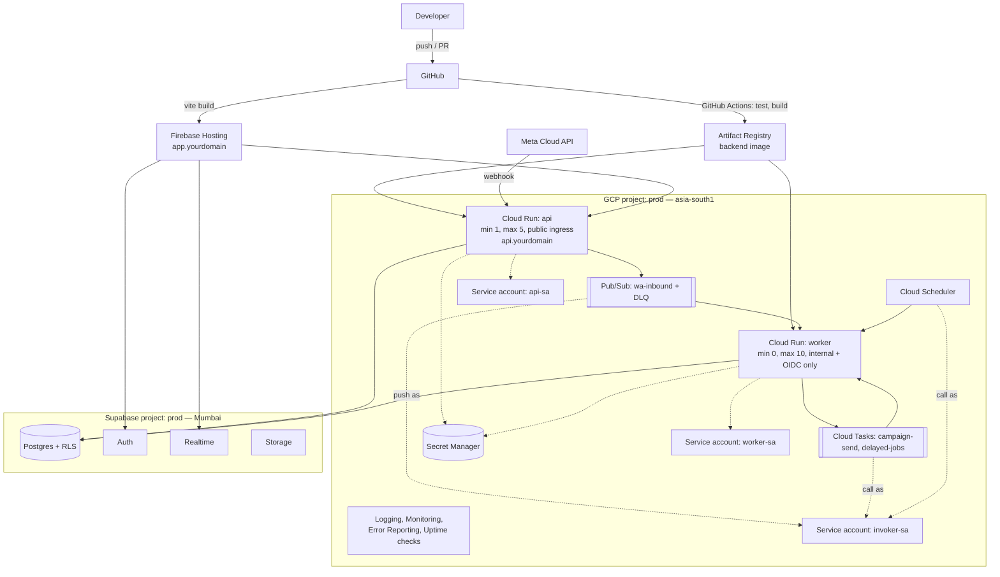
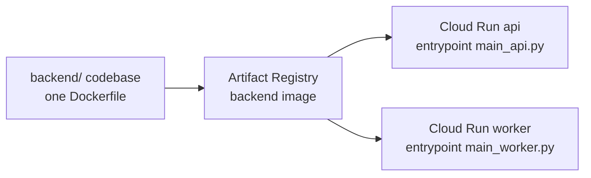

# Deployment

> **Area:** Infra
> **Source:** MVP Architecture v0.1 §9, §2, §6.1, §12 ([source](../_source/mvp-architecture-v0.1.md))
> **Status:** Draft v0.1 · **Owner:** Aman
> **Used by:** [`infra/CLAUDE.md`](../../infra/CLAUDE.md), [`/CLAUDE.md`](../../CLAUDE.md), [`backend/CLAUDE.md`](../../backend/CLAUDE.md)

## Summary

One backend image is built in CI, stored in Artifact Registry and deployed as two Cloud Run services: `api` (public, always warm) and `worker` (internal, scales to zero). The React SPA is a static Vite build on Firebase Hosting. Supabase provides Postgres, Auth, Realtime and Storage in Mumbai.

## Deployment diagram (§9)

Follow the solid arrows for traffic (Meta → `api` → Pub/Sub → `worker`) and the dotted ones for identities and secrets.

## Services

| Service | Platform | Scaling | Ingress | Domain | Runs |
|---|---|---|---|---|---|
| `api` | Cloud Run | min 1, max 5 | Public | `api.yourdomain` | `main_api.py`: webhooks, staff, admin, platform routers |
| `worker` | Cloud Run | min 0, max 10 | Internal + OIDC only | none | `main_worker.py`: internal routers (Pub/Sub push, tasks, jobs) |
| SPA | Firebase Hosting | CDN | Public | `app.yourdomain` | Static Vite build: Staff panel, Owner console, Platform admin |
| Images | Artifact Registry | — | Private | — | The single backend image |

### Why `api` keeps one instance warm

Meta expects a fast `200` on webhooks (target under 1 s, §6.2). A Cloud Run cold start can blow that budget, so `api` runs with `min-instances=1` in production. It is a small but real cost against the $300 credit (§2).

### Why `worker` can scale to zero

Nothing calls `worker` from the internet. Pub/Sub push, Cloud Tasks and Cloud Scheduler all call it with an OIDC token from `invoker-sa`, and they retry on failure, so a cold start costs latency but never loses work. The latency budget is the webhook → reply p95 < 8 s alert (§11); if cold starts eat into it during service hours, set `min-instances=1` on `worker` too **(proposed)**.

## One image, two services

The same image is deployed twice with a different entrypoint, so domain services never know which service they run in (§6.1).

- Both services run the same commit at all times; deploy them together from the same image digest **(proposed)**.
- The entrypoint is selected per service (container command or an environment variable) **(proposed)**.

## Rough monthly cost shape (1–2 pilot cafés)

| Cost | Type | Notes |
|---|---|---|
| Cloud Run `api` at min-instance 1 | Main fixed GCP cost | Always-on single instance |
| Cloud Run `worker` | Small, variable | Scales to zero |
| Pub/Sub, Cloud Tasks, Cloud Scheduler, Secret Manager | Negligible | At pilot volume |
| Firebase Hosting | Negligible | Static assets |
| Supabase | Fixed | Paid tier for the pilot café (free in dev) |
| LLM | Variable, per conversation | Measured in `ai_usage` |
| Meta marketing templates | Variable, per campaign | Measured from `pricing` on `messages` |

Measure the three main costs (Cloud Run `api`, LLM, Meta templates) from day one rather than estimating (§9, §11). See [../observability/cost-tracking.md](../observability/cost-tracking.md).

## Rules / invariants

- `worker` ingress stays internal and requires OIDC; it is never given a public URL that accepts unauthenticated calls.
- `api` keeps `min-instances=1` in `prod`.
- Every Cloud Run service and queue lives in `asia-south1`.

## Open questions

- Custom domain mapping for `api.yourdomain` (Cloud Run domain mapping vs a load balancer, which would also enable Cloud Armor for per-IP rate limiting) **(proposed)**.
- `worker` min instances during service hours.
- IaC tool ([../delivery/open-decisions.md](../delivery/open-decisions.md)).

## Related

- [environments.md](environments.md) · [async-messaging.md](async-messaging.md) · [iam-and-secrets.md](iam-and-secrets.md) · [ci-cd.md](ci-cd.md)
- [../adr/0007-one-codebase-two-services.md](../adr/0007-one-codebase-two-services.md) · [../adr/0002-ack-fast-process-async.md](../adr/0002-ack-fast-process-async.md)
- Context file: [`infra/CLAUDE.md`](../../infra/CLAUDE.md)
