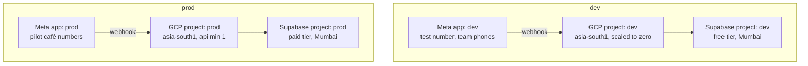

# Environments

> **Area:** Infra
> **Source:** MVP Architecture v0.1 §9 (Environments), §2, §14 ([source](../_source/mvp-architecture-v0.1.md))
> **Status:** Draft v0.1 · **Owner:** Aman
> **Used by:** [`infra/CLAUDE.md`](../../infra/CLAUDE.md), [`supabase/CLAUDE.md`](../../supabase/CLAUDE.md)

## Summary

There are two fully separate environments, `dev` and `prod`. Each has its own GCP project, its own Supabase project and its own Meta app, so a test webhook can never reach production and a dev bug can never touch a pilot café's data. `dev` is kept scaled to zero to protect the GCP credit.

## Isolation

There are no arrows between the two columns: nothing in `dev` points at anything in `prod`.

## Per-environment resources

| Resource | `dev` | `prod` |
|---|---|---|
| GCP project | `dev` | `prod` |
| Region | `asia-south1` | `asia-south1` |
| Cloud Run `api` | Scaled to zero (min 0) | min 1, max 5, `api.yourdomain` |
| Cloud Run `worker` | min 0 | min 0, max 10 |
| Pub/Sub `wa-inbound` + `wa-inbound-dlq` | Yes | Yes |
| Cloud Tasks `campaign-send`, `delayed-jobs` | Yes | Yes |
| Cloud Scheduler jobs | Yes; may be paused when idle **(proposed)** | Yes |
| Secret Manager | Dev App Secret, test-number token, dev Supabase and LLM credentials | Prod App Secret, pilot WABA tokens, 2FA PINs, prod Supabase and LLM credentials |
| Service accounts | `api-sa`, `worker-sa`, `invoker-sa` | `api-sa`, `worker-sa`, `invoker-sa` |
| Supabase project | Free tier, Mumbai | Paid tier, Mumbai |
| Meta app | Separate dev app | Separate prod app |
| WhatsApp number | Meta test number | Pilot café numbers (dedicated number per café is the suggested default) |
| Who messages it | Team phones | Real customers |
| Firebase Hosting | Dev site **(proposed)** | `app.yourdomain` |
| Seed data | `supabase/seed/` | Never |
| IaC folder | `infra/environments/dev/` | `infra/environments/prod/` |

## Why these choices

- **Separate Meta app per environment.** Webhook URLs are configured per Meta app. One app per environment means test webhooks can't hit production (§9).
- **Meta test number and team phones in dev.** Meta's test number lets the team exercise the full flow without a production number.
- **Dev scaled to zero.** Protects the $300 GCP credit; the dev webhook may respond slowly on a cold start, which is acceptable for testing.
- **Supabase free for dev, paid for the pilot.** Free projects have historically been paused after about a week of inactivity and have a small database size cap. Fine for development; a live pilot café must never pause on a quiet week (§2, §14). Check current Supabase limits.

## Rules / invariants

- No credential, project ID or webhook URL is shared between `dev` and `prod`.
- Production data is never copied into `dev`; dev uses seed data and test phones only.
- Each environment's resources are defined in its own `infra/environments/{dev,prod}` folder.

## Open questions

- Whether a separate staging environment is needed before the pilot (the source defines only two).
- Dev Firebase Hosting site and dev domain names **(proposed)**.
- IaC tool: Terraform vs gcloud scripts ([../delivery/open-decisions.md](../delivery/open-decisions.md)).

## Related

- [deployment.md](deployment.md) · [ci-cd.md](ci-cd.md) · [iam-and-secrets.md](iam-and-secrets.md)
- [../database/migrations.md](../database/migrations.md)
- [../whatsapp/README.md](../whatsapp/README.md)
- Context file: [`infra/CLAUDE.md`](../../infra/CLAUDE.md)
