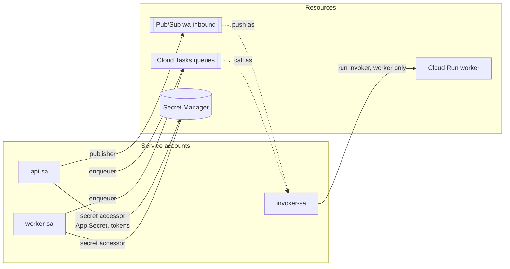
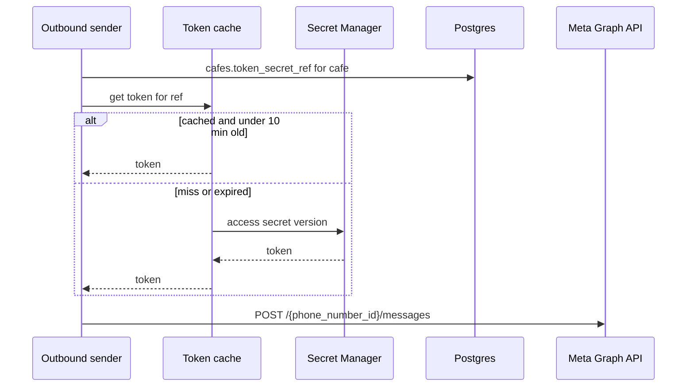

# IAM and secrets

> **Area:** Infra
> **Source:** MVP Architecture v0.1 §9 (Service accounts), §2, §6.13, §6.14, §10 ([source](../_source/mvp-architecture-v0.1.md))
> **Status:** Draft v0.1 · **Owner:** Aman
> **Used by:** [`infra/CLAUDE.md`](../../infra/CLAUDE.md), [`backend/app/core/CLAUDE.md`](../../backend/app/core/CLAUDE.md), [`backend/app/integrations/whatsapp/CLAUDE.md`](../../backend/app/integrations/whatsapp/CLAUDE.md)

## Summary

Three service accounts with least-privilege roles run the backend: `api-sa` for the public service, `worker-sa` for the internal one, and `invoker-sa`, the only identity allowed to call `worker`. Every credential (Meta App Secret, per-café WABA tokens, 2FA PINs, Supabase service credentials, LLM key) lives in Secret Manager; the database stores only a reference, and nothing appears in logs or the frontend.

## Service accounts (§9)

| Service account | Attached to | Roles | Used for |
|---|---|---|---|
| `api-sa` | Cloud Run `api` | Pub/Sub publisher; Secret Manager accessor (App Secret, tokens); Cloud Tasks enqueuer | Publishing inbound events, verifying webhook signatures, sending staff-action messages, enqueuing tasks |
| `worker-sa` | Cloud Run `worker` | Secret Manager accessor; Cloud Tasks enqueuer | Reading tokens and the LLM key, enqueuing campaign sends and delayed jobs |
| `invoker-sa` | Pub/Sub push subscription, Cloud Tasks tasks, Cloud Scheduler jobs | Cloud Run invoker on `worker` only | Producing the OIDC token the worker verifies |

Only `invoker-sa` can call `worker`; neither `api-sa` nor `worker-sa` has invoker rights, and `invoker-sa` has no other permissions.

Additional bindings the setup will need **(proposed, standard GCP requirements)**:

- `api-sa` and `worker-sa` need permission to act as `invoker-sa` (service account user) so the tasks they create can carry an `invoker-sa` OIDC token.
- The Pub/Sub service agent needs token-creator rights on `invoker-sa` for authenticated push, and publish/subscribe rights for dead-lettering to `wa-inbound-dlq`.
- Both runtime accounts need log writing and metric writing (usually default).
- Secret access granted per secret, not project-wide, so `api-sa` can read only the secrets it needs.
- CI deploys with its own deployer identity (see [ci-cd.md](ci-cd.md)), not with these runtime accounts.

## Secret Manager contents

| Secret | Scope | Read by | Notes |
|---|---|---|---|
| Meta App Secret | Per environment (one Meta app each) | `api` | HMAC-SHA256 webhook signature check on the raw body (§10); also verifies Meta's signed data-deletion request |
| WABA access tokens | Per café | `api`, `worker` | Referenced by `cafes.token_secret_ref` |
| 2FA PINs | Per café number | Platform onboarding | Phone number registration PINs |
| Supabase service credentials | Per environment | `api`, `worker` | Server-side Postgres role for the pooler; the service-role key never leaves Secret Manager and the backend (§6.14) |
| LLM key | Per environment | `worker` | Provider is an open decision; Vertex AI would use the service account instead of a key |
| Webhook verify token | Per environment | `api` | Not listed in source **(proposed)**; used for the `hub.verify_token` handshake |

### Reference, not value

- The database stores only `cafes.token_secret_ref`, the Secret Manager name of the café's token (§7, §10). The token value is never in a table, a log line or the frontend.
- `integrations/gcp/secrets.py` looks up the token and caches it for **10 minutes** (§6.13). A rotated token takes effect within that window.
- When the outbound sender gets an auth error from Meta, it stores the error and raises a token-health alert; `token_health` also runs a daily debug-token check and flags "Reconnect" (§6.13, §6.17).

The token goes from Secret Manager to memory to the Authorization header, and nowhere else.

## Rules / invariants

- No secret value in the database, repo, `infra/` files, logs, error reports or the frontend bundle.
- The frontend only ever holds the Supabase anon key.
- `invoker-sa` has Cloud Run invoker on `worker` and nothing else.
- New secrets are granted to the specific service account that needs them.

## Open questions

- Who can read 2FA PINs (platform-admin humans only vs a service account) **(proposed: humans only)**.
- Whether `api` needs the LLM key (only if AI is ever called on the `api` path).
- Supabase credential model: pooler connection string with a dedicated role vs the service-role key.

## Related

- [deployment.md](deployment.md) · [async-messaging.md](async-messaging.md) · [ci-cd.md](ci-cd.md)
- [../security/security-controls.md](../security/security-controls.md) · [../whatsapp/outbound-sender.md](../whatsapp/outbound-sender.md) · [../whatsapp/number-health.md](../whatsapp/number-health.md)
- Context files: [`infra/CLAUDE.md`](../../infra/CLAUDE.md), [`backend/app/core/CLAUDE.md`](../../backend/app/core/CLAUDE.md)
