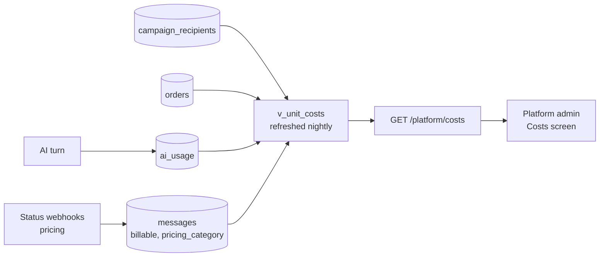

# Cost tracking

> **Area:** Observability
> **Source:** MVP Architecture v0.1 §11, §9, §6.5, §6.16, §7, §8.4 ([source](../_source/mvp-architecture-v0.1.md))
> **Status:** Draft v0.1 · **Owner:** Aman
> **Used by:** [backend/app/domain/ai_agent/CLAUDE.md](../../backend/app/domain/ai_agent/CLAUDE.md), [backend/app/db/CLAUDE.md](../../backend/app/db/CLAUDE.md), [supabase/CLAUDE.md](../../supabase/CLAUDE.md)

## Summary

Cost is tracked from the first pilot day: AI cost per turn, WhatsApp cost per message, and per-campaign cost against redeemed visits and revenue. These numbers feed the platform cost screen and, later, pricing. The fixed GCP cost is small; the variable costs (LLM and marketing templates) are what must be measured.

## Sources

| Cost | Recorded in | How |
|---|---|---|
| AI per turn | `ai_usage` | `model`, `input_tokens`, `output_tokens`, `latency_ms`, `cost_usd`, `fallback_used` per turn |
| AI per order | sum of `ai_usage` | Sum over the conversation that produced the order |
| WhatsApp per message | `messages.billable`, `messages.pricing_category` | `pricing` object from status webhooks |
| Per campaign | `campaign_recipients` + `messages` + `orders` | WhatsApp cost, delivered, redeemed, revenue → cost per redeemed visit and revenue ÷ cost |

## Data flow

Look at `v_unit_costs`: it is the one place where AI and WhatsApp costs meet per order and per campaign.

## Monthly cost shape (1–2 pilot cafés)

| Cost | Kind |
|---|---|
| Cloud Run `api` at min-instance 1 | Main fixed GCP cost |
| Pub/Sub, Tasks, Scheduler, Secret Manager | Negligible at this volume |
| LLM | Variable, per conversation |
| Meta marketing templates | Variable, per campaign |

A per-customer limit on AI turns per minute caps cost from spam (§10).

## Rules / invariants

- One `ai_usage` row per AI turn, including fallbacks.
- Pricing from every status webhook is stored on its message.
- Measure, don't estimate.

## Open questions

- The `pricing` object gives category and billable flag, not an amount. A rate card per category is needed to turn it into money **(proposed: platform setting)**.
- AI cost is in USD (`cost_usd`), revenue is in ₹: pick a conversion rule.
- A conversation can produce more than one order; how to split its AI cost.

## Related

- [README.md](README.md) · [logging-and-metrics.md](logging-and-metrics.md)
- [../database/analytics-views.md](../database/analytics-views.md) · [../retention/redemption.md](../retention/redemption.md)
- [../api/platform.md](../api/platform.md) · [../frontend/platform-admin.md](../frontend/platform-admin.md)
- Context: [backend/app/domain/ai_agent/CLAUDE.md](../../backend/app/domain/ai_agent/CLAUDE.md)
