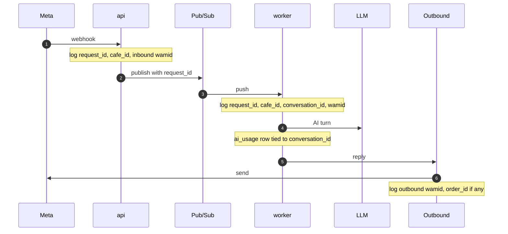
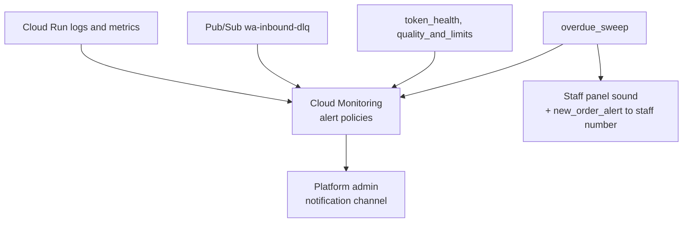

# Logging and metrics

> **Area:** Observability
> **Source:** MVP Architecture v0.1 §11, §6.2, §6.8, §6.9, §9, §10 ([source](../_source/mvp-architecture-v0.1.md))
> **Status:** Draft v0.1 · **Owner:** Aman
> **Used by:** [backend/app/core/CLAUDE.md](../../backend/app/core/CLAUDE.md), [infra/CLAUDE.md](../../infra/CLAUDE.md), [backend/CLAUDE.md](../../backend/CLAUDE.md)

## Summary

Logs are structured JSON with the same correlation IDs on every line, so one customer's turn can be traced across `api`, Pub/Sub and `worker`. Seven metrics have alert thresholds; they cover reply speed, lost events, send failures, AI fallbacks, unanswered staff requests and number health. Everything runs on GCP's Cloud Logging, Monitoring, Error Reporting and uptime checks.

## Structured logs

| Field | Set when |
|---|---|
| `cafe_id` | Resolved from `phone_number_id` (inbound) or membership (panel) |
| `conversation_id` | Conversation loaded in the worker |
| `wamid` | Inbound message id, then each outbound message id |
| `order_id` | When an order is created or changed |
| Request ID | At the first entry point (webhook or REST call) |

Logging setup lives in `app/core/logging.py`. Secrets, tokens and the App Secret are never logged.

## Tracing one customer turn

Look at the request ID: it travels with the event so every log line from webhook to reply can be filtered together. Carrying it as a Pub/Sub message attribute is **(proposed)**.

## Metrics and alerts

Verbatim from §11.

| Metric | Alert when |
|---|---|
| Webhook → reply latency (p95) | > 8 s for 5 min |
| Pub/Sub DLQ depth | > 0 |
| Outbound send failures | > 5% in 15 min |
| AI fallback rate | > 15% of turns in an hour |
| Waiter requests unacknowledged > 60 s | any |
| Orders in PLACED unacknowledged > 2 min | any |
| Token invalid / quality rating drops | any |

## Tooling

| Tool | Used for |
|---|---|
| Cloud Logging | JSON logs from `api` and `worker` |
| Cloud Monitoring | Metrics and alert policies above |
| Error Reporting | Exceptions from both services |
| Uptime checks | `GET /health` on `api` |

## Alert routing

Look at the split: platform problems go to us, café-floor problems go to staff first.

## Rules / invariants

- Correlation IDs on every line; JSON only.
- No secrets in logs.
- Every alert in the table above is wired before the pilot (build step 6).

## Open questions

- Notification channel for platform alerts (email, chat) is not specified.
- How the request ID is propagated through Pub/Sub and Cloud Tasks **(proposed: message attributes / headers)**.

## Related

- [README.md](README.md) · [cost-tracking.md](cost-tracking.md)
- [../backend/inbound-pipeline.md](../backend/inbound-pipeline.md) · [../backend/background-jobs.md](../backend/background-jobs.md)
- [../whatsapp/number-health.md](../whatsapp/number-health.md) · [../infra/deployment.md](../infra/deployment.md)
- Context: [backend/app/core/CLAUDE.md](../../backend/app/core/CLAUDE.md)
