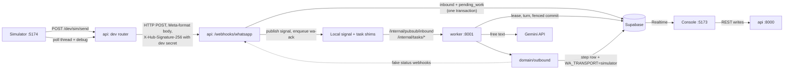
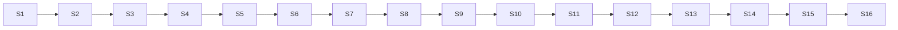

# Ordering slice

**Status: plan for approval.** Nothing in this doc is built yet. Code starts once Aman approves it.

The first working product: a tester chats on a **WhatsApp simulator**, the Gemini agent takes the order, and the **shift manager** runs service in the Restro Console. The data is mock (seeded, synthetic). Every rule is the real one from [backend](backend.md), [architecture](architecture.md) and [console](console.md).

It covers [roadmap](plan.md#roadmap) Phase 0, Phase 1 and the service parts of Phase 4. It runs on a laptop with no GCP: a cloud Supabase project and the Gemini developer API. Build plan v1.0 ([Restro_Build_Plan.md](../Restro_Build_Plan.md)) §8 Phase 1 is the source of the goal; where the build plan and `docs/` differ (Pub/Sub wake-up + `pending_work` work queue, staff cancel rules), `docs/` wins.

Progress: [ordering-slice-checklist.md](ordering-slice-checklist.md).

## Contents

1. [Goal](#goal) · 2. [Scope](#scope) · 3. [Decisions for this slice](#decisions-for-this-slice) · 4. [Real vs mocked](#real-vs-mocked) · 5. [How a test message flows](#how-a-test-message-flows) · 6. [Swappable adapters](#swappable-adapters) · 7. [Setup you do](#setup-you-do) · 8. [Structure](#structure) · 9. [Seed data](#seed-data) · 10. [Simulator](#simulator) · 11. [Customer profile](#customer-profile) · 12. [Steps](#steps) · 13. [How you test it](#how-you-test-it) · 14. [Risks](#risks-in-this-slice) · 15. [Assumptions](#assumptions)

## Goal

**Done when** all of these pass on a laptop:

1. In the simulator a new customer taps **Table 5 QR**, gives a name, types "2 cold coffee aur ek avocado toast, toast mein chilli nahi", sees the code-rendered summary (2 × Cold Coffee, 1 × Avocado Toast with note "no chilli", "Total (incl. GST)") and taps Confirm.
2. The order appears on **Live orders** within 2 s with a chime, for `shift@restro.test` logged in through Supabase Auth.
3. Accept → Mark ready → Mark served each send the right status message to the phone after 5 s. Undo within 5 s sends nothing.
4. Call waiter, an `unknown` allergen question and two unclear messages in a row each reach **Calls and bills** / **Chats**. The shift manager takes over, replies and hands back, and the bot answers again.
5. A sold-out toggle on **Menu** stops the agent offering the item on the next message.
6. A forced worker failure is retried and, after 3 retries, dead-lettered with the standard customer message. Nothing is lost or sent twice.
7. On a returning customer's order card, **Profile** opens the at-a-glance box (name, visits, last visit, allergies, dislikes, preferences). A staff comment "she's vegan now and hates mushrooms" updates diet and dislikes within a few seconds, shows what changed, and Undo puts it back.
8. 20 scripted runs end with no lost, duplicate or wrong orders (build plan Phase 1 exit gate).

## Scope

| In this slice | Later |
|---|---|
| Webhook ingress, `pending_work` work queue, lease, debounce, retries, dead letters | Real Meta number (the `meta` transport is built and unit-tested, not connected) |
| Every [deterministic flow](backend.md#deterministic-flows) for ordering; STOP opt-out (routing rule 1) | Feedback, opt-in ask, campaigns, offer codes (Phase 5) |
| AI agent: one structured call per free-text turn, guardrails, allergens, handoff, cancellation draft | Full eval set and model routing decision (Phase 2) |
| Cart, Confirm, `transition()`, undo, delay, staff cancel, customer edit / cancel while `NEW`, manual order, pause ordering | Menu edit and CSV import (`manager`+ / `owner`) |
| Requests `help` / `allergy` / `bill`, human mode, escalation timers, bill delivered | Bell panel for cancellation `notifications` (rows are written; the list UI is a `manager` screen) |
| Console: login, shell, urgency engine and sounds, **Live orders, Chats, Calls and bills, Menu** (sold-out), print ticket, Pause button (`manager`+) | Today, Customers, Campaigns, Analytics, Setup, Service report, Platform screens, `/platform/dead-letters` |
| [Customer profile](#customer-profile) from the order card, Chats and Calls: at-a-glance box, feedback, complaints, recent orders, staff comments applied by the AI | Owner **Customers** screen (list, segments, consent register, delete data) |
| Simulator: customer phones, behind-the-scenes panel, alert phone, fault injection | Deploying anything (Phase 3) |
| Adapters ready for Vertex AI, Cloud Tasks, Pub/Sub, Secret Manager | Load test at 100 conversations (Phase 3) |

## Decisions for this slice

Aman's answers (24 Oct 2026). Step S2 writes them into [decisions](decisions.md) and every doc they touch, and removes them from [open decisions](plan.md#open-decisions).

| # | Decision | Docs updated in S2 |
|---|---|---|
| G1 | Add `wa_messages.payload jsonb`: the rendered outbound message, so Chats and the simulator can show it. Purged on customer deletion like chat text | data-and-api, architecture (data protection) |
| G2 | **No GST setting for now.** Menu prices are final; orders store only `total_paise` (= sum of lines). The summary and bill say "Total (incl. GST)". No `gst_mode` / `gst_rate` in `cafes.settings`, no GST line, no subtotal column | backend (Cart, Confirmation, Bill sheet), data-and-api (`cafes.settings`), console (Setup → Settings), rules (cart tests), decisions (replaces the "GST" smaller decision) |
| G3 | WhatsApp simulator: top-level `simulator/` app + `api/dev/` router. Mounted only when `APP_ENV=local` and `SIMULATOR_ENABLED=true` | CLAUDE.md + README layout, architecture (local infra) |
| G4 | Skip MSW for this slice; the console runs against the real local backend with seed data. MSW returns for demo builds | plan (phase work), console (shell) |
| G5 | Local task and signal shims are in memory; a restart drops pending timers. Inbound work is safe in `pending_work` and recovered by `stuck_inbound_check` | architecture (handler rules) |
| G6 | Dev-only `dev_turn_traces` (raw LLM input summary and output per turn) behind `DEV_TRACES=true`, in `supabase/dev/`, never in the main migrations | data-and-api |
| G7 | **Customer profile** for `shift_manager`+: a Profile button on order cards (and the customer panel in Chats and Calls) opens the at-a-glance box and the details below it. Everyone on the console sees all of it, including feedback and complaints (today `feedback` is readable by `manager`+ only) | console (Live orders, Chats, new Customer profile section), data-and-api (RLS: `feedback`, `customer_preferences`), plan (roles) |
| G8 | **Staff comments** (`shift_manager`+): saved word for word with author and time; the AI reads each one and **applies the profile changes automatically, allergies included**. Each comment shows what changed with Undo; every change is audited. A comment never changes marketing consent | backend (Customers), data-and-api (`customer_notes`, `customer_preferences`, endpoints, Realtime), architecture (data deletion), decisions |
| G9 | **Profile allergies** show as "On profile: peanuts" in the order card's allergy banner and boxed on the print ticket. They never go to the LLM, and allergen questions are still answered only from menu data (`unknown` → person). Diet, likes and dislikes go into the prompt so recommendations avoid dislikes | backend (AI agent prompt, Allergens), console (card, print ticket) |
| G10 | One more LLM call type: reading a staff comment into profile changes (structured output, validated in code), next to the turn call and the cancellation draft | backend (AI agent), contracts (`llm_output.schema.json`), architecture (cost) |

**Review.** Aman approves this plan once, then tests the result. This stands in for the per-PR critical-core review in the [work split](plan.md#work-split) for this slice; the critical-core modules written here are listed in each step so the review can focus on them.

Open decisions that touch the slice use their defaults: manual order created as `ACCEPTED`; prep time 1–120 min; only `manager`+ pauses ordering; one bill per table session; dead-lettered turn → `help` request + human mode; cancellation message never gets `reason_text` and drops refund wording.

## Real vs mocked

| Part | Real | Mocked |
|---|---|---|
| Customer phone | — | Simulator with synthetic `wa_id`s `9199990000NN` |
| Meta Cloud API | Webhook route, signature on raw bytes, `webhook_events`, parser, builders with Meta limits, `domain/outbound` with step rows, error classification | Transport only: stores the send, returns a fake `wamid`, then posts `sent` → `delivered` → `read` through the real status webhook |
| Café, menu, tables, customers, staff | Rows in Supabase, real RLS | Synthetic content from the [seed](#seed-data) |
| LLM | Real Gemini call (developer API) | `stub` backend in automated tests |
| Work queue, signal, timers | Real `pending_work`, leases, retries, dead letters; same `publish()` / `enqueue()` interfaces with real delays | In-process shims instead of Pub/Sub and Cloud Tasks |
| Scheduled jobs | Same job handlers | A loop inside `worker` instead of Cloud Scheduler |
| Secrets | Same `token_ref` lookup | `env` backend instead of Secret Manager |
| Auth, DB, Realtime | Supabase cloud project | — |

## How a test message flows



The dev router posts to the webhook over real HTTP, so signature, dedupe, tenant lookup, work queue, lease and debounce all run exactly as they would for Meta. Only the last hop of a send is swapped.

## Swappable adapters

Each is one env value; no code change to move to the cloud.

| Concern | Now | Later | Switch |
|---|---|---|---|
| LLM | Gemini developer API | Vertex AI, global endpoint | `LLM_BACKEND=developer_api` → `vertex` (+ `GCP_PROJECT`, `GCP_LOCATION=global`) |
| Model | `LLM_MODEL_PRIMARY` / `LLM_MODEL_FALLBACK`; `cafes.settings.model` overrides | Same | Config only |
| WhatsApp transport | Simulator | Meta Cloud API | `WA_TRANSPORT=simulator` → `meta` |
| Wake-up signal | In-process shim → `/internal/pubsub/inbound` | Pub/Sub push | `SIGNAL_BACKEND=local` → `pubsub` |
| Task queue | In-process shim | Cloud Tasks | `TASKS_BACKEND=local` → `cloud_tasks` |
| Internal auth | Shared dev token | OIDC for `invoker-sa` | `INTERNAL_AUTH=dev_token` → `oidc` |
| Secrets | `.env` | Secret Manager | `SECRETS_BACKEND=env` → `gcp` |

Both Gemini paths use the `google-genai` SDK (`genai.Client(api_key=…)` or `genai.Client(vertexai=True, project=…, location="global")`), imported only in `integrations/llm`. Model ids are config defaults, **[verify]** when S9 starts.

## Setup you do

### Supabase project

Free project, region **Mumbai (ap-south-1)**, using the **new JWT signing keys**.

| Value | Dashboard | File · variable |
|---|---|---|
| Project URL | Project Settings → API | `backend/.env` `SUPABASE_URL` · `frontend/.env.local` `VITE_SUPABASE_URL` |
| Publishable key `sb_publishable_…` | Project Settings → API Keys | `frontend/.env.local` `VITE_SUPABASE_PUBLISHABLE_KEY` |
| Secret key `sb_secret_…` | Project Settings → API Keys | `backend/.env` `SUPABASE_SECRET_KEY` |
| Transaction pooler string (port 6543) | Connect → Connection string | `backend/.env` `DATABASE_URL` (backend at runtime) |
| Session pooler string (port 5432) | Connect → Connection string | `backend/.env` `DATABASE_URL_SESSION` (migrations and seed only) |
| Project ref (the `abcd…` in the URL) | — | `.mcp.json` `PASTE_PROJECT_REF` |

- **JWT:** nothing to copy. The backend verifies tokens against the public JWKS at `<SUPABASE_URL>/auth/v1/.well-known/jwks.json` (audience `authenticated`, issuer `<SUPABASE_URL>/auth/v1`).
- **Why two connection strings:** the transaction pooler shares connections between many short transactions, which is what `api` and `worker` do (no transaction is held across an LLM call or a send). Migrations and the seed need a session connection.
- **Auth settings:** Email provider on; **"Allow new users to sign up" off**. The seed creates staff logins with confirmed emails.
- Free projects pause after about a week idle **[verify]**; unpause from the dashboard.

### Gemini

An API key from Google AI Studio → `backend/.env` `GEMINI_API_KEY`. Free-tier data terms differ **[verify]**: the simulator carries synthetic data only, so never type a real name or number into it.

### Files already created (git-ignored)

[backend/.env](../backend/.env), [frontend/.env.local](../frontend/.env.local), [simulator/.env.local](../simulator/.env.local). Each value to paste sits under a `>>> PASTE` line. Dev-only secrets (`META_APP_SECRET`, `META_VERIFY_TOKEN`, `INTERNAL_DEV_TOKEN`, `SIMULATOR_TOKEN`, `SEED_STAFF_PASSWORD`) are already generated. S1 commits matching `.env.example` files with no values.

### MCP

[.mcp.json](../.mcp.json) connects Claude Code to Supabase's hosted MCP server, **read-only**, scoped to the project ref, signed in through the browser (OAuth), so no token is stored. Used to inspect tables, run check queries and read security / performance advisors. Migrations are applied by the Supabase CLI with the session string, not through MCP.

### Local tools

Already installed: Python 3.12 (`py -3.12`), Node 20, npm, Docker, git. Supabase CLI runs through `npx supabase`. Database integration tests run against the hosted dev project, each in its own throwaway café that is deleted afterwards, so seeded data is never touched (Aman, 24 Oct 2026; Docker Desktop doesn't start on this machine). CI runs the same tests on the local Supabase stack. `scripts/test.ps1 -Integration` wires the settings.

## Structure

Only what this slice creates; full layout in [architecture](architecture.md#backend-layout).

```text
contracts/
  schema.sql · state-machines.md · openapi.yaml · events.md · llm_output.schema.json · allergens.json
supabase/
  config.toml                  local stack for tests
  migrations/                  0001_schema · 0002_rls · 0003_realtime · 0004_functions
  dev/                         0001_dev_turn_traces (local only)
  seed/generate.py             synthetic data → SQL + Auth Admin API
backend/
  pyproject.toml · .env.example
  app/main_api.py              public: /healthz, /webhooks/*, staff routes, /dev/* (local only)
  app/main_worker.py           internal: /healthz, /internal/* + local job loop
  app/core/                    config · logging · errors · secrets · auth (jwks, membership, roles) · signature · internal_auth · ids
  app/db/                      pool · tx (short transactions, lease fencing) · repositories/<table>.py
  app/integrations/whatsapp/   parser · builders · limits · errors · client · transports/{meta,simulator}
  app/integrations/llm/        base · gemini · stub · pricing
  app/integrations/tasks/      base · local (signal + tasks shims)
  app/integrations/gcp/        pubsub · cloud_tasks · secrets (interfaces only, raise NotImplemented)
  app/domain/
    conversation/              pipeline · lease · router · steps · flows/* · keywords · render
    ai_agent/                  prompt · call · validate · guardrails · allergens · cancel_draft · profile_note · kill_switch
    cart/                      ops · pricing · confirmation
    orders/                    transition · confirm · cancel · delay · undo · manual · table_sessions · bills
    menu/                      availability · version
    handoff/                   requests · human_mode · escalation
    outbound/                  send · window · steps · send_check
    customers/                 identity · summary · profile · notes · preferences
    consent/                   optout
    timers/                    schedule · dispatch · handlers/*
    notifications/             write
    audit/                     write
  app/api/                     webhooks.py · staff/{orders,requests,bills,conversations,menu,cafes,customers,telemetry}.py · internal/{pubsub,tasks,jobs}.py · dev/sim.py
  tests/                       unit/ · integration/ · conversations/ · fixtures/
frontend/
  src/app/                     router, guard, shell, login, café context, banners, toasts
  src/components/              presentational only
  src/lib/                     supabase · api (openapi-fetch) · realtime · urgency · sound · format · telemetry
  src/features/                orders · calls · chats · menu · customer-profile (shared panel)
simulator/
  src/phone/                   thread · bubble · buttons · list-sheet · composer · ticks · typing
  src/panel/                   state · llm-trace · event-log · faults · alert-phone
  src/lib/                     dev API client
evals/                         cases/*.yaml (drafts) · run.py · reports/
scripts/                       dev.ps1 · test.ps1 · reset-dev-db.ps1
```

| Process | Port | Start |
|---|---|---|
| `api` | 8000 | `uvicorn app.main_api:app --port 8000` |
| `worker` | 8001 | `uvicorn app.main_worker:app --port 8001` |
| Console | 5173 | `npm run dev` in `frontend/` |
| Simulator | 5174 | `npm run dev` in `simulator/` |

`scripts/dev.ps1` starts all four in one window with coloured prefixes.

**Libraries.** Backend: FastAPI, uvicorn, asyncpg, pydantic v2 + pydantic-settings, httpx, google-genai, PyJWT[crypto], structlog; dev: pytest, pytest-asyncio, ruff, mypy. Console: React 18, Vite, TypeScript, react-router, @supabase/supabase-js, @tanstack/react-query, openapi-typescript + openapi-fetch, lucide-react; Vitest, Testing Library, Playwright. Simulator: React, Vite, TypeScript. Versions pinned in S1.

## Seed data

`supabase/seed/generate.py`, synthetic only, safe to run again (upserts by natural keys).

| Data | Content |
|---|---|
| Café | "Kaapi House", `Asia/Kolkata`, `status = live`, `phone_number_id = 100000000000001`, display `+91 90000 00001`, hours 08:00–23:00 every day, `cutoff_minutes` 30, `settings`: `paused` false, `tone` warm, `feedback_delay_minutes` 30, `alert_phone` `919999000900`, `model` null (env default); `token_ref = env:WA_TOKEN_DEMO` |
| Menu | ~30 items in 7 categories: Hot coffee, Cold coffee, Tea and more, Breakfast, Toasts and sandwiches, Mains, Desserts. Includes **Cold Coffee**, **Avocado Toast**, **Cold Brew Tonic**. Prices ₹90–₹420 in paise, prep 3–20 min, veg and non-veg, spice 0–3, 2 items `available = false` |
| Allergens | Every item has rows for some of the 11 allergens; every state appears (`contains`, `free_from`, `unknown`), and at least one popular dish has only `unknown` so the handoff can be tested |
| Tables | T1–T12, areas Inside / Patio, `qr_text` "Hi, I'm at Table N" |
| Staff | `shift@restro.test` (`shift_manager`), `manager@restro.test` (`manager`), `owner@restro.test` (`owner`), password `SEED_STAFF_PASSWORD`, created through the Auth Admin API with confirmed email; `alert_phone` synthetic |
| Customers | 5 returning customers (`919999000001`–`05`, first names only) with 2–8 past `SERVED` orders each, so "Same again?" and visit counts work. Their profiles cover every case: one with a peanut allergy and "no onion", one vegan who dislikes mushrooms, one oat-milk regular, one with a 2★ rating and a complaint handoff, one with nothing set |
| Feedback and notes | `feedback` rows (1–5★, some with text) on past orders, two staff `customer_notes` with applied changes, so the profile's lower section isn't empty (feedback collection itself is Phase 5) |
| Templates | `order_update`, `new_order_alert` rows `approved` (the simulator renders them) |
| Second café | "Test Café B" with its own menu, table and staff user `b-shift@restro.test`, used only by isolation tests |

`--live` adds a few open orders in every status and flag for console work without chatting first. `scripts/reset-dev-db.ps1` wipes the cloud dev data and re-seeds.

## Simulator

Local-only React app modelled on `Customer Chat & Restro.html`.

**Phone (up to 3 side by side)**

- WhatsApp look: green header with café name and "online / typing…", wallpaper, customer bubbles right (green), business left (white), times, ✓ sent, ✓✓ delivered, blue ✓✓ read.
- Interactive replies: up to 3 buttons under the bubble; list messages show the button label and open a bottom sheet with sections and rows (title + description). Tapping sends the real reply id.
- Templates (`order_update`, `new_order_alert`) shown with a "Template" tag.
- Composer: text, plus "Send image", "Send voice note", "Send sticker" to test non-text handling.
- Top bar per phone: customer (pick seeded, or New customer), **Scan table QR** (T1–T12 → sends the table's `qr_text`), Restart (reset customer), **Close 24-h window**.
- "Try typing" chips: English, Hinglish and Hindi-script phrases, edit and cancel phrases, allergen questions, "talk to a person", off-topic.
- Meta-limit check: any outbound that breaks a limit (button title > 20, > 3 buttons, list > 10 rows, row title > 24, body > 1024) gets a red badge naming the rule.

**Behind the scenes (right panel, for the selected phone)**

- Conversation: `step`, `mode`, `assigned_to`, `awaiting`, `clarify_strikes`, `allergy_note`, cart lines, table session.
- Work queue: current `pending_work` row (status, attempts, `next_attempt_at`, `last_error`), lease holder and expiry.
- Last LLM call: model, provider, latency, tokens, outcome, cost; parsed `intent`, `cart_ops`, `clarify`, `needs_human`; raw JSON and what the guardrails changed (from `dev_turn_traces`).
- Event log: webhook received, signal, task, lease, LLM call, step row, send, status webhook, order event, timer fired.

**Alert phone** shows `new_order_alert` sends to the café alert number and managers' `alert_phone`.

**Fault injection** (applies once, then clears): next send times out after leaving (→ `ambiguous`), next send gets 429 (→ retried), next LLM call fails or returns invalid JSON (→ retry on the other model), next turn raises (→ `pending_work` retry; three times → dead letter).

**Dev API** (`api/dev/sim.py`; header `X-Sim-Token`; local only)

| Route | Does |
|---|---|
| `POST /dev/sim/send` | `{wa_id, kind: text\|button\|list\|image\|audio\|sticker, text?, reply_id?, reply_title?}` → builds the Meta payload with a fresh `wamid`, signs it, POSTs it to `/webhooks/whatsapp` |
| `GET /dev/sim/thread?wa_id&after` | Inbound and outbound messages (with `payload`, status, template name) since a cursor |
| `POST /dev/sim/read` | `{wa_id}` → status webhooks marking delivered sends as read (sent when the phone is on screen) |
| `GET /dev/sim/debug?wa_id` | State, `pending_work`, lease, last `llm_calls` + trace, recent order events, event log |
| `POST /dev/sim/customers` · `POST /dev/sim/customers/{wa_id}/reset` | New synthetic customer · clear conversation state and open cart (orders kept) |
| `POST /dev/sim/customers/{wa_id}/close-window` | `last_inbound_at` − 25 h |
| `POST /dev/sim/faults` | Arm one fault from the list above |
| `GET /dev/sim/alerts` | Template sends to alert numbers |

## Customer profile

Opened from the **Profile** button (user icon) on every order card, and from the customer panel in Chats and Calls and bills. One shared panel: a right-hand side panel on desktop, a full-height bottom sheet on phones. Readable by `shift_manager`+ ([G7](#decisions-for-this-slice)).

### At a glance (top box)

Built to be understood in two seconds: large type, one fact per line, icon + label on every chip, nothing to scroll.

```text
┌────────────────────────────────────────────┐
│ Riya                        6th visit       │
│ +91 98••• ••421 · Regular                   │
│ Last visit  12 Oct (12 days ago)            │
│ Usually     Cold Brew Tonic · Avocado Toast │
├────────────────────────────────────────────┤
│ ⚠ ALLERGY   Peanuts                         │
│ ✕ Dislikes  Mushrooms · Onion               │
│ ● Diet      Vegan                           │
│ ☕ Prefers   Oat milk · Less sugar · Spice 1 │
└────────────────────────────────────────────┘
```

| Line | Source |
|---|---|
| First name; visit number ("First visit" when 0); masked phone; segment (Regular / New / Lapsed) | `customers`, visits = non-cancelled orders on distinct table sessions, [segments](backend.md#customers-and-feedback) |
| Last visit (date + "N days ago"); first seen | `customers.last_visit_at`, `first_seen_at` |
| Usually orders (top 3 dishes, 90 days) | `order_items` snapshots, cancelled excluded |
| Allergy | `customer_preferences` kind `allergy`, plus allergies from this visit's chat. Shown in the allergy style used on order cards (colour + icon + label), always first |
| Dislikes · Diet · Prefers | `customer_preferences` kinds `dislike`, `diet`, `milk`, `sugar`, `spice`, `like`, `seating`, `other` |

Each chip has a small × (`shift_manager`+) to remove a wrong value by hand; removal is audited. New values come only from comments.

### Details (below the box)

| Section | Content |
|---|---|
| Feedback | Average rating and count; each rating with its text and date, newest first |
| Complaints | 1–2★ ratings and `help` requests with `reason_tag` `complaint` or `frustration`; date and the customer's words |
| Recent orders | Last 5: date, table, `qty × name` with notes, total; cancelled shown struck through |
| Comments | Timeline of staff comments, newest first: author, time, the comment as written, and under it what the AI changed ("Diet → vegan · Dislikes + mushrooms") with **Undo**; "No profile changes" or "Couldn't read this — profile unchanged" when nothing applied |
| Add a comment | Text box (≤ 500 chars) + Save. Hint: "Write what the customer told you — the profile updates itself. Offers and opt-outs can only be changed by the customer." |

### How a comment updates the profile

1. `POST /customers/{id}/notes` `{text}` stores a `customer_notes` row (`ai_status = pending`), audits `customer.note`, and enqueues a `profile_note` task. The api never calls the LLM.
2. The worker sends one structured call: the comment, the current profile values, and the fixed list of kinds and allergens. No phone, `wa_id`, orders or other customers.
3. Output `{ops: [{op: set|add|remove, kind, value}], summary}`. Code validates each op: `kind` from the fixed list; single-value kinds (`diet`, `milk`, `sugar`, `spice`, `seating`) are set, list kinds (`allergy`, `dislike`, `like`, `other`) add or remove; values ≤ 40 chars; allergies matched to the 11 allergens where they fit, otherwise kept as written. Anything about consent, offers, prices or orders is dropped.
4. One transaction applies the valid ops to `customer_preferences` (`source = staff_note`, `note_id`), stores the applied ops on the note (`ai_status = applied`, or `no_changes`), and writes `audit_log` (`customer.profile_update`, actor = the comment's author, via AI). Realtime pushes the note and the profile to every console.
5. LLM failure after one retry → `ai_status = failed`, profile unchanged, the comment stays.
6. **Undo** (`POST /customer-notes/{id}/undo`, `shift_manager`+): reverses that note's applied ops in one transaction, unless a later note changed the same value (then 409 "Changed again since — remove it from the box instead"). Audited `customer.profile_undo`.
7. Every call writes `llm_calls` with the note linked.

### Where the profile is used

- **Order card:** a profile allergy adds "On profile: Peanuts" to the allergy banner (until `READY`) and to the print ticket's allergy box. It doesn't change severity on its own; `allergy_note` from this visit still makes a `NEW` card critical.
- **AI agent prompt suffix:** diet, likes, dislikes and other preferences, so recommendations avoid what the customer dislikes. **Profile allergies are never sent to the LLM**; allergen questions are answered only from `menu_item_allergens`, as today ([G9](#decisions-for-this-slice)).
- **Deletion:** `customer_notes` text and every `customer_preferences` row are removed by customer data deletion.

### Data

| Table | Key columns | Notes |
|---|---|---|
| `customer_notes` (new) | `cafe_id`, `customer_id`, `author_id`, `text`, `ai_status` (`pending` / `applied` / `no_changes` / `failed`), `ai_ops`, `ai_summary`, `undone_at`, `undone_by` | RLS read `shift_manager`+; Realtime INSERT, UPDATE |
| `customer_preferences` (extended) | + `note_id`; `kind` checked against the fixed list; `source` `chat` / `staff_note` | RLS read changes from backend-only to `shift_manager`+; Realtime INSERT, UPDATE, DELETE |
| `feedback` | — | RLS read changes from `manager`+ to `shift_manager`+ |
| `v_customer_card` (new view) | Everything in the top box except preferences | Plain view, runs as the caller so RLS applies |

## Steps

Each step lists the files, what is built, its tests and its exit check. **CC** marks critical-core modules. One commit per step on branch `ordering-slice`; the checklist is ticked in the same commit. I only stop between steps when something blocks (a missing value, a doc that contradicts a contract, an open decision with no default).



One person builds this, so the steps run in sequence. S6 comes before S7 so every later backend step can be checked in the simulator.

### S1 · Scaffold

**Files:** `backend/pyproject.toml`, `backend/app/main_api.py`, `main_worker.py`, `core/config.py`, `core/logging.py`; `frontend/` and `simulator/` Vite apps; `.env.example` ×3; `scripts/dev.ps1`, `scripts/test.ps1`; `.github/workflows/ci.yml`; `supabase/config.toml`.

- Config loads every variable in `backend/.env` with types; missing required values fail at start with a clear message (never printing values).
- `main_api` mounts public routers only; `main_worker` mounts `/internal/*` only; a test asserts neither app has the other's routes.
- Console: design tokens from [console](console.md#design-tokens) as CSS variables, Archivo font, radius 0.
- CI: ruff, mypy, pytest (unit), `tsc`, ESLint, Vitest, both SPA builds.

**Exit:** `scripts/dev.ps1` starts all four processes; both services answer `/healthz`; CI green.

### S2 · Contracts and doc updates

**Files:** `contracts/*` (6 files); console types generated into `frontend/src/lib/api/schema.d.ts`; the doc updates in [Decisions for this slice](#decisions-for-this-slice).

- `schema.sql`: every table and column in [schema](data-and-api.md#schema) with G1 and G2 applied, checks, uniques, indexes, comments.
- `state-machines.md`: order transitions with roles (cancel: `shift_manager` only from `NEW`); conversation steps, back-edges and `mode` triggers; `pending_work` statuses; outbound step statuses.
- `llm_output.schema.json`: the six fields of [AI agent output](backend.md#output) with enums, `qty` 1–20, string lengths. Also the cancellation-draft output `{reply}` and the profile-note output `{ops, summary}`.
- `openapi.yaml`: every endpoint this slice uses (orders transition / cancel / undo / delay / manual, requests ack / resolve, bills deliver, conversations takeover / reply / handback / open, menu availability, cafes pause-ordering, customers notes / note undo / preference remove, telemetry) with the error body; `X-Cafe-Id` header; no `cafe_id` in any body.
- `events.md`: the 10 Realtime tables (the 8 in the docs + `customer_notes`, `customer_preferences`), events and the apply-if-newer rule. `allergens.json`: the 11 allergens. `preference_kinds.json`: the fixed kinds and which are single-value.

**Exit:** contracts match the docs line by line (checked by a script that lists every table, column and endpoint name in the docs and greps the contracts); docs updated for G1–G10.

### S3 · Database and seed — CC (migrations, RLS)

**Files:** `supabase/migrations/0001–0004`, `supabase/dev/0001_dev_turn_traces.sql`, `supabase/seed/generate.py`, `backend/tests/integration/test_rls.py`.

- `0001_schema`: all of `schema.sql`. Per-café counters `cafe_counters(cafe_id, order_number, menu_version)` with `next_order_number(cafe_id)` and `next_menu_version(cafe_id)` functions (row-locked increment).
- `0002_rls`: RLS on every table; read policies only, per [RLS](data-and-api.md#row-level-security), via `is_member(cafe_id)` / `has_role(cafe_id, role)` helper functions; `platform_admins` readers. Append-only tables: backend role gets no UPDATE / DELETE.
- `0003_realtime`: publication for `orders`, `requests`, `conversations`, `inbound_messages`, `wa_messages`, `menu_items`, `cafes`, `notifications`, `customer_notes`, `customer_preferences`.
- `0004_functions`: `touch_updated_at` triggers.
- Applied to the cloud project with `npx supabase db push --db-url $DATABASE_URL_SESSION`; to the local test stack with `npx supabase db reset`.

**Tests:** RLS as café A's shift manager: reads A, sees no B rows on every table; `low_rating` hidden below `manager`; `feedback`, `customer_notes`, `customer_preferences` and `v_customer_card` readable; `notifications` only own rows; anon sees nothing; any INSERT / UPDATE / DELETE from the client role denied.
**Exit:** migrations apply to an empty DB; seed runs twice with no duplicates; RLS tests green; Supabase security advisor (through MCP) shows no table without RLS.

### S4 · Backend core — CC (`core/`, lease, work queue)

**Files:** `core/{errors,secrets,auth,signature,internal_auth,ids}.py`, `db/{pool,tx}.py`, `db/repositories/*`, `integrations/tasks/*`, `domain/timers/*`, `domain/audit/*`, `domain/conversation/lease.py`, `db/repositories/pending_work.py`.

- **DB:** asyncpg pool on `DATABASE_URL` with `statement_cache_size=0` (transaction pooler); `tx()` context manager for short transactions; every repository function takes `cafe_id` first (lint rule: a test scans repository signatures).
- **Auth:** JWKS fetched and cached with expiry; verify signature, `exp`, `aud`, `iss`; membership lookup per request (active, role); `require_role("shift_manager")` dependency; café from path resource or `X-Cafe-Id`, never body; `platform_admin` rejected outside support mode (support mode itself is Later).
- **Errors:** one exception type per [error code](data-and-api.md#errors-and-idempotency) → JSON body; 409 carries the current row.
- **Audit:** `audit.write(conn, actor, action, change)` inside the caller's transaction.
- **Shims:** `signal.publish(conversation_id)` → background POST to `/internal/pubsub/inbound` with a Pub/Sub-shaped envelope; `tasks.enqueue(queue, body, delay_s, name)` → asyncio timer → POST to `/internal/tasks/*`; both with the dev token. Job loop in `worker`: `stuck_inbound_check` every 60 s, `llm_spend_check` every 15 min.
- **Lease:** `claim(conversation_id)` = one UPDATE setting `lease_owner` = instance id + token and `lease_expires_at` = now + 30 s where free or expired; `renew` every 10 s from a background task during a turn; `fenced(conn)` adds `AND lease_owner = $token` to the commit and raises `LeaseLost` on 0 rows; `release`.
- **Work queue:** `upsert_turn(conversation_id, due)` (one `pending` row per conversation and kind; a new text moves `next_attempt_at` to now + 1 s); `claim_due`; `mark_done`; `fail(error_class)` → attempts + 1, backoff 2 / 4 / 8 s, `work_retry` timer; 4th failure → `dead_lettered`.
- **Timers:** `schedule(kind, subject_id, delay)`; `dispatch` routes `/internal/tasks/timer` to a handler that re-reads state first.

**Tests:** expired JWT → 401; wrong audience → 401; other café's `X-Cafe-Id` → 403; deactivated membership → 403; `shift_manager` on a `manager` endpoint → 403; `/internal/*` without token → 401; two concurrent claims → one holder; expired lease re-claimed and the old holder's fenced commit refused; `fail` × 4 → dead letter; delayed task delivered once.
**Exit:** all green.

### S5 · WhatsApp ingress, send layer, dev router — CC (`api/webhooks.py`, `integrations/whatsapp`, `domain/outbound`)

**Files:** `api/webhooks.py`, `integrations/whatsapp/*`, `domain/outbound/*`, `domain/customers/identity.py`, `api/internal/tasks.py` (ack), `api/dev/sim.py`, `tests/fixtures/meta/*.json`.

- **Webhook GET:** `hub.verify_token` → echo challenge, else 403.
- **Webhook POST:** HMAC-SHA256 on raw bytes, constant time, before parsing (401, nothing stored) → `webhook_events` → café from `metadata.phone_number_id` (unknown → 200, logged) → per message, one transaction: upsert customer (`last_inbound_at`) + conversation, insert `inbound_messages` (`ON CONFLICT (wamid) DO NOTHING`; duplicate → skip), upsert `pending_work` (text due +1 s, taps now) → after commit: `signal.publish`, `tasks.enqueue("wa-ack")` → 200. Target < 300 ms.
- **Statuses:** forward-only update of `wa_messages` by `wamid`, or by row id from `biz_opaque_callback_data` for an `ambiguous` row.
- **Parser:** every entry and change; text, interactive `button_reply` / `list_reply`, image / audio / sticker / other → typed objects exposing `phone_number_id`, `wa_id`, `wamid`.
- **Builders:** text, reply buttons, list, template; enforce [limits](backend.md#sending) by truncating names and splitting lists; prices go in row descriptions.
- **Outbound:** `send(cafe_id, customer_id, message, key)`: window check (outside 24 h: order status → `order_update` template, staff reply → `WindowClosed`, others dropped and logged) → insert step row `pending` with `payload` (unique key; existing row → return it, never resend) → set `attempted_at` → transport → `sent` + `wamid` / stays `pending` on 429 or connection refused (retry with backoff, then `failed`) / `ambiguous` on timeout or 5xx after the request left (`send_check` timer at 60 s) / `failed` + `error_code` on other 4xx.
- **Simulator transport:** stores nothing extra (the step row has the payload); returns a fake `wamid`; schedules status webhooks `sent` (0.3 s) and `delivered` (0.8 s), signed like Meta; honours armed faults.
- **wa-ack:** mark read + typing (simulator: shows "typing…").
- **Dev router:** every route in [Simulator](#simulator) except faults wiring for later modules.

**Tests:** tampered signature → 401 and no row; duplicate `wamid` → one `inbound_messages` row, one signal; multi-entry payload → every message stored; inbound + `pending_work` committed before 200; status `read` then `delivered` → stays `read`; timeout after send → `ambiguous`, not resent; 429 → retried and sent once; free-form outside the window blocked; builder payload snapshots; parser fixtures per type.
**Exit:** a message typed in the simulator appears in `webhook_events`, `inbound_messages` and `pending_work`; the phone shows typing.

### S6 · Simulator UI

**Files:** `simulator/src/**`.

Everything in [Simulator](#simulator). Until S7 lands, the worker uses a temporary echo turn ("You said: …") that is deleted in S7.

**Tests:** Vitest for the list sheet, ticks and limit checker; a Playwright smoke test that sends a message and sees the echo.
**Exit:** chat with the echo works on 3 phones; ticks go ✓ → ✓✓ → blue; a forced over-long button title shows the red badge.

### S7 · Conversation pipeline and deterministic flows — CC (`domain/conversation`, `domain/consent`)

**Files:** `api/internal/pubsub.py`, `domain/conversation/*`, `domain/customers/summary.py`, `domain/consent/optout.py`, `domain/orders/table_sessions.py`, `tests/conversations/*`.

- **Pipeline:** `/internal/pubsub/inbound` acks at once, then in a background task: claim lease (held → exit) → wait until `pending_work` is due → read unprocessed `inbound_messages` oldest first → build turns (each tap its own turn; consecutive texts joined) → for each turn: route, run the handler with **no transaction open** (LLM call), then one fenced transaction writes state, `processed_at` and outbound step rows → send each step outside any transaction → `pending_work` done → loop while due work remains → release. Any exception → `pending_work.fail`.
- **Dead letter:** standard code-rendered message + Call waiter button, `help` request with `system_error`, `mode = human`, error-level log for `platform_admin`.
- **Router:** [routing order](backend.md#routing-order) 1–9 exactly; keywords match the whole normalised message against per-language lists (English, Hinglish, Hindi).
- **Flows:** new customer greeting and name capture (`awaiting = name`; > 3 words or a dish → treated as free text, name asked after the order); returning greeting with "Same again?" from SQL; QR text → join or open the table session → greeting; menu (categories with ≥ 1 available item) → category list with pages → item tap (+1 to cart, summary); non-text reply; paused / closed fixed replies; status; call waiter and bill keywords (stub handlers until S10); STOP → `consents` `opted_out` row + reply.
- Reply ids `action[:arg[:arg]]` validated against this café and conversation; stale ids get the [stale reply](backend.md#deterministic-flows).
- **Render:** every customer-facing string in one module (`render.py`) with the café name and tone, so wording is easy to review.

**Tests (stub LLM, scripted chats):** new and returning greeting; name capture edge cases; QR join for two customers at one table; category paging; sold-out item tap; stale and foreign reply ids; non-text; paused and closed; STOP in human mode; three texts within 1 s → one turn; lease held → second signal exits; crash mid-turn → rerun after lease expiry with no double send; 3 failures → dead letter.
**Exit:** in the simulator, Table 5 QR → name → Menu → items → cart summary works with taps only.

### S8 · Cart, Confirm and orders — CC (`domain/cart`, `domain/orders`, `domain/timers`)

**Files:** `domain/cart/*`, `domain/orders/*`, `domain/notifications/write.py`, `domain/timers/handlers/*`, `api/staff/orders.py`, `api/staff/cafes.py`.

- **Cart:** ops `add` / `remove` / `set_qty` / `set_note` with the [rejections](backend.md#cart); lines keyed by `(item_id, note)`; `version` + 1 per change; prices read at every render; **total = sum of `price_paise × qty`** (G2); `expected_minutes` = max prep.
- **Confirmation:** "Your order · Table 5", one line per item with note, allergy line, "Total (incl. GST) ₹ X", "Ready in about N min", buttons Confirm · Edit · Cancel with `cart_version`.
- **Confirm:** steps 1–6 of [Confirmation](backend.md#confirmation); one transaction: `orders` (`NEW`, `next_order_number`, `total_paise`, `idempotency_key = {conversation_id}:{cart_version}`, `near_closing`) + `order_items` snapshots + `order_events`; clear cart; step `order_placed`; after commit `accept_escalation_1` and "Order #N received". Duplicate key → "Already placed — order #N".
- **transition():** load with `cafe_id` → allowed-move table (422) → `UPDATE … WHERE version = expected` (409 with current row) → status timestamp, `version` + 1, `order_events`, `audit_log` for staff → after commit: next timer + `status_message` at +5 s for staff moves.
- **Undo:** same actor within 5 s → back to previous status, reason `undo`; the `status_message` handler sees the move was undone and sends nothing.
- **Delay:** +N min, note ≤ 120, `delayed` flag, clears `overdue`, re-creates `overdue`, message at once.
- **Staff cancel** (`POST /orders/{id}/cancel`): role by status (`shift_manager` from `NEW` only, `manager`+ after), `reason_code` from the list, `reason_text` required for `other`; `cancel_*` fields; one `notifications` row per active `manager` and `owner` in the same transaction; customer message drafted in S9 (until then the fixed fallback).
- **Customer edit / cancel while `NEW`:** Edit order → `order_edit` → "Updated order #N" with Save changes · Keep order → `transition(NEW → NEW)` with the customer's version, flag `edited`; Cancel order → `CANCELLED` (`cancel_reason_code = customer`); after `ACCEPTED` → "already accepted" + Call waiter.
- **Manual order:** `Idempotency-Key` header; priced by code; created `ACCEPTED`; no customer messages; no escalation.
- **Pause:** `POST /cafes/{id}/pause-ordering` (`manager`+), sets `settings.paused`, audited.
- **Timers:** `accept_escalation_1` (flag `escalated`, `escalations` row, `new_order_alert` to alert numbers, schedule level 2), `accept_escalation_2`, `overdue`, `auto_served`, `status_message`. Each re-reads state and no-ops if it moved.

**Tests:** cart every qty / note mix, integer paise only, total = sum of lines; every allowed and forbidden transition; `shift_manager` cancel on `ACCEPTED` → 403; cancel writes reason fields + one notification per manager and owner; edit / accept race both ways → 409 / "already accepted"; double and stale Confirm → one order; item sold out between summary and Confirm; undo inside 5 s → nothing sent, after 5 s → 422; timer after the state moved → no-op; manual order idempotent on the header.
**Exit:** taps-only order → Confirm → exactly one order row; Accept from a REST call sends "Your order is being made" after 5 s.

### S9 · AI agent — CC (`domain/ai_agent`, `integrations/llm`)

**Files:** `integrations/llm/*`, `domain/ai_agent/*`, `evals/*`, `tests/unit/ai_agent/*`.

- **Client:** `LlmClient.generate(model, prefix, suffix, schema, timeout=6)` → `{json, usage, latency_ms, outcome}`; `developer_api` and `vertex` both on `google-genai` with JSON-schema output, low temperature, capped output tokens; `stub` returns scripted outputs keyed by input text for tests and evals.
- **Prompt prefix** (cached per `(cafe_id, menu_version)`; version checked by one query per turn): role and hard rules (never state a price, total, discount or time; never invent dishes; reply in the customer's language, Hinglish first-class; short WhatsApp style), café name and tone, Hinglish few-shots, menu lines `id|name|price|veg|spice|tags` for available items only, as in [decision 4](decisions.md#4-full-available-menu-in-the-prompt). (Suggestion for you: dropping `price` from these lines would make "the LLM never states a price" easier to hold, since the amount scan would almost never fire. Not applied without a decision.)
- **Suffix:** first name, visit count, last order's items, top 3 items (90 days), profile diet / likes / dislikes / other preferences, open / closed / paused / near closing, cart lines, step, last ~6 turns. Never phone, `wa_id`, other customers or **profile allergies** ([G9](#decisions-for-this-slice)).
- **Validation:** parse against `llm_output.schema.json` (fail → invalid output); resolve every `item_ref` (menu id → item; sold out → alternatives; not on menu → "couldn't find" + strike); any rejected op discards the model `reply`; amount scan on `reply`, `clarify`, notes (hit → code message + flag); allergen question → answered from `menu_item_allergens`, `unknown` → `allergy` request + handoff; `needs_human` → handoff with reason; strikes reset on a valid action, 2 → `repeated_unclear`.
- **Intents:** as in [AI agent](backend.md#ai-agent): `confirm` only acts at `confirming` with an unchanged cart; `cancel` with a `NEW` order sends its Cancel order button.
- **Failures:** timeout, error, 429 or invalid output → one retry on the other model → "Sorry, I'm having trouble…" + `system_error` handoff.
- **Metering:** every call (incl. failures) writes `llm_calls` with `provider`, `model`, tokens, `cost` from `pricing.py` (`pricing_version`), `currency`, `latency_ms`, `outcome`, `message_id`, `order_id`.
- **Kill switch:** `LLM_KILL_SWITCH=cheap` uses the fallback model only; `handoff` skips the LLM and hands free text to staff; `llm_spend_check` flips it when today's cost passes `LLM_DAILY_SPEND_LIMIT_USD`.
- **Cancellation draft:** input reason code, order number, first name, tone; output `{reply}`; code adds the order line and Call waiter; amount or refund / compensation wording → fixed fallback; `reason_text` never passed.
- **Dev traces:** `dev_turn_traces` row per call when `DEV_TRACES=true` (prompt size, suffix, raw output, guardrail actions).
- **Evals:** `evals/run.py` runs `evals/cases/*.yaml` against a model or the stub; scores validated cart and `intent` exact match per category; reports accuracy, p50 / p95 latency, tokens and cost per case. ~30 draft synthetic cases across the [categories](rules.md#llm-evals) for you to review.

**Tests (stub):** unknown item rejected with strike; sold-out item → alternatives; amounts in `reply` dropped; `unknown` allergen → handoff 100 %; `human` intent → handoff; invalid JSON → retry → handoff; kill switch modes; cancellation draft fallback on refund wording; prompt contains no phone, `wa_id` or profile allergy; a customer who dislikes mushrooms isn't recommended a mushroom dish (stub-scored eval case).
**Exit:** in the simulator the goal phrase gives 2 × Cold Coffee + 1 × Avocado Toast with note "no chilli"; eval smoke run on the real model saved to `evals/reports/`.

### S10 · Human help — CC (`domain/handoff`)

**Files:** `domain/handoff/*`, `api/staff/{requests,conversations,bills}.py`, timer handlers `help_escalation`, `idle_handback`.

- Requests `help`, `allergy`, `bill`: one unresolved per (conversation, kind), customer messages per [requests](backend.md#requests); `help` never blocked by pause, closed or guardrails.
- Handoff sets `mode = human`; bot silent in human mode except STOP; `idle_handback` re-armed on each message, fires after 15 min with no unanswered customer message.
- Endpoints: `/requests/{id}/ack`, `/resolve` (resolving help or allergy → `mode = bot`), `/conversations/{id}/takeover`, `/reply` (through `outbound`; takes over from bot mode; window closed → 409 with a clear code), `/handback`, `/conversations/open` (table session → human mode), `/bills/{table_session_id}/deliver` (resolves the bill request, closes the session). Set-state calls are no-ops when already set.
- `help_escalation` at 2 min: escalate to managers (`escalations`, `new_order_alert`), customer hears "Sorry, the team is busy — someone is coming to you."

**Tests:** one open request per kind; ack and resolve idempotent; resolve help → bot answers the next message; staff reply in bot mode takes over; reply outside 24 h refused; idle hand-back after 15 min (fake clock); bill deliver closes the session.
**Exit:** in the simulator "call waiter" → request; REST ack → resolve → the bot answers again.

### S11 · Menu availability — CC (`domain/menu`)

**Files:** `domain/menu/*`, `api/staff/menu.py`.

`POST /menu/{id}/availability`: one transaction sets `available`, takes `next_menu_version`, audits `menu.availability`, flags open `NEW` / `ACCEPTED` orders containing the item `item_sold_out`. Idempotent when unchanged.
**Tests:** version rises; flags only open orders; the next turn's prompt lacks the item; an open cart drops the line at the next summary with "<dish> is sold out today".
**Exit:** toggle, then the next simulator message no longer offers the item.

### S12 · Customer profile backend — CC (`domain/ai_agent/profile_note`, `domain/customers`)

**Files:** `domain/customers/{profile,notes,preferences}.py`, `domain/ai_agent/profile_note.py`, `domain/timers/handlers/profile_note.py`, `api/staff/customers.py`, `supabase/migrations/0005_customer_profile.sql` (view `v_customer_card`; the table changes are already in 0001 from the S2 contracts).

Everything in [How a comment updates the profile](#how-a-comment-updates-the-profile):

- `POST /customers/{id}/notes` `{text ≤ 500}` (`shift_manager`+) → note row + `profile_note` task; audit `customer.note`.
- `profile_note` handler (worker): re-reads the note (skip unless `pending`) → one LLM call with one retry → validate ops → one transaction applying them → `applied` / `no_changes` / `failed`.
- `POST /customer-notes/{id}/undo` (`shift_manager`+): reverse that note's ops; 409 if a later note changed the same value; idempotent.
- `POST /customers/{id}/preferences/remove` `{kind, value}` (`shift_manager`+): the × on a chip; audit `customer.profile_update`.
- Profile allergies added to the order read used by the card and print ticket (`On profile: …`).
- Customer data deletion (when built) covers `customer_notes`; until then a unit test asserts the deletion function lists the table.

**Tests (stub):** "vegan now, hates mushrooms" → `diet = vegan`, `dislike + mushrooms`; "no more peanut allergy" → allergy removed (auto-apply, G8) and audited; a comment about offers → consent untouched, op dropped; unknown kind and > 40-char values dropped; LLM failure → `failed`, profile unchanged; undo reverses; undo after a later change → 409; a `shift_manager` of café B can't add a note to café A's customer (404); the note text never appears in logs.
**Exit:** `POST` a note from the API; within a few seconds the profile rows change and the note shows the applied ops.

### S13 · Console shell

**Files:** `frontend/src/app/*`, `frontend/src/lib/*`, `frontend/src/components/*`.

- **Login:** email + password (Supabase Auth); demo "sign in as" Shift manager / Manager / Owner behind `VITE_DEMO`; no memberships → "No access to any café".
- **Café context:** active membership → `X-Cafe-Id` on every call and `cafe_id` filter on every channel; café name on every screen.
- **Nav:** `shift_manager` and `manager` groups for Service (Live orders, Calls and bills, Chats, Menu); sidebar ≥ 768 px, bottom tab bar on phones; routes outside the role redirect to Live orders. Owner lands on Live orders in this slice (Today is Later).
- **Data:** `lib/api` typed from `openapi.yaml`; `lib/realtime`: subscribe → buffer → initial read → apply, apply only if `version` / `updated_at` newer; refetch active orders and open requests on reconnect, tab visible and every 30 s; disconnect / reconnect / offline-banner events to `POST /telemetry/console`.
- **Banners:** Offline (api or Realtime unreachable > 5 s; write buttons disabled except manual order; back online → refetch + "N orders arrived while offline"), Paused, Alerts off.
- **Urgency engine:** pure function per [urgency tables](console.md#urgency-and-alerts), recomputed every second; badges; ringing rules; sounds (chime, two-note, alarm repeating every 30 s while critical); alerts gate on phones; browser notifications when hidden.
- **Undo toast**, 403 / 409 / network error handling, masked phone formatter, ₹ formatter from paise.

**Tests:** urgency engine for every row of every severity table (fake clock); ringing only on severity change; realtime merge ignores older versions; formatter tests.
**Exit:** `shift@restro.test` logs in and lands on Live orders; stopping `api` shows Offline within 5 s; restarting refetches.

### S14 · Live orders

**Files:** `frontend/src/features/orders/*`, `frontend/src/features/customer-profile/*`.

Everything in [Live orders](console.md#live-orders): toolbar (Tabs / Board, Pause for `manager`+, Add manual order), summary strip, column tabs with counts and dots, type chips and legend, cards (allergy banner incl. "On profile: …", table, number / name / visit count, **Profile** button, severity and flag chips, timer and progress, items with notes, escalation chain, "Total (incl. GST)"), Accept / Mark ready / Mark served with `expected_version`, undo toast, Delay panel with message preview, Cancel dialog (reasons + Other text; Cancel only on New for `shift_manager`), Message (opens or creates the chat), manual order dialog, print ticket (browser print, allergy boxed incl. profile allergies, no prices). 409 → "<name> changed this order — check it again"; 422 → "This order was already updated".

**Customer profile panel** (shared, used again in S15): everything in [Customer profile](#customer-profile): the at-a-glance box, chip ×, Feedback, Complaints, Recent orders, Comments timeline with applied changes and Undo, Add a comment (shows "Updating profile…" until the note's `ai_status` arrives by Realtime). Reads through Supabase (`v_customer_card`, `customer_preferences`, `customer_notes`, `feedback`, `orders`); writes through the API.

**Tests:** component tests for card states and chips; dialog validation; profile box for each seeded customer type (allergy, vegan, empty, first visit); comment → pending → applied → Undo; Playwright at 375 px (no horizontal scroll) and desktop.
**Exit:** the Live orders "Done when" list passes, minus support-mode items; Profile opens from a card in one tap and the top box needs no scrolling at 375 px.

### S15 · Chats, Calls and bills, Menu

**Files:** `frontend/src/features/{chats,calls,menu}/*`.

- **Chats:** "Waiting for you" (human mode, by severity) and "Bot is handling"; thread with customer, agent and staff bubbles from `inbound_messages` + `wa_messages.payload`, "Not delivered" on failed; mode banner with Take over / Hand back; quick replies fill the composer, never send; window-closed composer; Message a table; customer panel = the shared [Customer profile](#customer-profile) panel.
- **Calls and bills:** summary strip, chips, one list by severity, cards with waiting time or "With <name>", escalation chain, buttons per kind, Profile button; bill sheet per table session (every non-cancelled order, "Total (incl. GST)", Bill delivered); no code field.
- **Menu:** "N items sold out today", category chips, rows with veg dot, name, category, two-tap sold-out switch (armed amber for 5 s); no prices, prep, Edit, New or Import for `shift_manager`.

**Tests:** component tests per screen; Playwright for take over → reply → hand back, and the two-tap switch.
**Exit:** each screen's "Done when" list passes, minus Later items.

### S16 · End to end

**Files:** `frontend/e2e/*.spec.ts`, `scripts/run-20.ps1`, `docs/ordering-slice-checklist.md`.

- Playwright with the simulator and console in two browser contexts: the [goal](#goal) path; edit while `NEW`; edit after `ACCEPTED` refused; sold out mid-order; `unknown` allergen → Calls → Reply → chat; call waiter → ack → resolve; delay; cancel with Other text; Profile → comment → profile updated → Undo, seen on two consoles; dead letter via fault injection; ambiguous send via fault injection (one message, never two).
- `scripts/run-20.ps1`: 20 scripted conversations on the stub LLM plus 3 on the real model; asserts one order per Confirm, no duplicate `wa_messages`, no unprocessed `inbound_messages`, no `pending_work` left `pending`.
- Manual dry run: the service items of the [dry run](rules.md#dry-run) that need no real number.

**Exit:** the [goal](#goal) is met; checklist complete or items moved to Later with a note.

## How you test it

1. `scripts/dev.ps1` → open `http://localhost:5174` (simulator) and `http://localhost:5173` (console) side by side.
2. Log into the console as `shift@restro.test` (or use the demo role picker).
3. In the simulator: New customer → Scan table QR → Table 5 → chat. Watch the behind-the-scenes panel and the console.
4. To test failures, arm a fault in the simulator panel before the next message.
5. `scripts/reset-dev-db.ps1` gives a clean café.

Earliest useful checkpoints: after **S7** the taps-only flow works in the simulator; after **S9** AI ordering works; after **S14** the full order loop runs through the console; **S16** is the full slice.

## Risks in this slice

| Risk | Mitigation |
|---|---|
| An AI misread of a comment silently adds or removes an allergy (auto-apply, G8) | Every change is shown under its comment with Undo and audited; chips can be removed by hand; profile allergies only add a warning for staff and never reach the LLM |
| Gemini free-tier rate limits slow manual testing | Debounce keeps calls low; `stub` for automated tests; the run of 20 uses the stub |
| Supabase transaction pooler and asyncpg prepared statements | `statement_cache_size=0`; integration tests run on the same pooler mode locally |
| Realtime limits on the free tier **[verify]** | One channel per table; 30 s refetch covers missed events |
| Windows-only dev environment | PowerShell scripts; CI on Linux catches path issues |
| Cloud dev DB drifts from migrations | Migrations only through the CLI; `reset-dev-db.ps1`; MCP is read-only |
| In-memory shims hide Cloud Tasks / Pub/Sub behaviour | Same interfaces and handler rules; Phase 3 load test exercises the real services |

## Assumptions

- Database tests run against the hosted dev project in throwaway cafés (CI: local stack); manual testing uses the seeded café. Neither holds real data.
- One demo café, plus a second used only by isolation tests.
- The console's `manager` and `owner` logins see the same service screens as `shift_manager` (plus Pause and cancel after `NEW`); their own screens are Later.
- Model ids, Supabase key names and Meta webhook field names are checked against current vendor docs at the step that uses them.
- Nothing is pushed to GitHub or deployed without asking.
