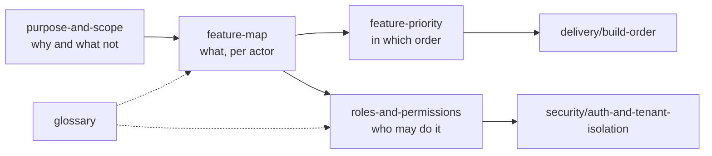

# Product

> **Area:** Product
> **Source:** MVP Architecture v0.1 §1, §3, §4 ([source](../_source/mvp-architecture-v0.1.md))
> **Status:** Draft v0.1 · **Owner:** Aman
> **Used by:** [/CLAUDE.md](../../CLAUDE.md)

## Summary

What the MVP is for, what it does, for whom, and in which order it gets built. Read these before touching any code so you know which features are P0 and who is allowed to do what.

## Docs in this folder

| Doc | What it covers |
|---|---|
| [purpose-and-scope.md](purpose-and-scope.md) | The two jobs (ordering hook, retention value), the reliability-first stance, and what is out of scope |
| [feature-map.md](feature-map.md) | The reviewed feature list, the full MVP feature map and a per-actor feature table |
| [feature-priority.md](feature-priority.md) | P0 / P1 / P2 / after-discovery priorities and how they map to build steps |
| [roles-and-permissions.md](roles-and-permissions.md) | `staff`, `manager`, `owner`, `platform_admin`: what each can and cannot do, plus a permission matrix |
| [glossary.md](glossary.md) | WhatsApp, platform and domain terms with links to the doc that explains each |

## How the product docs relate

Read left to right: scope bounds the feature map, which is then prioritised and permissioned; the glossary supports all of them.

## Related

- [../architecture/README.md](../architecture/README.md) — how the system is built
- [../delivery/build-order.md](../delivery/build-order.md) — build sequence
- [../security/auth-and-tenant-isolation.md](../security/auth-and-tenant-isolation.md) — how roles are enforced
- [../README.md](../README.md) — docs home
