# Feature map

> **Area:** Product
> **Source:** MVP Architecture v0.1 §3.1, §3.2 ([source](../_source/mvp-architecture-v0.1.md))
> **Status:** Draft v0.1 · **Owner:** Aman
> **Used by:** [/CLAUDE.md](../../CLAUDE.md), [frontend/src/features/CLAUDE.md](../../frontend/src/features/CLAUDE.md), [backend/app/domain/CLAUDE.md](../../backend/app/domain/CLAUDE.md)

## Summary

The original feature list covered the ordering loop well. Review found four groups of gaps, which became the additions marked ➕ in the final feature map. This doc holds the review, the full map, and a per-actor table that links each feature to its design doc.

## 3.1 The original list, reviewed

The list covers the ordering loop well. The gaps fall into four groups:

1. **Things a live café will hit on day one** that weren't on the list: new-order alerts, a two-tap sold-out toggle, editing or cancelling an order before the kitchen starts, and asking for the bill.
2. **The retention loop is only half there.** "Offers" and "Consent" exist, but the piece that proves value, **redemption tracking**, is missing. Without it you can send offers but can't show the owner "42 people came back and spent ₹X". It needs a staff-side action (enter the code) and an owner-side report.
3. **"Admin" is two different people.** The café owner (offers, customers, analytics, staff) and us as the platform operator (onboarding a café's WhatsApp number, template status, token health, cost per order). Mixing them in one role would let a café owner see other cafés' data.
4. **Platform plumbing that has no feature name but must exist:** webhook verification and deduplication, the 24-hour window guard, per-customer message ordering, AI guardrails and fallback, an audit log, cost tracking, and DPDP data-deletion handling.

## 3.2 Final MVP feature map

`➕` marks additions. `⏳` marks items to build last or only if discovery interviews confirm them.

```mermaid
flowchart LR
    MVP(("Restaurant<br/>Agentic System<br/>MVP"))

    MVP --> C["Customer (WhatsApp)"]
    MVP --> S["Restaurant staff (panel)"]
    MVP --> O["Café owner / manager (console)"]
    MVP --> P["➕ Platform admin (us)"]
    MVP --> X["➕ Platform services"]

    C --> C1["Start conversation<br/>➕ table session from QR"]
    C --> C2["Browse menu"]
    C --> C3["Ask questions"]
    C --> C4["Get recommendations"]
    C --> C5["Build cart"]
    C --> C6["Confirm order"]
    C --> C7["➕ Edit / cancel before preparing"]
    C --> C8["➕ Reorder 'same again'"]
    C --> C9["Track order"]
    C --> C10["Request human help"]
    C --> C11["➕ Request bill"]
    C --> C12["Give feedback"]
    C --> C13["Consent / offers<br/>➕ STOP opt-out"]
    C --> C14["➕ Data deletion request"]

    S --> S1["Login"]
    S --> S2["See orders<br/>➕ sound alert + overdue highlight"]
    S --> S3["Change order status"]
    S --> S4["Manage menu<br/>➕ two-tap sold-out toggle"]
    S --> S5["Handle customer requests<br/>➕ waiter queue + reply in chat"]
    S --> S6["View customer information"]
    S --> S7["➕ Redeem offer code"]

    O --> O1["Restaurant settings<br/>tables, hours, staff"]
    O --> O2["➕ Table QR generator"]
    O --> O3["Offers / campaigns<br/>➕ campaign report"]
    O --> O4["Customer intelligence"]
    O --> O5["Consent register"]
    O --> O6["Basic analytics<br/>➕ weekly report export"]

    P --> P1["Café onboarding<br/>WABA, number, tokens"]
    P --> P2["Template management + status"]
    P --> P3["Token, quality and limit health"]
    P --> P4["Cost per order / campaign"]
    P --> P5["AI conversation review"]
    P --> P6["Audit log"]

    X --> X1["Webhook verify + dedupe"]
    X --> X2["24-hour window guard"]
    X --> X3["AI guardrails + human fallback"]
    X --> X4["Scheduled jobs"]
    X --> X5["Logging, metrics, alerts"]
```

Five branches, one per actor or service layer; every ➕ node is an addition from the §3.1 review. This diagram is kept verbatim from the source and is over the 40-node guideline on purpose.

## Features per actor

### Customer (WhatsApp)

| Feature | ➕ | Priority | Design doc |
|---|---|---|---|
| Start conversation, table session from QR | ➕ session | P0 | [conversation-router.md](../backend/conversation-router.md) |
| Browse menu | | P0 | [interactive-messages.md](../whatsapp/interactive-messages.md) |
| Ask questions | | P0 | [ai-agent/README.md](../ai-agent/README.md) |
| Get recommendations | | P0 | [prompt-context.md](../ai-agent/prompt-context.md) |
| Build cart | | P0 | [cart-and-confirmation.md](../backend/cart-and-confirmation.md) |
| Confirm order | | P0 | [cart-and-confirmation.md](../backend/cart-and-confirmation.md) |
| Edit / cancel before preparing | ➕ | P2 | [order-lifecycle.md](../backend/order-lifecycle.md) |
| Reorder "same again" | ➕ | P2 | [customers.md](../backend/customers.md) |
| Track order | | P0 | [order-lifecycle.md](../backend/order-lifecycle.md) |
| Request human help | | P0 | [human-handoff.md](../backend/human-handoff.md) |
| Request bill | ➕ | P2 | [human-handoff.md](../backend/human-handoff.md) |
| Give feedback | | P1 | [feedback.md](../backend/feedback.md) |
| Consent / offers, STOP opt-out | ➕ STOP | P1 | [consent.md](../retention/consent.md) |
| Data deletion request | ➕ | Not ranked | [data-deletion.md](../retention/data-deletion.md) |

### Restaurant staff (panel)

| Feature | ➕ | Priority | Design doc |
|---|---|---|---|
| Login | | P0 | [auth-and-tenant-isolation.md](../security/auth-and-tenant-isolation.md) |
| See orders, sound alert + overdue highlight | ➕ alert | P0 | [staff-panel.md](../frontend/staff-panel.md), [realtime-and-alerts.md](../frontend/realtime-and-alerts.md) |
| Change order status | | P0 | [order-lifecycle.md](../backend/order-lifecycle.md) |
| Manage menu, two-tap sold-out toggle | ➕ toggle | P0 | [menu-management.md](../backend/menu-management.md) |
| Handle customer requests, waiter queue + reply in chat | ➕ queue | P0 | [human-handoff.md](../backend/human-handoff.md) |
| View customer information | | P2 | [customers.md](../backend/customers.md) |
| Redeem offer code | ➕ | P1 | [redemption.md](../retention/redemption.md) |

### Café owner / manager (console)

| Feature | ➕ | Priority | Design doc |
|---|---|---|---|
| Restaurant settings: tables, hours, staff | | Not ranked | [owner-console.md](../frontend/owner-console.md) |
| Table QR generator | ➕ | P0 | [owner-console.md](../frontend/owner-console.md) |
| Offers / campaigns, campaign report | ➕ report | P1 | [campaigns.md](../retention/campaigns.md) |
| Customer intelligence | | P2 | [customers.md](../backend/customers.md) |
| Consent register | | P1 | [consent.md](../retention/consent.md) |
| Basic analytics, weekly report export | ➕ export | P2 | [analytics-views.md](../database/analytics-views.md) |

### Platform admin (us) ➕

| Feature | Priority | Design doc |
|---|---|---|
| Café onboarding: WABA, number, tokens | Not ranked | [platform-admin.md](../frontend/platform-admin.md) |
| Template management + status | Not ranked | [templates.md](../whatsapp/templates.md) |
| Token, quality and limit health | Not ranked | [number-health.md](../whatsapp/number-health.md) |
| Cost per order / campaign | P2 | [cost-tracking.md](../observability/cost-tracking.md) |
| AI conversation review | P2 | [evaluation.md](../ai-agent/evaluation.md) |
| Audit log | Not ranked | [security-controls.md](../security/security-controls.md) |

### Platform services ➕

| Feature | Design doc |
|---|---|
| Webhook verify + dedupe | [webhooks.md](../whatsapp/webhooks.md), [inbound-pipeline.md](../backend/inbound-pipeline.md) |
| 24-hour window guard | [outbound-sender.md](../whatsapp/outbound-sender.md) |
| AI guardrails + human fallback | [guardrails.md](../ai-agent/guardrails.md) |
| Scheduled jobs | [background-jobs.md](../backend/background-jobs.md) |
| Logging, metrics, alerts | [logging-and-metrics.md](../observability/logging-and-metrics.md) |

Priority values come from [feature-priority.md](feature-priority.md). Where §3.3 names a feature directly or closely ("customer profile view" for customer information and intelligence, "table QR session" for the QR generator, "consent capture" for the consent register) that level is used. "Not ranked" means §3.3 gives no P-level; the feature still has to exist.

## Rules / invariants

- Café owner and platform admin are separate roles; a café owner must never see another café's data.
- Redemption tracking is part of the retention loop, not an optional extra: without it the owner report cannot exist.
- Platform plumbing (dedupe, 24-hour guard, per-customer ordering, guardrails, audit, cost tracking, DPDP deletion) is required even though it has no feature name.

## Open questions

- §3.3 gives no P-level for café settings, onboarding, template management, token health, data deletion or the audit log. Templates land in build step 4 (submitted for approval during step 1); the others have no explicit step in [build-order.md](../delivery/build-order.md).

## Related

- [feature-priority.md](feature-priority.md)
- [roles-and-permissions.md](roles-and-permissions.md)
- [purpose-and-scope.md](purpose-and-scope.md)
- [../frontend/README.md](../frontend/README.md)
- [../backend/README.md](../backend/README.md)
