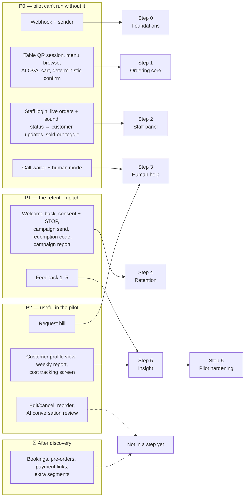

# Feature priority

> **Area:** Product
> **Source:** MVP Architecture v0.1 §3.3, §13 ([source](../_source/mvp-architecture-v0.1.md))
> **Status:** Draft v0.1 · **Owner:** Aman
> **Used by:** [/CLAUDE.md](../../CLAUDE.md)

## Summary

Every MVP feature has a priority. P0 is what the pilot cannot run without, P1 is the retention pitch, P2 is useful during the pilot, and ⏳ waits for discovery. The diagram below shows which build step in [build-order.md](../delivery/build-order.md) delivers each feature.

## Priority table

| Priority | Features |
|---|---|
| **P0 — pilot can't run without it** | Webhook + sender, table QR session, menu browse, AI Q&A/recommendations, cart, deterministic confirmation, staff login, live orders with sound alert, status changes → customer updates, sold-out toggle, call waiter + human mode |
| **P1 — the retention pitch** | Welcome back, consent capture + STOP, redemption code, simple campaign send, campaign report, feedback 1–5 |
| **P2 — useful in the pilot** | Edit/cancel before preparing, reorder, request bill, customer profile view, weekly report, cost tracking screen, AI conversation review |
| **⏳ After discovery** | Bookings, pre-orders, payment links, segments beyond "lapsed" and "all opted-in" |

## Priorities mapped to build steps

All P0 work lands in steps 0–3, the retention pitch in step 4, and insight features in step 5. Step 6 adds no features; it hardens what exists. Dashed arrows are features that §13 does not place in any step.

## Rules / invariants

- No P1 work starts before the P0 ordering loop works end to end; reliability beats features ([purpose-and-scope.md](purpose-and-scope.md)).
- MVP segments are only "all opted-in", "lapsed" and "regulars"; anything more is ⏳ ([campaigns.md](../retention/campaigns.md)).
- Templates are a step 4 feature but must be submitted for approval during step 1 ([build-order.md](../delivery/build-order.md)).

## Open questions

- Edit/cancel before preparing, reorder and AI conversation review are P2 but have no build step in §13. Placement is undecided.
- §3.3 lists "lapsed" and "all opted-in" as MVP segments, while §6.12 also lists "regulars". See [campaigns.md](../retention/campaigns.md).
- Bill / payment (UPI link now or later) — tracked in [open-decisions.md](../delivery/open-decisions.md).

## Related

- [feature-map.md](feature-map.md)
- [../delivery/build-order.md](../delivery/build-order.md)
- [../delivery/open-decisions.md](../delivery/open-decisions.md)
