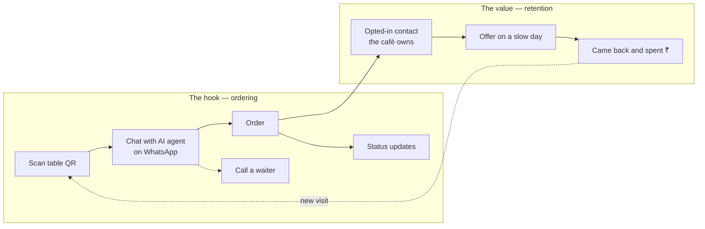
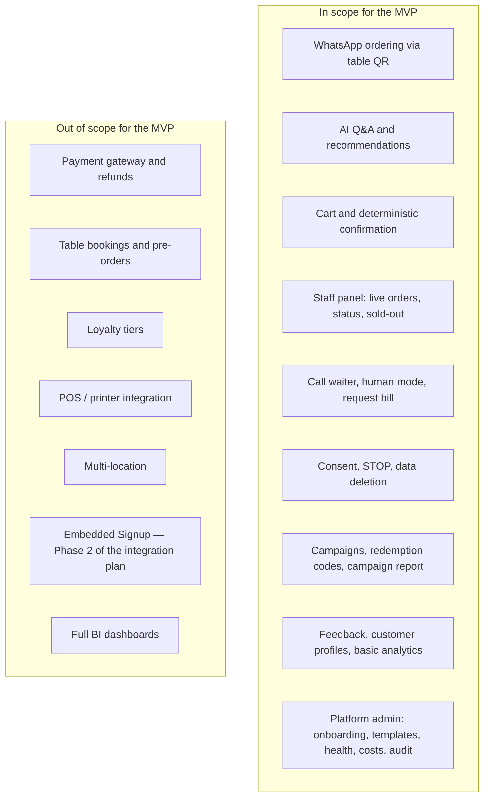

# Purpose and scope

> **Area:** Product
> **Source:** MVP Architecture v0.1 §1 ([source](../_source/mvp-architecture-v0.1.md))
> **Status:** Draft v0.1 · **Owner:** Aman
> **Used by:** [/CLAUDE.md](../../CLAUDE.md)

## Summary

The MVP is the smallest system a café can run live on a busy evening without us in the kitchen. It has two jobs that match the business plan: ordering is the hook, retention is the value. Reliability beats features, so anything touching money, order state or consent is deterministic code and the AI stays in conversation and recommendation.

## The two jobs

1. **The hook — ordering.** A customer scans a table QR, chats with the AI agent on WhatsApp, orders, gets status updates and can call a waiter.
2. **The value — retention.** Every customer who orders becomes an opted-in WhatsApp contact the café owns. The owner sends an offer on a slow day and sees how many people came back and what they spent.

The ordering loop is what gets a customer into the system; every order feeds the retention loop, which in turn brings them back to the table.

## Reliability first

One lost or wrong order costs more trust than ten missing features. Every design choice favours deterministic code for anything involving money, order state or consent, and keeps the AI to conversation and recommendation. See [design-principles.md](../architecture/design-principles.md), principle 3 ("AI talks, code decides").

## In scope vs out of scope

The left box is the full MVP feature set from [feature-map.md](feature-map.md); the right box is the explicit exclusion list from §1.

| In scope (summary) | Out of scope |
|---|---|
| Ordering loop on WhatsApp | Payment gateway and refunds |
| Staff panel and human help | Table bookings and pre-orders |
| Retention: consent, campaigns, redemption, report | Loyalty tiers |
| Owner console with basic analytics | POS / printer integration |
| Platform admin for us | Multi-location |
| Platform plumbing: dedupe, 24-hour guard, guardrails, audit, cost tracking, DPDP | Embedded Signup (Phase 2 of the integration plan) |
| | Full BI dashboards |

## Rules / invariants

- Deterministic code owns money, order state and consent. The AI never does.
- Nothing from the out-of-scope list is built in the MVP without a new decision (record it as an ADR).
- Bookings, pre-orders and payment links are only revisited after discovery (see [feature-priority.md](feature-priority.md)).

## Open questions

- Bill / payment: UPI link now or later? Default is "Request bill" → staff for the MVP. Tracked in [open-decisions.md](../delivery/open-decisions.md).

## Related

- [feature-map.md](feature-map.md)
- [feature-priority.md](feature-priority.md)
- [../architecture/design-principles.md](../architecture/design-principles.md)
- [../architecture/end-to-end-flow.md](../architecture/end-to-end-flow.md)
- [/CLAUDE.md](../../CLAUDE.md)
