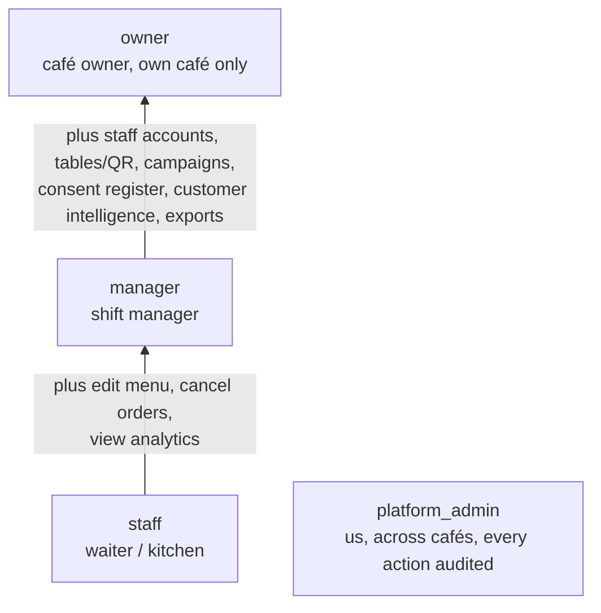

# Roles and permissions

> **Area:** Product
> **Source:** MVP Architecture v0.1 §4, §8, §6.15 ([source](../_source/mvp-architecture-v0.1.md))
> **Status:** Draft v0.1 · **Owner:** Aman
> **Used by:** [/CLAUDE.md](../../CLAUDE.md), [backend/app/core/CLAUDE.md](../../backend/app/core/CLAUDE.md), [backend/app/api/CLAUDE.md](../../backend/app/api/CLAUDE.md), [frontend/CLAUDE.md](../../frontend/CLAUDE.md), [supabase/CLAUDE.md](../../supabase/CLAUDE.md)

## Summary

Four roles exist. `staff`, `manager` and `owner` are café roles that build on each other; `platform_admin` is us, the platform operator, and is deliberately separate so a café owner can never see another café's data. Customers have no role and never log in: their identity is their WhatsApp number (`wa_id`).

## Roles

| Role | Who | Can do | Cannot do |
|---|---|---|---|
| `staff` | Waiter / kitchen | See live orders, change status, toggle sold-out, handle waiter calls, reply in human mode, redeem codes, view a customer's name and past orders | Edit prices, send campaigns, see analytics, export data |
| `manager` | Shift manager | Everything `staff` can, plus edit menu, cancel orders, view analytics | Manage staff accounts, send campaigns |
| `owner` | Café owner | Everything `manager` can, plus staff accounts, tables/QR, campaigns, consent register, customer intelligence, exports | Anything outside their own café |
| `platform_admin` | Us | Onboard cafés, manage WhatsApp config and templates, view health, costs, audit log, AI transcripts across cafés | (Use sparingly; every action audited) |

Roles live in `staff_memberships (user_id, cafe_id, role)`. One person can belong to several cafés later without schema changes.

## Role inheritance

Café roles are nested: each role inherits everything below it, scoped to one café through `staff_memberships`. `platform_admin` is not part of the chain and does not inherit café operations.

## Permission matrix

Derived from §4 and the role notes on each endpoint group in §8. Endpoint groups are described in [api/README.md](../api/README.md).

| Capability | Endpoint group | staff | manager | owner | platform_admin |
|---|---|---|---|---|---|
| See live orders | `GET /staff/orders` | ✅ | ✅ | ✅ | ❌ |
| Change order status | `PATCH /staff/orders/{id}/status` | ✅ | ✅ | ✅ | ❌ |
| Cancel an order with reason | `POST /staff/orders/{id}/cancel` | ❌ | ✅ | ✅ | ❌ |
| Toggle sold-out | `PATCH /staff/menu/items/{id}/availability` | ✅ | ✅ | ✅ | ❌ |
| Handle waiter calls and bill requests | `/staff/waiter-requests` | ✅ | ✅ | ✅ | ❌ |
| Take over, release and reply in human mode | `/staff/conversations/{id}/*` | ✅ | ✅ | ✅ | ❌ |
| Redeem an offer code | `POST /staff/redeem` | ✅ | ✅ | ✅ | ❌ |
| View customer name and past orders, masked number | `GET /staff/customers/{id}` | ✅ | ✅ | ✅ | ❌ |
| Edit menu: categories, items, prices | `/admin/menu/categories`, `/admin/menu/items` | ❌ | ✅ | ✅ | ❌ |
| CSV menu import | `POST /admin/menu/import` | ❌ | ❌ | ✅ | ✅ |
| View basic analytics | `/admin/analytics/*` | ❌ | ✅ | ✅ | ❌ |
| Manage staff accounts | `/admin/staff` | ❌ | ❌ | ✅ | ❌ |
| Manage tables and QR codes | `/admin/tables` | ❌ | ❌ | ✅ | ❌ |
| Café settings: hours, tone, feedback delay, tax | `/admin/settings` | ❌ | ❌ | ✅ | ❌ |
| View the café's approved templates | `GET /admin/templates` | ❌ | ❌ | ✅ | ❌ |
| Create, schedule, cancel campaigns and see reports | `/admin/campaigns` | ❌ | ❌ | ✅ | ❌ |
| Customer intelligence: list and profiles | `/admin/customers` | ❌ | ❌ | ✅ | ❌ |
| Consent register and export | `/admin/consents` | ❌ | ❌ | ✅ | ❌ |
| Weekly report and data exports | `/admin/reports/weekly` | ❌ | ❌ | ✅ | ❌ |
| Onboard cafés | `POST /platform/cafes` | ❌ | ❌ | ❌ | ✅ |
| Create templates on a café's WABA, sync status | `/platform/cafes/{id}/templates` | ❌ | ❌ | ❌ | ✅ |
| View token, quality and messaging-tier health | `/platform/cafes/{id}/health` | ❌ | ❌ | ❌ | ✅ |
| View WhatsApp + AI costs | `/platform/costs` | ❌ | ❌ | ❌ | ✅ |
| Review AI transcripts across cafés | `/platform/conversations` | ❌ | ❌ | ❌ | ✅ |
| View audit log | `/platform/audit` | ❌ | ❌ | ❌ | ✅ |
| See any data outside their own café | — | ❌ | ❌ | ❌ | ✅ audited |

## How roles are enforced

- **Panel requests.** The API verifies the Supabase JWT, looks up the role in `staff_memberships` for `sub` and the requested café, then runs an RBAC check per endpoint. No membership → `403`. See [auth-and-tenant-isolation.md](../security/auth-and-tenant-isolation.md).
- **Queries.** Every query is filtered by `cafe_id` taken from the membership, never from input ([design-principles.md](../architecture/design-principles.md), principle 6).
- **Realtime reads.** RLS limits rows to the cafés the user is a member of ([row-level-security.md](../database/row-level-security.md)).
- **Staff accounts.** Per-person logins, no shared accounts; the owner can deactivate staff instantly (`staff_memberships.active`).
- **Audit.** Status changes, sold-out flips, cancellations, campaigns and redemptions write `audit_log`; every `platform_admin` action is audited.

## Rules / invariants

- Customers are never Auth users. They are rows in `customers`, keyed by `(cafe_id, wa_id)`.
- `owner` can do nothing outside their own café. Only `platform_admin` works across cafés.
- The role always comes from `staff_memberships`, never from the JWT claims alone or from a request body.
- `staff` cannot edit prices, send campaigns, see analytics or export data.
- `manager` cannot manage staff accounts or send campaigns.

## Open questions

- §6.7 says staff can cancel a `PLACED` order, while §8.2 marks `POST /staff/orders/{id}/cancel` as `manager`+ and §4 lists cancel as a manager capability. The matrix follows §4/§8; confirm in [order-lifecycle.md](../backend/order-lifecycle.md).
- CSV menu import is owner-only in §8.3 but "owner / platform" in §6.15, so the matrix grants it to both. Whether `platform_admin` calls the `/admin` route or a platform route is not specified.
- §6.17 says quality rating and messaging tier are stored "for the owner and platform screens", so the owner may see read-only health on their own café. Not listed in §4 or §8.3.
- How `platform_admin` is represented (a membership row or a separate flag) is not specified.

## Related

- [../security/auth-and-tenant-isolation.md](../security/auth-and-tenant-isolation.md)
- [../api/staff.md](../api/staff.md), [../api/admin.md](../api/admin.md), [../api/platform.md](../api/platform.md)
- [../database/row-level-security.md](../database/row-level-security.md)
- [../frontend/app-structure.md](../frontend/app-structure.md)
- [backend/app/core/CLAUDE.md](../../backend/app/core/CLAUDE.md)
