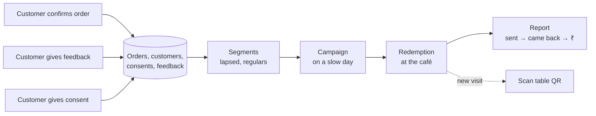

# Retention

> **Area:** Retention
> **Source:** MVP Architecture v0.1 §1, §3.1, §3.3, §5.4, §6.11, §6.12, §13, §14 ([source](../_source/mvp-architecture-v0.1.md))
> **Status:** Draft v0.1 · **Owner:** Aman
> **Used by:** [/CLAUDE.md](../../CLAUDE.md), [backend/app/domain/consent/CLAUDE.md](../../backend/app/domain/consent/CLAUDE.md), [backend/app/domain/campaigns/CLAUDE.md](../../backend/app/domain/campaigns/CLAUDE.md)

## Summary

Retention is **the value** the café owner pays for. Every customer who orders becomes an opted-in WhatsApp contact the café owns; on a slow day the owner sends an offer and sees how many people came back and what they spent. That only works if consent is recorded properly, campaigns respect it, and redemption at the counter is tracked, because without redemption you can send offers but can't show "42 people came back and spent ₹X".

## The business-side loop

From §5.4 (business side).

Look at the dotted edge: a redemption is also a new visit, which feeds the ordering loop and produces more data for the next segment.

## Documents in this folder

| Doc | What it covers |
|---|---|
| [consent.md](consent.md) | Consent states, append-only rows, when the ask happens, STOP, re-ask rule, consent register |
| [campaigns.md](campaigns.md) | Segments, audience preview, scheduling, throttled send, DEFERRED / resume, campaign and recipient states |
| [redemption.md](redemption.md) | Unique codes, `POST /staff/redeem`, validation, the campaign report funnel and ROI |
| [data-deletion.md](data-deletion.md) | "Delete my data", Meta deletion callback, the `data_deletion` job, what's kept vs removed |

## Priority and build order

| Priority | Retention features |
|---|---|
| **P1 — the retention pitch** | Welcome back, consent capture + STOP, redemption code, simple campaign send, campaign report, feedback 1–5 |
| **⏳ After discovery** | Segments beyond "lapsed" and "all opted-in" |

Retention is build step 4 (welcome back, consent + STOP, templates, campaign send, redemption, report), but the templates are submitted for approval during step 1. See [../delivery/build-order.md](../delivery/build-order.md).

## Rules / invariants

- Marketing goes only to customers whose latest consent row is `OptedIn`.
- Consent is recorded by fixed code, never by the AI.
- Every campaign recipient gets a unique redemption code; the report is as important as the send.
- Only the `owner` role can send campaigns and see the consent register.
- Each café owns its own customer list: the same person at two cafés is two customer rows with separate consent.

## Open questions

- Consent re-ask window after a "No": default not within 30 days. Tracked in [../delivery/open-decisions.md](../delivery/open-decisions.md).
- Top risk: campaigns hurting the number's quality rating (mitigated by opt-in only, small first batches, easy Stop button). See [../delivery/risks.md](../delivery/risks.md).

## Related

- [../whatsapp/templates.md](../whatsapp/templates.md) · [../whatsapp/outbound-sender.md](../whatsapp/outbound-sender.md) · [../whatsapp/number-health.md](../whatsapp/number-health.md)
- [../backend/feedback.md](../backend/feedback.md) · [../backend/customers.md](../backend/customers.md)
- [../frontend/owner-console.md](../frontend/owner-console.md) · [../database/analytics-views.md](../database/analytics-views.md)
- Context: [backend/app/domain/consent/CLAUDE.md](../../backend/app/domain/consent/CLAUDE.md), [backend/app/domain/campaigns/CLAUDE.md](../../backend/app/domain/campaigns/CLAUDE.md)
