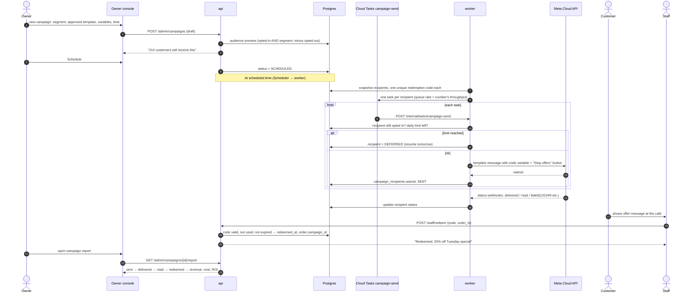
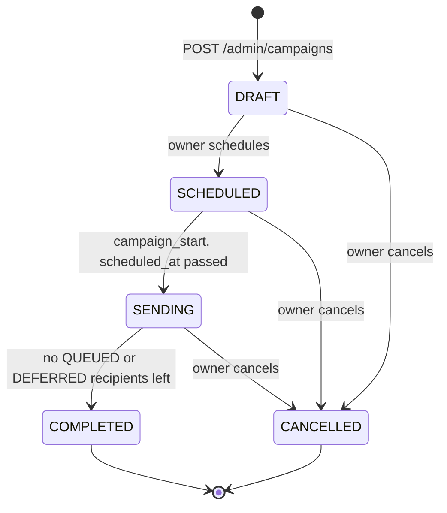
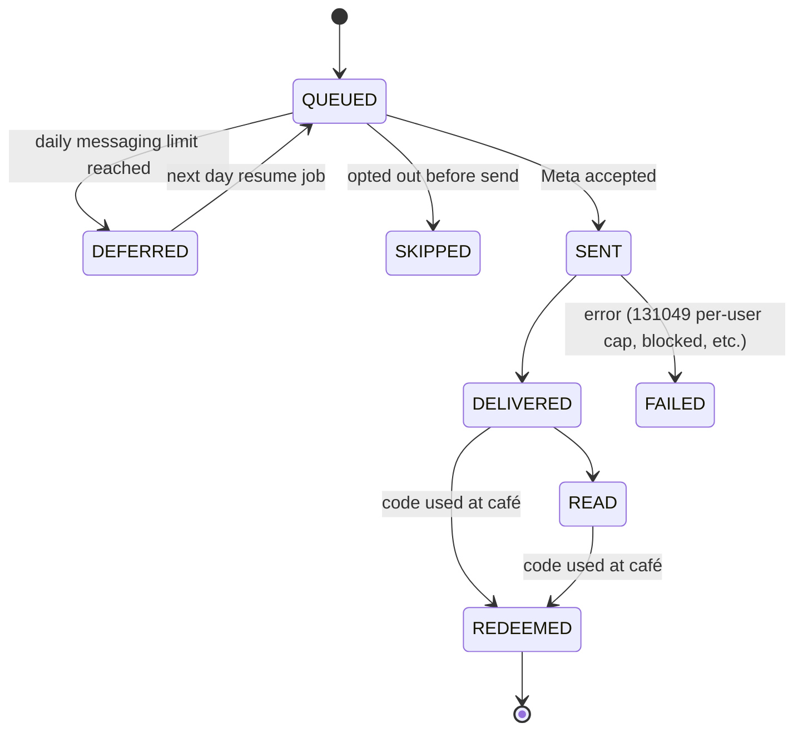

# Campaigns

> **Area:** Retention
> **Source:** MVP Architecture v0.1 §3.3, §4, §6.12, §6.17, §7, §8.3, §8.5, §10, §14 ([source](../_source/mvp-architecture-v0.1.md))
> **Status:** Draft v0.1 · **Owner:** Aman
> **Used by:** [backend/app/domain/campaigns/CLAUDE.md](../../backend/app/domain/campaigns/CLAUDE.md), [backend/app/domain/outbound/CLAUDE.md](../../backend/app/domain/outbound/CLAUDE.md), [frontend/src/features/CLAUDE.md](../../frontend/src/features/CLAUDE.md)

## Summary

A campaign is an approved marketing template sent to one segment of opted-in customers at a scheduled time, each with a unique redemption code. Recipients are snapshotted when the campaign starts, then sent one Cloud Task each through a throttled queue that matches the number's throughput. If the daily messaging limit is hit, recipients are deferred to the next day, never dropped. This is the retention value the owner pays for, so the report at the end matters as much as the send.

## End-to-end sequence

Verbatim from §6.12.

Look at the three phases: owner setup in `api`, throttled per-recipient sending in `worker`, then redemption and reporting back in `api`. Redemption and the report are detailed in [redemption.md](redemption.md).

## MVP segments (only three)

| Segment | Definition | Parameter |
|---|---|---|
| All opted-in | Every customer whose current consent is `OptedIn` | — |
| Lapsed | No order in N days | N |
| Regulars | ≥ K orders in 60 days | K |

Every segment is intersected with `OptedIn` and minus opted-out. Add more segments only after the owner asks for them. Stored as `campaigns.segment_definition`.

## Steps

| Step | Who / what | Endpoint or job |
|---|---|---|
| Create draft | Owner picks segment, approved template, variables, time | `POST /admin/campaigns` |
| Audience preview | `api` counts opted-in AND segment, minus opted-out ("214 customers will receive this") | `POST /admin/campaigns` · `/preview` |
| Schedule | Status → `SCHEDULED`, `scheduled_at` set | `POST /admin/campaigns` · `/schedule` |
| Cancel | Owner stops a campaign | `POST /admin/campaigns` · `/cancel` |
| Start | Picks up campaigns whose `scheduled_at` has passed; snapshots recipients and codes; enqueues tasks | `campaign_start` (Scheduler, every 5 min) |
| Send one | Re-check opt-in and daily limit, send template, store `wamid` | `campaign_send` (Cloud Task, `/internal/tasks/campaign-send`) |
| Resume | Re-queues DEFERRED recipients | `campaign_resume` (Scheduler, daily 10:00 local) |
| Track | Status webhooks move recipient status | `/internal/pubsub/inbound` |
| Report | Funnel, revenue, cost, ROI | `GET /admin/campaigns/{id}/report` |

- **Snapshot.** Recipients are fixed when the campaign starts: one `campaign_recipients` row per customer, each with a unique `redemption_code`. Later opt-ins are not added; later opt-outs are caught at send time (`SKIPPED`).
- **Throttle.** The `campaign-send` Cloud Tasks queue rate is set to the number's throughput.
- **Small first batches.** Keep early campaigns small to protect the number's quality rating ([../whatsapp/number-health.md](../whatsapp/number-health.md)).

## Campaign status (header)

`SCHEDULED` is in the source; the other states are **(proposed)**.

Look at `SENDING`: a campaign stays here across days while DEFERRED recipients are resumed.

## Recipient status

Verbatim from §6.12.

Look at `DEFERRED`: hitting the daily limit pauses a recipient, and `campaign_resume` returns it to `QUEUED` the next day.

## Tables

| Table | Fields |
|---|---|
| `campaigns` | `id`, `cafe_id`, `template_id`, `segment_definition`, `variables`, `scheduled_at`, `status` |
| `campaign_recipients` | `id`, `campaign_id`, `customer_id`, `wamid`, `send_status`, `redemption_code`, `redeemed_at`, `order_id` |

Constraints: `UNIQUE (redemption_code)`, `UNIQUE (campaign_id, customer_id)` (one code per person per campaign).

## Rules / invariants

- Only the `owner` role creates, schedules or cancels campaigns (`manager` and `staff` cannot send campaigns).
- Only approved marketing templates; only `OptedIn` recipients, re-checked at send time.
- Every send goes through the single outbound send function.
- One task per recipient; the queue rate never exceeds the number's throughput.
- Daily limit reached → DEFERRED, never dropped.
- Every campaign action writes `audit_log`.

## Open questions

- Header status values other than `SCHEDULED` are **(proposed)**.
- The source lists `/admin/campaigns` · `/preview` · `/schedule` · `/cancel` without the full path shape (for example whether they sit under `/admin/campaigns/{id}/`).
- Default values for N (lapsed) and K (regulars).
- How "daily limit left" is computed from the messaging tier.
- Code expiry: the source validates "not expired" but has no expiry column. See [redemption.md](redemption.md).
- The §6.12 sequence says the `campaign_start` trigger is "Scheduler → worker"; the job table says every 5 min. Both agree on Scheduler; the 5-minute polling means a send can start up to 5 minutes late.
- Behaviour if the template is paused mid-send ([../whatsapp/templates.md](../whatsapp/templates.md)).

## Related

- [README.md](README.md) · [consent.md](consent.md) · [redemption.md](redemption.md)
- [../whatsapp/templates.md](../whatsapp/templates.md) · [../whatsapp/outbound-sender.md](../whatsapp/outbound-sender.md) · [../whatsapp/number-health.md](../whatsapp/number-health.md)
- [../backend/background-jobs.md](../backend/background-jobs.md) · [../infra/async-messaging.md](../infra/async-messaging.md)
- [../api/admin.md](../api/admin.md) · [../frontend/owner-console.md](../frontend/owner-console.md)
- Context: [backend/app/domain/campaigns/CLAUDE.md](../../backend/app/domain/campaigns/CLAUDE.md)
