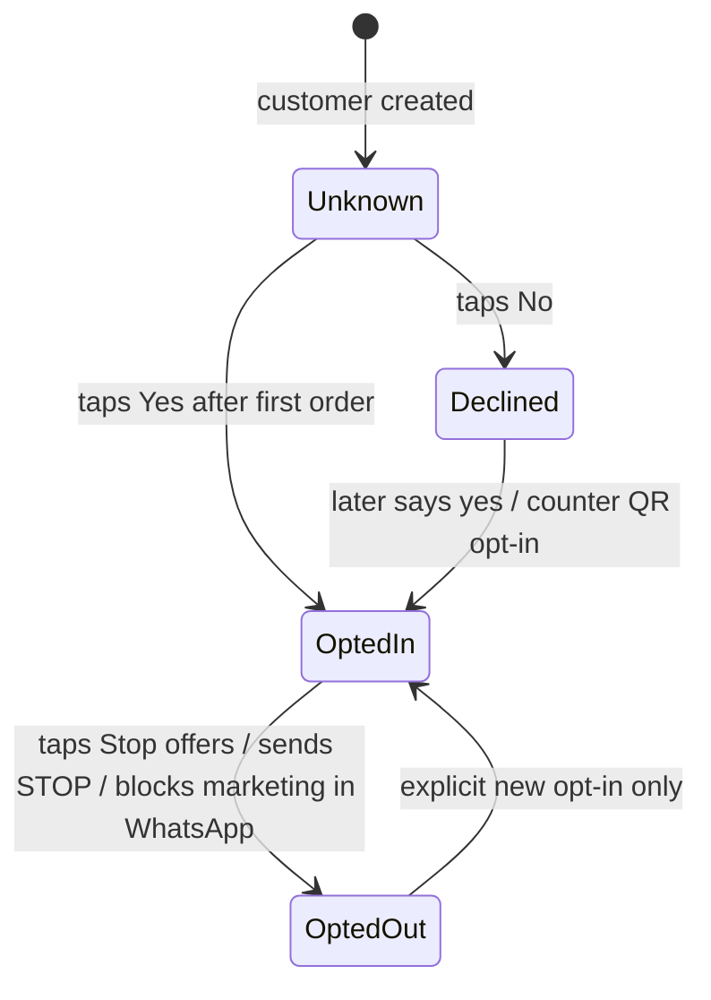
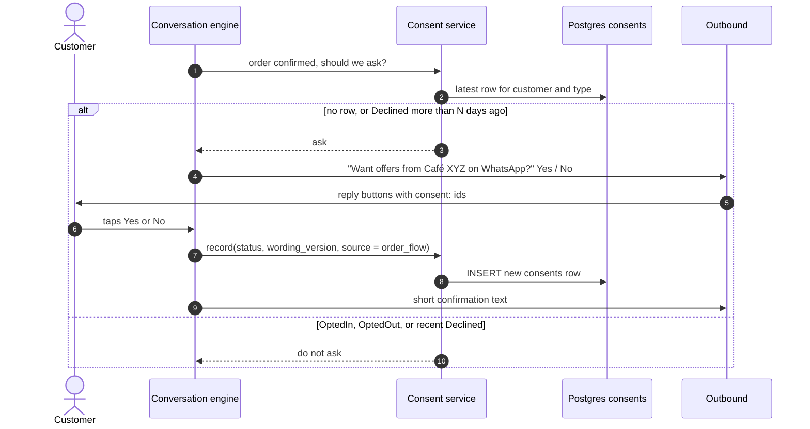

# Consent

> **Area:** Retention
> **Source:** MVP Architecture v0.1 §6.3, §6.6, §6.10, §6.11, §6.12, §6.13, §7, §8.3, §10, §14 ([source](../_source/mvp-architecture-v0.1.md))
> **Status:** Draft v0.1 · **Owner:** Aman
> **Used by:** [backend/app/domain/consent/CLAUDE.md](../../backend/app/domain/consent/CLAUDE.md), [backend/app/domain/conversation/CLAUDE.md](../../backend/app/domain/conversation/CLAUDE.md), [backend/app/domain/outbound/CLAUDE.md](../../backend/app/domain/outbound/CLAUDE.md), [backend/app/domain/campaigns/CLAUDE.md](../../backend/app/domain/campaigns/CLAUDE.md)

## Summary

Consent decides who may receive marketing. It is recorded by fixed code, never by the AI, as **append-only rows**: the latest row per customer and type is the current state. Every row keeps the exact wording shown and where the consent came from, so the café can prove what each customer agreed to (DPDP and Meta policy). Opting out is always one tap or one word away.

## Consent states

Verbatim from §6.11.

Look at `OptedOut`: the only way back is an explicit new opt-in; nothing automatic ever re-opts a customer in.

## The `consents` row

| Field | Meaning |
|---|---|
| `id` | Row id |
| `customer_id` | The café-scoped customer |
| `type` | Consent type (current state is per customer **and** type) |
| `status` | `OptedIn`, `Declined`, `OptedOut` |
| `wording_version` | The exact text shown to the customer |
| `source` | `order_flow`, `counter_qr` or `feedback_flow` |
| `created_at` | When it was recorded |

- Rows are **append-only**. A change of mind is a new row, never an update.
- Index `(customer_id, type, created_at DESC)` makes the "current consent" lookup fast.
- Campaign audiences query only `OptedIn`.

## When the ask happens

| Moment | Condition | `source` |
|---|---|---|
| After the first order is confirmed | First order and no consent record | `order_flow` |
| After a feedback rating of 4 or 5 | No consent yet ("+ consent ask if none yet") | `feedback_flow` |
| Counter QR opt-in at the café | Customer scans the counter QR and opts in | `counter_qr` |

The ask is a reply-button message: "Want offers from Café XYZ on WhatsApp?" **Yes** / **No**, with `consent:` IDs (see [../whatsapp/interactive-messages.md](../whatsapp/interactive-messages.md)).

**Re-ask rule.** Never ask again within N days after a "No", or the ask becomes spam. Suggested default: **not within 30 days** (open decision).

## The consent ask

Look at the branch: the decision to ask is made by code from the latest row, and the tap only ever appends a new row.

## Opting out

| Trigger | How it's detected |
|---|---|
| Text `STOP` | Conversation router, checked before QR, buttons and AI |
| "Stop offers" button | On every marketing template; checked with STOP |
| Blocking marketing in WhatsApp | Signalled by Meta (e.g. on the status webhook of a marketing send; verify the exact signal) |

On opt-out the router appends an `OptedOut` row and confirms by text. Before each campaign send, `campaign_send` re-checks that the recipient is still opted in; if not, the recipient is `SKIPPED`.

## Consent register

- Owner-only: `GET /admin/consents` and `GET /admin/consents/export`.
- Shows each customer's current status, wording version, source and date.
- The customer profile page shows consent status too ([../backend/customers.md](../backend/customers.md)).

## Rules / invariants

- Append-only; the latest row per customer and type is the truth.
- Every row stores `wording_version` and `source`.
- The AI cannot record consent; only fixed code paths do.
- Marketing templates require `OptedIn` at send time (checked in the outbound sender and in `campaign_send`).
- STOP and "Stop offers" always work, in any stage.
- No re-ask within N days after "No".

## Open questions

- Re-ask window N after "No": suggested 30 days. Tracked in [../delivery/open-decisions.md](../delivery/open-decisions.md).
- Is `Unknown` a stored row or just the absence of rows? **(proposed)** Absence of rows; no row is written on customer creation.
- Allowed values of `type` (only marketing in the MVP?).
- The router checks `mode = human` before STOP, so a STOP sent during human mode is forwarded to staff. **(proposed)** Check STOP first, even in human mode.
- Exact Meta signal for "blocks marketing in WhatsApp".
- The counter QR flow (prefilled text and handler) is not described in the source.

## Related

- [README.md](README.md) · [campaigns.md](campaigns.md) · [data-deletion.md](data-deletion.md)
- [../backend/conversation-router.md](../backend/conversation-router.md) · [../backend/cart-and-confirmation.md](../backend/cart-and-confirmation.md) · [../backend/feedback.md](../backend/feedback.md)
- [../whatsapp/outbound-sender.md](../whatsapp/outbound-sender.md) · [../security/data-protection.md](../security/data-protection.md)
- [../api/admin.md](../api/admin.md) · [../database/schema-by-domain.md](../database/schema-by-domain.md)
- Context: [backend/app/domain/consent/CLAUDE.md](../../backend/app/domain/consent/CLAUDE.md)
