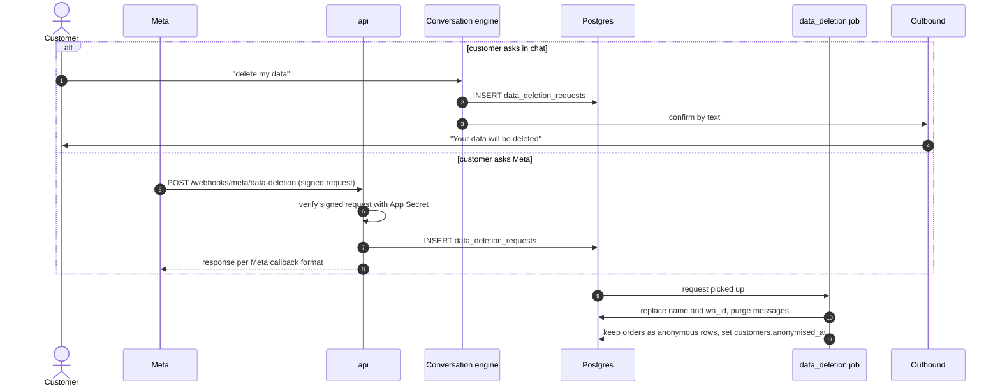

# Data deletion

> **Area:** Retention
> **Source:** MVP Architecture v0.1 §3.1, §6.11, §6.17, §7, §8.1, §10 ([source](../_source/mvp-architecture-v0.1.md))
> **Status:** Draft v0.1 · **Owner:** Aman
> **Used by:** [backend/app/domain/consent/CLAUDE.md](../../backend/app/domain/consent/CLAUDE.md), [backend/app/domain/conversation/CLAUDE.md](../../backend/app/domain/conversation/CLAUDE.md), [backend/app/integrations/whatsapp/CLAUDE.md](../../backend/app/integrations/whatsapp/CLAUDE.md)

## Summary

Under DPDP a customer can ask the café to delete their data. They send "delete my data" on WhatsApp, or ask Meta, which calls our data-deletion callback. Both paths create a `data_deletion_requests` row and run the same `data_deletion` job, which **anonymises** the customer rather than deleting their orders, so the café's sales history stays intact.

## Flow

Look at the join: two different entry points, one job, one outcome.

## What is kept vs removed

| Data | Outcome | Source |
|---|---|---|
| `customers.name` | Replaced | §6.11 |
| `customers.wa_id` | Replaced | §6.11 |
| `customers.anonymised_at` | Set | §7 |
| `messages` (conversation content) | Purged | §6.11 |
| `orders`, `order_items` | **Kept** as anonymous rows (sales history) | §6.11 |
| `consents` | **(proposed)** Kept as anonymous proof of past consent, or removed |  |
| `feedback` | **(proposed)** Rating kept, comment removed | |
| `campaign_recipients` | **(proposed)** Kept for campaign totals, unlinked from the person | |
| `conversations`, `ai_usage` | **(proposed)** Kept as counts and cost, no content | |
| `webhook_events` | Removed by the 30-day prune anyway | §6.17 |

## Rules / invariants

- Anonymise, don't delete orders: café revenue and analytics stay correct.
- Both triggers use the same `data_deletion` job.
- The Meta callback is verified before any data is touched.
- Confirm to the customer by text.

## Open questions

- How "delete my data" is detected (keyword in the router or AI intent); it isn't in the §6.3 router diagram.
- The placeholder for `wa_id` must stay unique under `UNIQUE (cafe_id, wa_id)`. **(proposed)** A random placeholder per row.
- The same person is a separate customer row in each café. Does a Meta callback anonymise all of them, and a chat request only that café's row?
- Outcomes for consents, feedback, campaign recipients, conversations and AI usage (rows marked **proposed** above).
- Deadline for completing a request under DPDP; whether a later message from the same number simply creates a new customer.

## Related

- [README.md](README.md) · [consent.md](consent.md)
- [../whatsapp/webhooks.md](../whatsapp/webhooks.md) · [../backend/background-jobs.md](../backend/background-jobs.md) · [../backend/customers.md](../backend/customers.md)
- [../security/data-protection.md](../security/data-protection.md) · [../api/public.md](../api/public.md)
- Context: [backend/app/domain/consent/CLAUDE.md](../../backend/app/domain/consent/CLAUDE.md)
