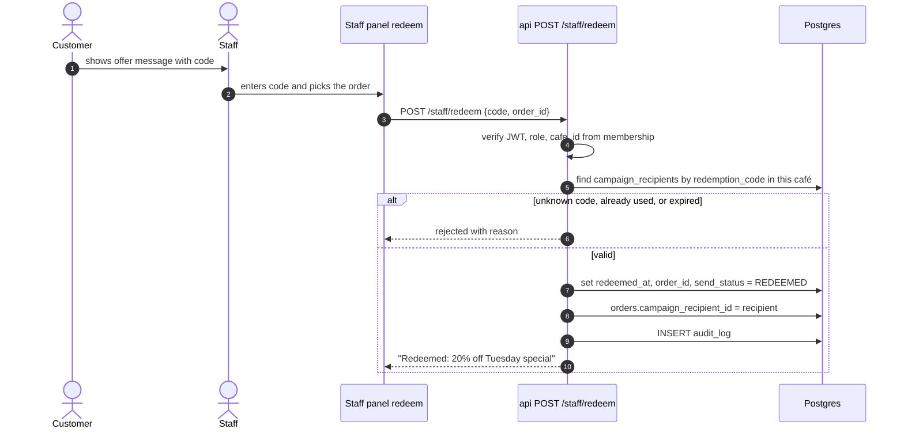
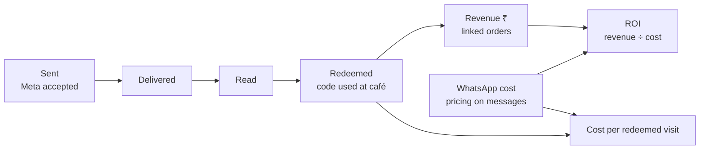

# Redemption and the campaign report

> **Area:** Retention
> **Source:** MVP Architecture v0.1 §3.1, §4, §6.7, §6.12, §6.16, §7, §8.2, §8.3, §10, §11 ([source](../_source/mvp-architecture-v0.1.md))
> **Status:** Draft v0.1 · **Owner:** Aman
> **Used by:** [backend/app/domain/campaigns/CLAUDE.md](../../backend/app/domain/campaigns/CLAUDE.md), [backend/app/api/CLAUDE.md](../../backend/app/api/CLAUDE.md), [frontend/src/features/CLAUDE.md](../../frontend/src/features/CLAUDE.md)

## Summary

Redemption is the piece that **proves value**. Without it the café can send offers but can't show the owner "42 people came back and spent ₹X". Every campaign recipient gets a unique code; when the customer shows the offer at the café, staff enter the code against the order, which links the visit to the campaign. The campaign report then turns sends into a funnel ending in revenue, cost and ROI.

## Redemption codes

- One unique `redemption_code` per recipient, generated when recipients are snapshotted at campaign start ([campaigns.md](campaigns.md)).
- `UNIQUE (redemption_code)` across all recipients; `UNIQUE (campaign_id, customer_id)` gives one code per person per campaign.
- The code is a variable in the marketing template, so it appears in the customer's WhatsApp message.

## Redeeming at the café

Look at the validation branch: one code can be redeemed once, and only in the café that sent it.

| Check | Meaning |
|---|---|
| Valid | Code exists and belongs to a campaign of the staff member's café |
| Unused | `redeemed_at` is empty |
| Not expired | Within the offer's validity |

On success: `campaign_recipients.redeemed_at` and `campaign_recipients.order_id` are set, the recipient moves to `REDEEMED` (from `DELIVERED` or `READ`), and the order is linked through `orders.campaign_recipient_id`. Redemptions are audited.

Roles: `staff`, `manager` and `owner` can redeem codes ([../product/roles-and-permissions.md](../product/roles-and-permissions.md)).

## The campaign report

`GET /admin/campaigns/{id}/report` (owner) returns the funnel, revenue and cost, served from the `v_campaign_funnel` view (refreshed nightly) over `campaign_recipients` and `orders`. The weekly report includes the same funnel.

Look at the two outputs on the right: they are what the owner reads to decide whether to send the next campaign.

| Measure | From |
|---|---|
| Sent, delivered, read | `campaign_recipients.send_status`, moved by status webhooks |
| Redeemed | `campaign_recipients.redeemed_at` |
| Revenue | Orders linked to recipients (`orders.campaign_recipient_id`) |
| WhatsApp cost | `pricing` from status webhooks, stored on `messages` |
| Cost per redeemed visit | cost ÷ redeemed |
| ROI | revenue ÷ cost |

## Rules / invariants

- One code per recipient; a code redeems at most once.
- Redemption only through `POST /staff/redeem`; the `cafe_id` comes from the staff membership, never from the request.
- Every redemption writes `audit_log`.
- Redemption never touches consent or sends a template.

## Open questions

- **Expiry.** "Not expired" is checked, but no expiry field exists in §7. **(proposed)** An expiry in `campaigns.variables` or a new column.
- **Link field.** The §6.12 sequence writes `order.campaign_id`; the §7 data model has `orders.campaign_recipient_id`. This doc follows §7.
- **Discount.** Whether redeeming changes the order total, or staff apply the discount outside the system (no payments in MVP).
- **Revenue rule (proposed).** Sum of `total` of linked orders, excluding `CANCELLED` (cancelled orders are excluded from analytics revenue).
- A code shown before the `delivered` webhook arrives: the state diagram only allows `REDEEMED` from `DELIVERED` or `READ`. **(proposed)** Allow from `SENT` too.

## Related

- [README.md](README.md) · [campaigns.md](campaigns.md) · [consent.md](consent.md)
- [../api/staff.md](../api/staff.md) · [../api/admin.md](../api/admin.md)
- [../database/analytics-views.md](../database/analytics-views.md) · [../observability/cost-tracking.md](../observability/cost-tracking.md)
- [../frontend/staff-panel.md](../frontend/staff-panel.md) · [../frontend/owner-console.md](../frontend/owner-console.md)
- Context: [backend/app/domain/campaigns/CLAUDE.md](../../backend/app/domain/campaigns/CLAUDE.md)
