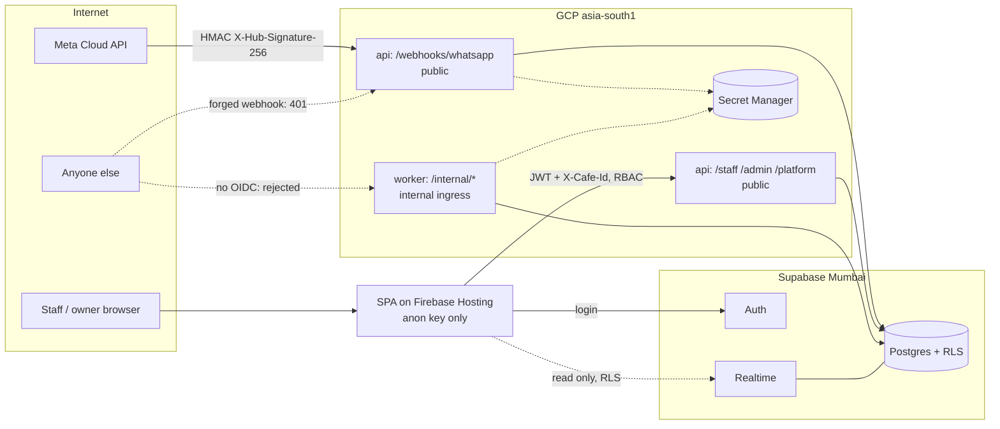

# Security

> **Area:** Security
> **Source:** MVP Architecture v0.1 §10, §6.14, §5.3, §9 ([source](../_source/mvp-architecture-v0.1.md))
> **Status:** Draft v0.1 · **Owner:** Aman
> **Used by:** [`/CLAUDE.md`](../../CLAUDE.md), [`backend/CLAUDE.md`](../../backend/CLAUDE.md), [`backend/app/core/CLAUDE.md`](../../backend/app/core/CLAUDE.md)

## Summary

The system handles money-adjacent order data, customer phone numbers and marketing consent for several cafés at once, so the two security goals are: no café can ever see another café's data, and no customer data or credential leaks out of the backend. This folder covers authentication and tenant isolation, the full control list from §10, and personal-data protection under India's DPDP Act and Meta's policies.

## Documents in this folder

| Doc | What it covers |
|---|---|
| [auth-and-tenant-isolation.md](auth-and-tenant-isolation.md) | Staff login, JWT verification, membership and RBAC, tenant resolution for inbound and panel traffic, cross-café test |
| [security-controls.md](security-controls.md) | The §10 control table with where each is enforced; rate limiting, staff accounts, audit, prompt injection |
| [data-protection.md](data-protection.md) | PII inventory, masking, what the AI sees, consent records, deletion and retention |

## Threat surface

Five entry points face the internet or a browser; each has exactly one control that lets traffic in, labelled on its arrow.

| Surface | Exposure | Primary control | Doc |
|---|---|---|---|
| Public webhook `/webhooks/whatsapp`, `/webhooks/meta/data-deletion` | Internet | HMAC-SHA256 of the raw body with the App Secret; signed request for deletion | [security-controls.md](security-controls.md) |
| Public REST API `/staff`, `/admin`, `/platform` | Internet | Supabase JWT, membership lookup, RBAC, `cafe_id` from membership | [auth-and-tenant-isolation.md](auth-and-tenant-isolation.md) |
| SPA | Browser | Anon key only, no write policies, read-only Realtime under RLS | [../database/row-level-security.md](../database/row-level-security.md) |
| Internal worker `/internal/*` | GCP only | Internal ingress plus OIDC from `invoker-sa` | [../infra/iam-and-secrets.md](../infra/iam-and-secrets.md) |
| Secrets | GCP only | Secret Manager, per-account access, DB stores references only | [../infra/iam-and-secrets.md](../infra/iam-and-secrets.md) |
| Database | Supabase | Server-side role via pooler for the backend; RLS for the SPA | [../database/row-level-security.md](../database/row-level-security.md) |
| Customer message text | Via WhatsApp | Never treated as instructions for tools; AI tools scoped to the conversation | [security-controls.md](security-controls.md#prompt-injection) |

## Rules / invariants

- Tenant comes from infrastructure (`phone_number_id`, membership), never from request input or message text.
- Every write goes through FastAPI.
- No secret in the DB, logs or frontend.

## Open questions

- None beyond those in the individual docs.

## Related

- [../infra/iam-and-secrets.md](../infra/iam-and-secrets.md) · [../database/row-level-security.md](../database/row-level-security.md) · [../ai-agent/guardrails.md](../ai-agent/guardrails.md)
- [../adr/0006-tenant-from-infrastructure.md](../adr/0006-tenant-from-infrastructure.md) · [../adr/0004-all-writes-through-fastapi.md](../adr/0004-all-writes-through-fastapi.md)
- Context files: [`backend/app/core/CLAUDE.md`](../../backend/app/core/CLAUDE.md), [`backend/CLAUDE.md`](../../backend/CLAUDE.md)
