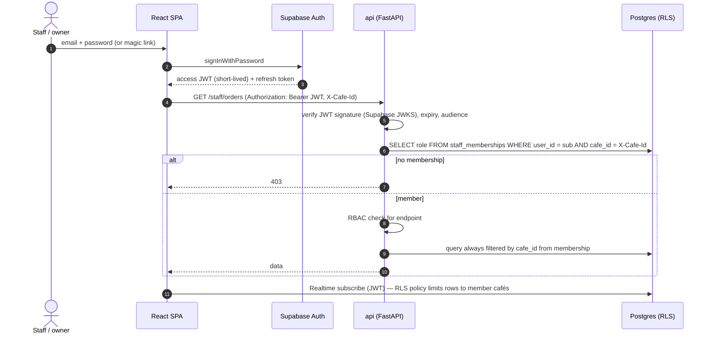
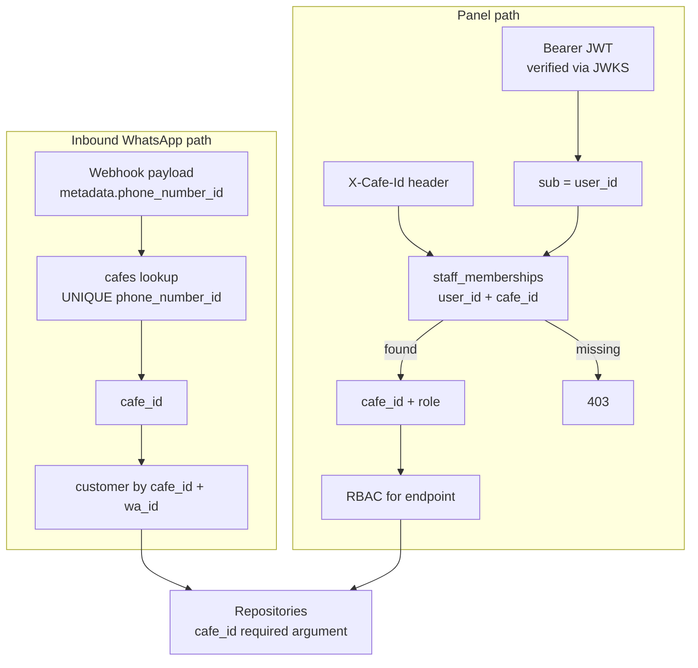

# Authentication and tenant isolation

> **Area:** Security
> **Source:** MVP Architecture v0.1 §6.14, §4, §5.3, §10, §12 ([source](../_source/mvp-architecture-v0.1.md))
> **Status:** Draft v0.1 · **Owner:** Aman
> **Used by:** [`backend/app/core/CLAUDE.md`](../../backend/app/core/CLAUDE.md), [`backend/app/api/CLAUDE.md`](../../backend/app/api/CLAUDE.md), [`backend/app/db/CLAUDE.md`](../../backend/app/db/CLAUDE.md), [`frontend/CLAUDE.md`](../../frontend/CLAUDE.md), [`backend/tests/CLAUDE.md`](../../backend/tests/CLAUDE.md)

## Summary

Only staff, managers, owners and platform admins log in, through Supabase Auth. Customers never log in: their identity is their WhatsApp number (`wa_id`) inside one café. Every request is scoped to exactly one café, and that café always comes from infrastructure (the WhatsApp `phone_number_id` or a verified staff membership), never from anything the caller types.

## Staff login and request flow (§6.14)

`X-Cafe-Id` is only a selector: it is accepted only if a membership row for that user and café exists, and the `cafe_id` used in queries is the one from that row.

- **Backend DB access** uses a server-side Postgres role through the Supavisor pooler; the backend enforces `cafe_id` in every repository method (repositories take `cafe_id` as a required argument).
- **Frontend direct access** is read-only Realtime under RLS: a row is visible when its `cafe_id` is one of the cafés in the user's `staff_memberships` (`auth.uid()`). See [../database/row-level-security.md](../database/row-level-security.md).
- **Inbound WhatsApp traffic** resolves `cafe_id` from `phone_number_id` in the webhook payload, never from message text.
- **The Supabase service-role key** never leaves Secret Manager and the backend.

## Two paths to a tenant

Both paths end in a `cafe_id` that no caller could choose freely, and both feed the same repositories.

| Path | Tenant source | Identity | Never trusted |
|---|---|---|---|
| Inbound messages and statuses | `phone_number_id` in the webhook payload (after signature check) | `wa_id` within that café | Text in the message ("I'm at Café X"), any id typed by the customer |
| Panel (staff, manager, owner) | `staff_memberships` row for JWT `sub` and `X-Cafe-Id` | Supabase Auth user | `cafe_id` in a body or query string, ids of rows from another café |
| Internal (Pub/Sub, Tasks, Scheduler) | Inside the payload produced by our own code | `invoker-sa` OIDC token | Anything without a valid OIDC token |
| Platform admin | Cross-café by design | `platform_admin` role | Not applicable; every action is audited instead (§4) |

Interactive reply ids (`confirm:{cart_id}:{cart_version}`, `item:{menu_item_id}`, `fb:{order_id}:{n}`) come from the customer's phone, so handlers must check that the referenced row belongs to the current café and conversation before acting **(proposed explicit rule; implied by §6.3 and §6.5)**.

## Roles (RBAC)

| Role | Can do (summary) | Cannot do |
|---|---|---|
| `staff` | Live orders, status changes, sold-out toggle, waiter calls, human-mode replies, redeem codes, customer name and past orders | Edit prices, send campaigns, see analytics, export data |
| `manager` | `staff` + edit menu, cancel orders, analytics | Manage staff accounts, send campaigns |
| `owner` | `manager` + staff accounts, tables/QR, campaigns, consent register, customer intelligence, exports | Anything outside their own café |
| `platform_admin` | Onboard cafés, WhatsApp config, templates, health, costs, audit log, AI transcripts across cafés | (Use sparingly; every action audited) |

Full matrix: [../product/roles-and-permissions.md](../product/roles-and-permissions.md).

## Cross-café isolation test

§10 requires an integration test that tries cross-café access (`backend/tests/integration/`, tenant isolation). It should prove, with two seeded cafés A and B **(proposed cases)**:

| Attempt | Expected |
|---|---|
| User with membership in A only calls `/staff/orders` with `X-Cafe-Id` = B | 403 |
| Member of A calls `PATCH /staff/orders/{id}/status` with an order id from B | Not found / 403, no row changed |
| Member of A redeems a code issued by a B campaign | Rejected |
| Realtime subscription by a member of A | Receives no B rows from `orders`, `order_items`, `waiter_requests`, `messages` |
| `authenticated` JWT tries a direct insert or update on any table | Denied by RLS |
| Webhook for B's `phone_number_id` with text naming café A | Handled entirely as café B |
| Deactivated membership (`active = false`) calls any endpoint | 403 |
| `staff` role calls a `manager`/`owner` endpoint | 403 |

## Rules / invariants

- Never read `cafe_id` from a request body, query parameter or message text.
- Every repository method takes `cafe_id` as a required argument.
- Verify JWT signature (Supabase JWKS), expiry and audience on every panel request; then load the membership.
- Membership checks include `active` so deactivation takes effect immediately **(proposed)**.
- Every `platform_admin` action writes `audit_log`.

## Open questions

- How `platform_admin` is represented (membership rows per café vs a separate flag) and how cross-café access is scoped in queries.
- Whether Realtime RLS should also check `active`.

## Related

- [security-controls.md](security-controls.md) · [data-protection.md](data-protection.md)
- [../database/row-level-security.md](../database/row-level-security.md) · [../api/README.md](../api/README.md) · [../frontend/app-structure.md](../frontend/app-structure.md)
- [../adr/0006-tenant-from-infrastructure.md](../adr/0006-tenant-from-infrastructure.md)
- Context files: [`backend/app/core/CLAUDE.md`](../../backend/app/core/CLAUDE.md), [`backend/app/db/CLAUDE.md`](../../backend/app/db/CLAUDE.md), [`backend/tests/CLAUDE.md`](../../backend/tests/CLAUDE.md)
