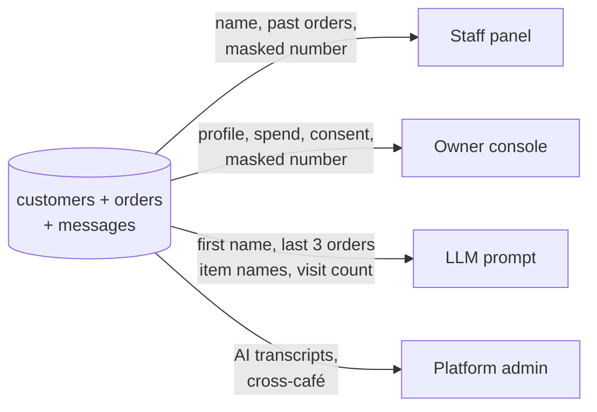
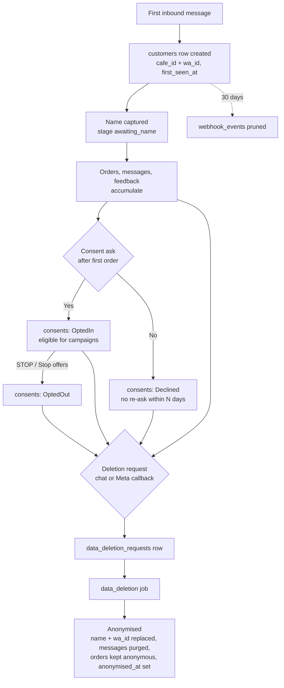

# Data protection

> **Area:** Security
> **Source:** MVP Architecture v0.1 §10, §6.5, §6.11, §6.16, §6.17, §7, §8 ([source](../_source/mvp-architecture-v0.1.md))
> **Status:** Draft v0.1 · **Owner:** Aman
> **Used by:** [`backend/app/domain/consent/CLAUDE.md`](../../backend/app/domain/consent/CLAUDE.md), [`backend/app/domain/ai_agent/CLAUDE.md`](../../backend/app/domain/ai_agent/CLAUDE.md), [`backend/app/api/CLAUDE.md`](../../backend/app/api/CLAUDE.md), [`frontend/CLAUDE.md`](../../frontend/CLAUDE.md), [`supabase/CLAUDE.md`](../../supabase/CLAUDE.md)

## Summary

Customers share a phone number, a name, what they eat and what they say in chat. The café owns that list, but the system must minimise who sees what, keep consent provable under India's DPDP Act and Meta's rules, and erase a customer on request without breaking the café's sales history. This doc is the inventory of personal data and the rules for each piece.

## PII inventory

| Data | Where stored | Who sees it | Retention | Masking / minimisation |
|---|---|---|---|---|
| WhatsApp number (`wa_id`) | `customers.wa_id`; inside `messages.payload` and `webhook_events` payloads | Backend; owner (masked in profile); staff (masked) | Until deletion request; replaced on anonymisation | Masked in staff panel and owner profile; never sent to the AI; not a log field **(proposed)** |
| Name | `customers.name` | Staff (with past orders), owner, AI (first name only) | Until deletion; replaced on anonymisation | AI gets first name only |
| Messages (chat text) | `messages.payload` | Staff in human-mode chat view; platform admin in AI transcript review; AI (last ~10 messages of this conversation) | Purged on anonymisation; general retention limit open | Only this conversation's messages reach the AI |
| Orders | `orders`, `order_items` | Staff, manager, owner (analytics), AI (last 3 orders, item names only) | Kept; become anonymous rows on deletion | AI sees item names, not totals or dates |
| Feedback | `feedback.rating`, `feedback.comment` | Owner, manager (low ratings alert), platform admin | Kept with the order **(proposed: clear comment text on anonymisation)** | — |
| Consent records | `consents` (status, `wording_version`, source, `created_at`) | Owner (consent register, export), backend | Append-only | — |
| Visit metadata | `customers.first_seen_at`, `last_visit_at`, `visit_count`, `language_hint` | Owner, AI (visit count) | Kept on the anonymised row **(proposed)** | — |
| Raw webhooks | `webhook_events` | Backend, platform admin for debugging | **30 days**, then deleted by `prune_webhook_events` | — |
| Campaign delivery | `campaign_recipients` | Owner (report) | Kept for the funnel, linked to the anonymised customer | — |

Staff and owner identities (Supabase Auth users, `staff_memberships`) are also personal data, handled by Supabase Auth.

## What each audience sees

The AI gets the least: no number, no surname, no totals; only `platform_admin` sees across cafés.

- **Phone masking.** `/staff/customers/{id}` returns a masked number (§8.2), and the owner's profile page shows a masked number (§6.16). The masking format (for example last four digits visible) is **(proposed)**.
- **AI minimisation.** Customer context per turn is first name, last 3 orders (item names only) and visit count, with no phone number (§6.5).
- **Exports.** The owner can export the consent register (`/admin/consents/export`) and the weekly report. Whether the export includes full numbers is open; the owner legitimately owns the list, but exports leave our control.

## Encryption

- **At rest:** Supabase default encryption at rest (§10).
- **In transit:** HTTPS to Meta, Cloud Run, Supabase and the LLM provider.
- **Secrets:** Secret Manager ([../infra/iam-and-secrets.md](../infra/iam-and-secrets.md)).

## Consent (DPDP and Meta)

- Every consent change is a new `consents` row with `status`, `wording_version` (the exact text shown), `source` (`order_flow`, `counter_qr`, `feedback_flow`) and `created_at`. The latest row per customer and type is the current state (§6.11).
- Marketing templates go only to `OptedIn` customers; the outbound sender checks this on every marketing send (§6.13).
- **STOP.** The text STOP or the "Stop offers" button records `OptedOut` and confirms by text, before any other routing (§6.3). Blocking marketing inside WhatsApp also counts as opt-out.
- After a "No", don't ask again within N days (suggested 30).

Details: [../retention/consent.md](../retention/consent.md).

## Deletion requests

Two entry points, one job:

| Entry | Path |
|---|---|
| Customer sends "delete my data" | Conversation engine creates a `data_deletion_requests` row and confirms by text |
| Meta data deletion callback | `POST /webhooks/meta/data-deletion` (signed request) creates the same request |

The `data_deletion` job then anonymises the customer: name and `wa_id` replaced, messages purged, orders kept as anonymous rows so the café's sales history stays intact; `customers.anonymised_at` is set (§6.11). Details: [../retention/data-deletion.md](../retention/data-deletion.md).

## Customer record lifecycle

Follow any path down to the anonymised box; raw webhook copies of the customer's messages disappear after 30 days regardless.

Consequence: because `wa_id` is replaced, if the same person messages the café again later, the `UNIQUE (cafe_id, wa_id)` key no longer matches and they start as a new customer with no history.

## Retention limits

| Data | Limit | Status |
|---|---|---|
| `webhook_events` (raw payloads) | 30 days, `prune_webhook_events` daily | Source §6.17 |
| `messages.payload` | Purged on anonymisation; a general retention limit is required by §10 but not set | **Open** |
| Cloud Logging | Logs carry IDs (`cafe_id`, `conversation_id`, `wamid`, `order_id`), not message text or numbers | **(proposed)** |
| Consent records | Kept as proof of consent; whether they survive anonymisation is open | **Open** |
| Orders | Kept indefinitely as anonymous sales history | Source §6.11 |

## Rules / invariants

- Never send a phone number to the LLM.
- Never show an unmasked number in the staff panel.
- Never log message text, names or `wa_id` in plain text **(proposed)**.
- Consent rows are append-only and record the exact wording shown.
- Deletion keeps orders but removes the link to an identifiable person.

## Open questions

- Retention period for `messages.payload` outside deletion requests ([../delivery/open-decisions.md](../delivery/open-decisions.md)).
- Whether consent records are retained (as proof) or removed on anonymisation.
- Whether feedback comments are cleared on anonymisation.
- Masking format and whether exports include full numbers.
- Whether `webhook_events` rows for a deleted customer are purged immediately or left to the 30-day prune.

## Related

- [security-controls.md](security-controls.md) · [auth-and-tenant-isolation.md](auth-and-tenant-isolation.md)
- [../retention/consent.md](../retention/consent.md) · [../retention/data-deletion.md](../retention/data-deletion.md) · [../ai-agent/prompt-context.md](../ai-agent/prompt-context.md)
- [../database/data-model.md](../database/data-model.md)
- Context files: [`backend/app/domain/consent/CLAUDE.md`](../../backend/app/domain/consent/CLAUDE.md), [`backend/app/domain/ai_agent/CLAUDE.md`](../../backend/app/domain/ai_agent/CLAUDE.md)
