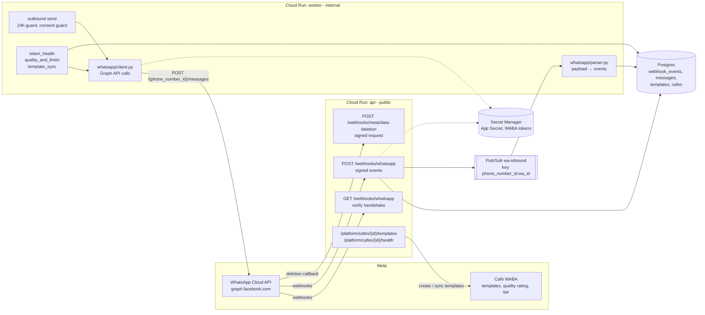

# WhatsApp integration

> **Area:** WhatsApp
> **Source:** MVP Architecture v0.1 §2, §5.1, §5.2, §6.2, §6.13, §6.17, §8.1, §8.4 ([source](../_source/mvp-architecture-v0.1.md))
> **Status:** Draft v0.1 · **Owner:** Aman
> **Used by:** [/CLAUDE.md](../../CLAUDE.md), [backend/app/integrations/whatsapp/CLAUDE.md](../../backend/app/integrations/whatsapp/CLAUDE.md), [backend/app/domain/outbound/CLAUDE.md](../../backend/app/domain/outbound/CLAUDE.md)

## Summary

The system talks to customers only through the **Meta WhatsApp Cloud API, called directly** (no BSP in between). Meta pushes webhooks into the public `api` service; the `worker` sends replies, templates and campaign messages out through the Graph API. Templates and number health (token validity, quality rating, messaging tier) are managed per café by the platform admin.

> **Meta facts are as of mid-2026.** Message limits, error codes, template statuses, messaging tiers and pricing change. Verify limits and pricing against current Meta documentation before building against them.

## Integration surface

Inbound traffic always enters through `api` and is processed in `worker`; outbound traffic always leaves through the single send function and `whatsapp/client.py`.

## Documents in this folder

| Doc | What it covers |
|---|---|
| [webhooks.md](webhooks.md) | GET verify handshake, POST signature check, `webhook_events`, Pub/Sub publish, event types, `wamid` dedupe, monotonic status, pricing, retention, Meta data-deletion callback |
| [outbound-sender.md](outbound-sender.md) | The single send function, 24-hour window, marketing consent check, token lookup, retries, error handling |
| [interactive-messages.md](interactive-messages.md) | Message types, the `action:arg1:arg2` ID scheme, button sets, code-rendered dish lists |
| [templates.md](templates.md) | `weekly_offer`, `winback`, `order_update`, `new_order_alert`; the `templates` table; `template_sync`; template status |
| [number-health.md](number-health.md) | Café onboarding fields, `token_health`, `quality_and_limits`, daily limits, error 131049 |

## Names used across the integration

| Kind | Name | Defined in |
|---|---|---|
| Public endpoint | `GET /webhooks/whatsapp`, `POST /webhooks/whatsapp` | [webhooks.md](webhooks.md) |
| Public endpoint | `POST /webhooks/meta/data-deletion` | [webhooks.md](webhooks.md) |
| Internal endpoint | `/internal/pubsub/inbound` | [webhooks.md](webhooks.md) |
| Topic | `wa-inbound`, `wa-inbound-dlq` | [../infra/async-messaging.md](../infra/async-messaging.md) |
| Graph API call | `POST /{phone_number_id}/messages` | [outbound-sender.md](outbound-sender.md) |
| Platform endpoint | `POST /platform/cafes`, `GET /platform/cafes/{id}/health`, `POST /platform/cafes/{id}/templates` · `/sync` | [number-health.md](number-health.md), [templates.md](templates.md) |
| Jobs | `token_health`, `quality_and_limits`, `template_sync`, `prune_webhook_events`, `campaign_send` | [../backend/background-jobs.md](../backend/background-jobs.md) |
| Code modules | `integrations/whatsapp/` (client, payload parser, message builders, error codes), `domain/outbound/` (24h guard, message builders) | [../backend/module-structure.md](../backend/module-structure.md) |

## Rules / invariants

- Verify `X-Hub-Signature-256` on the **raw** body before parsing anything. Invalid → `401`, not processed.
- Acknowledge fast: store, publish, return `200` (target under 1 s). All real work happens in `worker`.
- The café is resolved from `phone_number_id`, never from message text.
- Every outbound message goes through one send function; nothing calls the Graph API around it.
- `wamid` is unique; message status only moves forward.
- Tokens and the App Secret live in Secret Manager; the database stores only `token_secret_ref`.

## Open questions

- Embedded Signup is Phase 2 and out of MVP scope; onboarding is manual by the platform admin. See [number-health.md](number-health.md).
- Pilot number: dedicated new number (default) vs the café's existing number. Tracked in [../delivery/open-decisions.md](../delivery/open-decisions.md).

## Related

- [../architecture/system-context.md](../architecture/system-context.md) · [../architecture/container-view.md](../architecture/container-view.md)
- [../backend/inbound-pipeline.md](../backend/inbound-pipeline.md) · [../backend/conversation-router.md](../backend/conversation-router.md)
- [../retention/README.md](../retention/README.md) · [../security/security-controls.md](../security/security-controls.md)
- [../adr/0002-ack-fast-process-async.md](../adr/0002-ack-fast-process-async.md) · [../adr/0006-tenant-from-infrastructure.md](../adr/0006-tenant-from-infrastructure.md)
- Context: [backend/app/integrations/whatsapp/CLAUDE.md](../../backend/app/integrations/whatsapp/CLAUDE.md)
