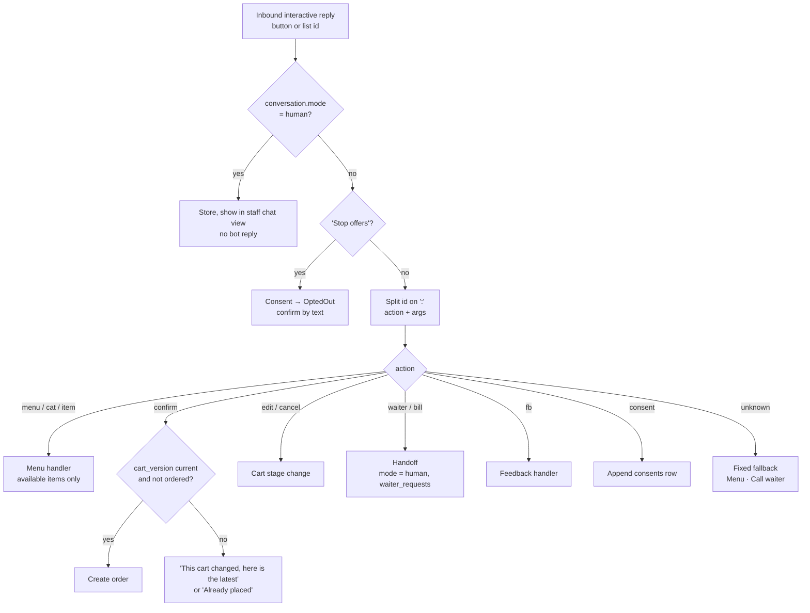

# Interactive messages

> **Area:** WhatsApp
> **Source:** MVP Architecture v0.1 §6.3, §6.5, §6.6, §6.9, §6.10, §6.11, §6.12, §6.15 ([source](../_source/mvp-architecture-v0.1.md))
> **Status:** Draft v0.1 · **Owner:** Aman
> **Used by:** [backend/app/domain/conversation/CLAUDE.md](../../backend/app/domain/conversation/CLAUDE.md), [backend/app/integrations/whatsapp/CLAUDE.md](../../backend/app/integrations/whatsapp/CLAUDE.md), [backend/app/domain/outbound/CLAUDE.md](../../backend/app/domain/outbound/CLAUDE.md)

## Summary

Most turns never reach the AI: button and list taps are handled by deterministic code keyed on the reply **ID**, never on the visible title. IDs follow `action:arg1:arg2`, so an old button still resolves correctly and a stale one (an outdated cart version, for example) is rejected politely. Dish lists and cart summaries are rendered by code from the database, so a hallucinated dish name or price can never reach the customer.

## Message types used

| Type | Used for | Window |
|---|---|---|
| Text | AI replies, confirmations ("Order #123 received, about 20 minutes"), status updates, staff replies in human mode | Inside 24 h |
| Reply buttons | Greeting, order confirmation, fallback, consent ask | Inside 24 h |
| List message | Menu categories and dishes, AI-suggested dishes, feedback rating 1–5 | Inside 24 h |
| Template | Campaigns (`weekly_offer`, `winback`), out-of-window updates (`order_update`), staff alerts (`new_order_alert`) | Any time (see [templates.md](templates.md)) |

Meta limits to design around (Meta facts as of mid-2026, verify): up to 3 reply buttons per message, up to 10 rows in a list message, short character limits on button and row titles, and a maximum length on reply IDs.

## ID scheme `action:arg1:arg2`

| ID | Sent on | Handler does |
|---|---|---|
| `menu:` | Greeting "Menu" button, fallback "Menu" button | Show the menu categories as a list |
| `cat:` | Category rows in the menu list | Show available dishes in that category (argument: category id, **proposed** `cat:{category_id}`) |
| `item:{menu_item_id}` | Dish rows in menu lists and AI-suggested dish lists | Show / act on that dish; re-checks availability |
| `confirm:{cart_id}:{cart_version}` | "Confirm" on the order summary | Validate the version is current and the cart isn't already ordered, then create the order |
| `edit:` | "Edit" on the order summary | Back to `CartOpen` |
| `cancel:` | "Cancel" on the order summary | Back to `Browsing` (cart not ordered) |
| `waiter` | Greeting "Call waiter", fallback "Call waiter" | `mode = human`, `waiter_requests` row, staff alert |
| `bill` | "Request bill" | Same path as `waiter` with `reason = BILL` |
| `fb:{order_id}:{n}` | Feedback list rows, `n` = 1 to 5 | Save rating; 4–5 thank you, 3 ask for comment, 1–2 apologise + alert manager |
| `consent:` | Consent ask Yes / No | Append a `consents` row (`OptedIn` or `Declined`) |

The args shown in braces are from the source; argument shapes marked **proposed** are not. Every handler validates its args against the database scoped to the current café and conversation.

## Button sets

| Moment | Message | Buttons / rows |
|---|---|---|
| Greeting (new or welcome back) | Reply buttons | **Menu** · **Recommend** · **Call waiter** |
| Order summary (deterministic confirmation) | Reply buttons, id `confirm:{cart_id}:{version}` | **Confirm** / **Edit** / **Cancel** |
| Fallback (guardrails failed twice, AI timeout) | Fixed text + reply buttons | **Menu** · **Call waiter** |
| Consent ask (after first order, or after a 4–5 rating) | "Want offers from Café XYZ on WhatsApp?" | **Yes** / **No** |
| Feedback (+30 min after SERVED) | List message | Ratings 1 to 5, ids `fb:{order_id}:{n}` |
| Campaign (marketing template) | Template with code variable | **Stop offers** |

"Stop offers" (and the text `STOP`) is checked by the router **before** interactive dispatch and sets consent to `OptedOut`. See [../retention/consent.md](../retention/consent.md).

## How a tap routes to a handler

Look at the order of checks: human mode and STOP win over every button, and only then is the ID's action prefix used to pick a handler.

## Code-rendered dish lists

- The AI returns structured output: `reply_text`, `suggested_item_ids`, `intent`.
- Guardrails check every suggested ID exists and is available, and that the free text has no currency amounts.
- The outbound layer renders the suggested dishes as a **list message from the database**: names and prices come from `menu_items`, row IDs are `item:{menu_item_id}`, images from Supabase Storage where used.
- The same applies to the cart and the order summary: items, quantities, notes, subtotal, taxes and total are computed by the cart service.
- Menu lists read `menu_items` with `is_available = true`; sold-out items disappear on the next render.

## Rules / invariants

- Handlers act on the ID, never on the visible title.
- Stale IDs are rejected politely, never acted on (`confirm:` with an old `cart_version`, an `item:` that is now sold out).
- No dish name or price in any message comes from AI text.
- `confirm:` is the only way an order gets created; a double-tap can't create two orders (`UNIQUE (cart_id, cart_version)`).
- In human mode, taps are forwarded to staff and the bot stays silent.

## Open questions

- Argument shapes for `menu:`, `cat:`, `edit:`, `cancel:` and `consent:` are not defined in the source. **(proposed)** `cat:{category_id}`, `edit:{cart_id}`, `cancel:{cart_id}`, `consent:yes` / `consent:no`.
- The greeting "Recommend" button has no ID prefix in the source list. **(proposed)** `recommend`, routed to an AI turn.
- Whether `cancel:` also covers cancelling a placed order before PREPARING (feature "Edit / cancel before preparing"), and with what args.
- Menus with more than 10 dishes in a category need paging or splitting within list-message limits.
- How the "Stop offers" quick-reply on a template arrives (template button payload vs interactive reply ID).

## Related

- [README.md](README.md) · [outbound-sender.md](outbound-sender.md) · [templates.md](templates.md)
- [../backend/conversation-router.md](../backend/conversation-router.md) · [../backend/cart-and-confirmation.md](../backend/cart-and-confirmation.md) · [../backend/human-handoff.md](../backend/human-handoff.md) · [../backend/feedback.md](../backend/feedback.md)
- [../ai-agent/guardrails.md](../ai-agent/guardrails.md) · [../retention/consent.md](../retention/consent.md)
- [../adr/0001-ai-talks-code-decides.md](../adr/0001-ai-talks-code-decides.md)
- Context: [backend/app/domain/conversation/CLAUDE.md](../../backend/app/domain/conversation/CLAUDE.md)
