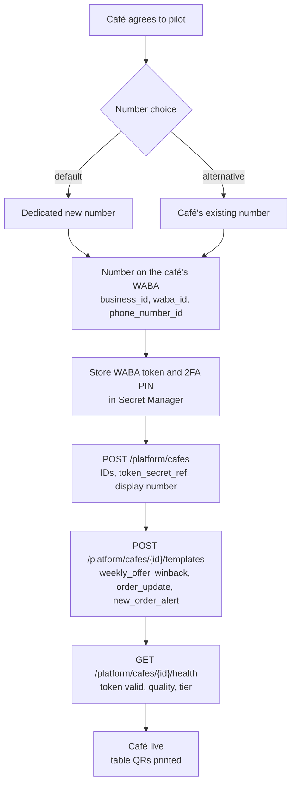
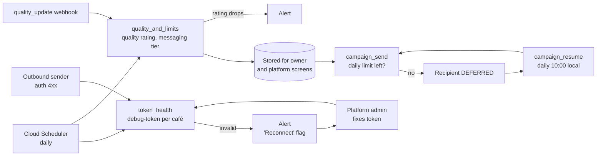

# Café onboarding and number health

> **Area:** WhatsApp
> **Source:** MVP Architecture v0.1 §1, §2, §3.1, §6.12, §6.17, §7, §8.4, §9, §10, §11, §14 ([source](../_source/mvp-architecture-v0.1.md))
> **Status:** Draft v0.1 · **Owner:** Aman
> **Used by:** [backend/app/integrations/whatsapp/CLAUDE.md](../../backend/app/integrations/whatsapp/CLAUDE.md), [backend/app/api/CLAUDE.md](../../backend/app/api/CLAUDE.md), [infra/CLAUDE.md](../../infra/CLAUDE.md), [frontend/src/features/CLAUDE.md](../../frontend/src/features/CLAUDE.md)

## Summary

Each café brings its own WhatsApp Business Account (WABA) and phone number. The platform admin onboards it manually in the MVP (Embedded Signup is Phase 2 and out of scope), storing the IDs on `cafes` and the token in Secret Manager. After that, three things can silently break a café: the token stops working, the number's quality rating drops, or the daily messaging limit runs out. Daily jobs and webhooks watch all three and surface them on the owner and platform screens.

## Onboarding fields (`cafes`)

| Field | Meaning |
|---|---|
| `business_id` | Meta Business account id |
| `waba_id` | WhatsApp Business Account id |
| `phone_number_id` | Graph API id of the number. **Unique**: this is how every inbound webhook resolves the café |
| `display_phone_number` | The number customers see |
| `token_secret_ref` | Reference to the WABA token in Secret Manager (the DB never holds the token) |
| `onboarding_model` | How the number was onboarded (e.g. dedicated pilot number vs café's existing number) |
| `timezone` | Used for local-time jobs such as `campaign_resume` at 10:00 |
| `status` | Café status |
| `settings` | Hours, tone, feedback delay, tax (owner-managed) |

2FA PINs for the number also live in Secret Manager.

**Pilot number.** Default is a **new dedicated number** for the pilot café rather than the café's existing number (see the WhatsApp Integration Plan and [../delivery/open-decisions.md](../delivery/open-decisions.md)).

**Environments.** `dev` uses a Meta test number and team phones; `prod` holds the pilot cafés. A separate Meta app per environment avoids test webhooks hitting production.

## Onboarding flow

Look at where secrets go: the token goes to Secret Manager first, and only its reference reaches `POST /platform/cafes`. How the number is attached to the WABA and the Meta app is a manual Meta-side step in the MVP; Embedded Signup would automate it in Phase 2.

## Health signals

| Signal | Source | Job / path | Surfaces as |
|---|---|---|---|
| Token validity | Daily debug-token check per café | `token_health` (Scheduler, daily) | Alert + **"Reconnect"** flag on the café |
| Token failure at send time | Outbound sender gets an auth `4xx` | Sender stores `error_code`, alerts → token health | Same alert / flag |
| Quality rating | Meta | `quality_and_limits` (Scheduler, daily) + `quality_update` webhooks | Owner and platform screens |
| Messaging tier / daily limit | Meta | `quality_and_limits` | Campaign recipients DEFERRED when the limit is reached |
| Webhook errors | `webhook_events`, logs | — | `GET /platform/cafes/{id}/health` |
| Per-user marketing cap | Meta error `131049` on a status webhook | Status handler | Recipient `FAILED`, `messages.error_code` |

`GET /platform/cafes/{id}/health` returns token validity, quality rating, messaging tier and webhook errors. The alert "Token invalid / quality rating drops" fires on any occurrence ([../observability/logging-and-metrics.md](../observability/logging-and-metrics.md)).

## Health monitoring loop

Look at the two feedback loops: token problems loop back through the platform admin; limit problems loop back through `campaign_resume` the next day.

## Protecting the quality rating

Campaigns are the main risk to a number's quality rating. Mitigations from the source:

- Opt-in only: marketing templates go only to `OptedIn` customers.
- Small first batches.
- An easy **"Stop offers"** button on every marketing template.
- Queue rate on `campaign-send` matched to the number's throughput.
- Respect the daily messaging limit (DEFERRED + `campaign_resume`) and the per-user cap (`131049`).

## Rules / invariants

- `phone_number_id` is unique across cafés; tenant resolution depends on it.
- The token is only ever read from Secret Manager via `token_secret_ref`; never stored in the DB, logs or the frontend.
- Every `platform_admin` action is audited.
- A café whose token is invalid is flagged "Reconnect" and alerted the same day.
- When the daily limit is reached, campaign recipients are deferred, never dropped.

## Open questions

- Where the "Reconnect" flag, quality rating and messaging tier are stored. They are not columns in the §7 `cafes` entity. **(proposed)** A health record per café, or keys in `cafes.status` / `settings`.
- How "daily limit left" is computed from the messaging tier (Meta tier sizes and how they count, verify against current Meta docs).
- Allowed values of `onboarding_model` and `cafes.status`.
- Embedded Signup timing (Phase 2).

## Related

- [README.md](README.md) · [templates.md](templates.md) · [outbound-sender.md](outbound-sender.md) · [webhooks.md](webhooks.md)
- [../retention/campaigns.md](../retention/campaigns.md) · [../backend/background-jobs.md](../backend/background-jobs.md)
- [../api/platform.md](../api/platform.md) · [../frontend/platform-admin.md](../frontend/platform-admin.md)
- [../infra/iam-and-secrets.md](../infra/iam-and-secrets.md) · [../infra/environments.md](../infra/environments.md)
- Context: [infra/CLAUDE.md](../../infra/CLAUDE.md), [backend/app/integrations/whatsapp/CLAUDE.md](../../backend/app/integrations/whatsapp/CLAUDE.md)
