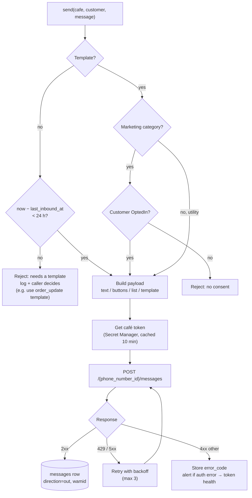

# Outbound sender and the 24-hour window

> **Area:** WhatsApp
> **Source:** MVP Architecture v0.1 §6.13, §6.2, §6.5, §6.7, §6.10, §6.12, §10, §11 ([source](../_source/mvp-architecture-v0.1.md))
> **Status:** Draft v0.1 · **Owner:** Aman
> **Used by:** [backend/app/domain/outbound/CLAUDE.md](../../backend/app/domain/outbound/CLAUDE.md), [backend/app/integrations/whatsapp/CLAUDE.md](../../backend/app/integrations/whatsapp/CLAUDE.md), [backend/app/domain/CLAUDE.md](../../backend/app/domain/CLAUDE.md)

## Summary

Every message to a customer goes through **one send function**, so the 24-hour window rule, the marketing-consent rule and logging can't be bypassed. The function decides whether the message is allowed, builds the payload, fetches the café's token from Secret Manager, posts to the Graph API, retries transient failures and stores the result as a `messages` row with `direction = out`.

## The send flow

Verbatim from §6.13.

Look at the two guards before anything is built: free-form messages need an open window, marketing templates need `OptedIn`. Utility templates pass both.

## Guards

| Message kind | Allowed when | Otherwise |
|---|---|---|
| Free-form (text, reply buttons, list) | `now − customers.last_inbound_at < 24 h` | Reject "needs a template"; log; the caller decides (e.g. send the `order_update` utility template instead, or skip) |
| Utility template (`order_update`, `new_order_alert`) | Always (no window, no consent check) | — |
| Marketing template (`weekly_offer`, `winback`) | Customer's latest consent row is `OptedIn` | Reject "no consent" |

- `last_inbound_at` is set by the worker on every inbound message (see [webhooks.md](webhooks.md)). It is the only clock for the window.
- Consent is read from the latest `consents` row for the customer (append-only; see [../retention/consent.md](../retention/consent.md)).
- Callers that hit the window rule today: feedback (skips rather than spending a template, §6.10) and order status messages (customer messages are sent "inside 24-h window", §6.7).

## Who calls the sender

| Caller | Sends |
|---|---|
| Conversation engine | Greeting, AI reply + code-rendered dish list / cart, fallback, consent ask, STOP confirmation |
| `orders` | PLACED / PREPARING / READY / CANCELLED / overdue messages |
| `handoff` | "Someone from our team will be with you shortly", staff replies from `/staff/conversations/{id}/reply` |
| `feedback` | 1–5 rating list, thank-you / follow-up |
| `consent` | Opt-in / opt-out confirmations |
| `campaigns` (`campaign_send`) | One marketing template per recipient, with code variable and "Stop offers" button |
| Sweeps (`overdue_sweep`) | Delay message; `new_order_alert` backup alert to the staff number |
| `api` staff actions | Status change → customer message (sent from `api`, not `worker`) |

The sender lives in `app/domain/outbound` (24h guard, message builders); the HTTP call lives in `app/integrations/whatsapp/client.py`; the token lookup in `app/integrations/gcp/secrets.py`.

## Token lookup

- `cafes.token_secret_ref` points to the café's WABA token in Secret Manager. The database never stores the token itself.
- The token is cached in-process for **10 minutes** to avoid a Secret Manager call per message.
- Both `api` (`api-sa`) and `worker` (`worker-sa`) have Secret Manager accessor permission.

## Response handling

| Response | Action |
|---|---|
| `2xx` | Store a `messages` row: `direction = out`, `wamid` from Meta, `type`, `payload`, `cafe_id`, `conversation_id`. Status starts at `sent` and is moved forward by status webhooks. |
| `429` or `5xx` | Retry with backoff, **max 3** attempts. |
| Other `4xx` | Store `error_code`; if it is an auth error, alert and hand to token health (`token_health`, "Reconnect" flag; see [number-health.md](number-health.md)). |

## Read receipts and typing indicator

When the worker starts handling a new inbound message (after dedupe and the advisory lock), it marks the message as read and shows a typing indicator through the same integration client, before the conversation engine runs. This tells the customer the message landed while the AI is working.

## Logging and metrics

- Every send logs `cafe_id`, `conversation_id`, `wamid` (or `error_code`) and the request ID.
- Metric "Outbound send failures" alerts when > 5% in 15 min. See [../observability/logging-and-metrics.md](../observability/logging-and-metrics.md).
- Pricing per message arrives later on status webhooks and is stored on the `messages` row. See [../observability/cost-tracking.md](../observability/cost-tracking.md).

## Rules / invariants

- One send function. Nothing calls `POST /{phone_number_id}/messages` except through it.
- No free-form message outside the 24-hour window. No marketing template without `OptedIn`.
- The AI cannot send templates; it only produces reply text and suggested item IDs.
- Dish names and prices in outbound messages are rendered by code from the database, never taken from AI text.
- Every successful send writes a `messages` row with `direction = out`.
- Tokens never appear in logs.

## Open questions

- Backoff timings for the 3 retries are not specified.
- **(proposed)** Drop the cached token on an auth error so a rotated token is picked up without waiting 10 minutes.
- Which Meta error codes count as "auth error" (Meta fact, verify; token/OAuth errors).
- The signature is `send(cafe, customer, message)`, but `new_order_alert` goes to a staff WhatsApp number, not a customer. Decide how staff recipients are modelled (and whether they are logged in `messages`).
- Whether a staff human-mode reply outside the 24-hour window should fall back to a template or be blocked in the panel.

## Related

- [README.md](README.md) · [webhooks.md](webhooks.md) · [interactive-messages.md](interactive-messages.md) · [templates.md](templates.md) · [number-health.md](number-health.md)
- [../backend/inbound-pipeline.md](../backend/inbound-pipeline.md) · [../backend/order-lifecycle.md](../backend/order-lifecycle.md) · [../backend/feedback.md](../backend/feedback.md)
- [../retention/consent.md](../retention/consent.md) · [../retention/campaigns.md](../retention/campaigns.md)
- [../infra/iam-and-secrets.md](../infra/iam-and-secrets.md)
- Context: [backend/app/domain/outbound/CLAUDE.md](../../backend/app/domain/outbound/CLAUDE.md)
