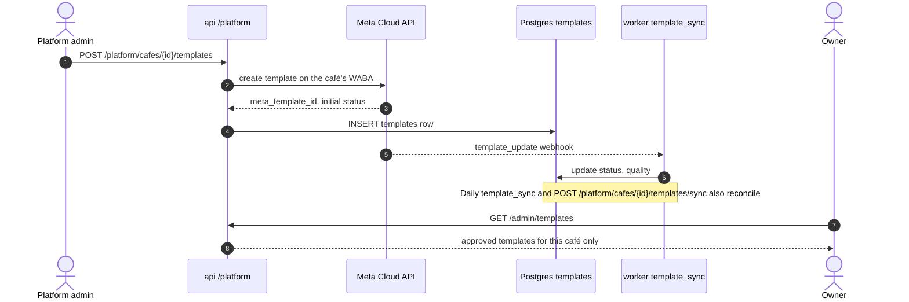
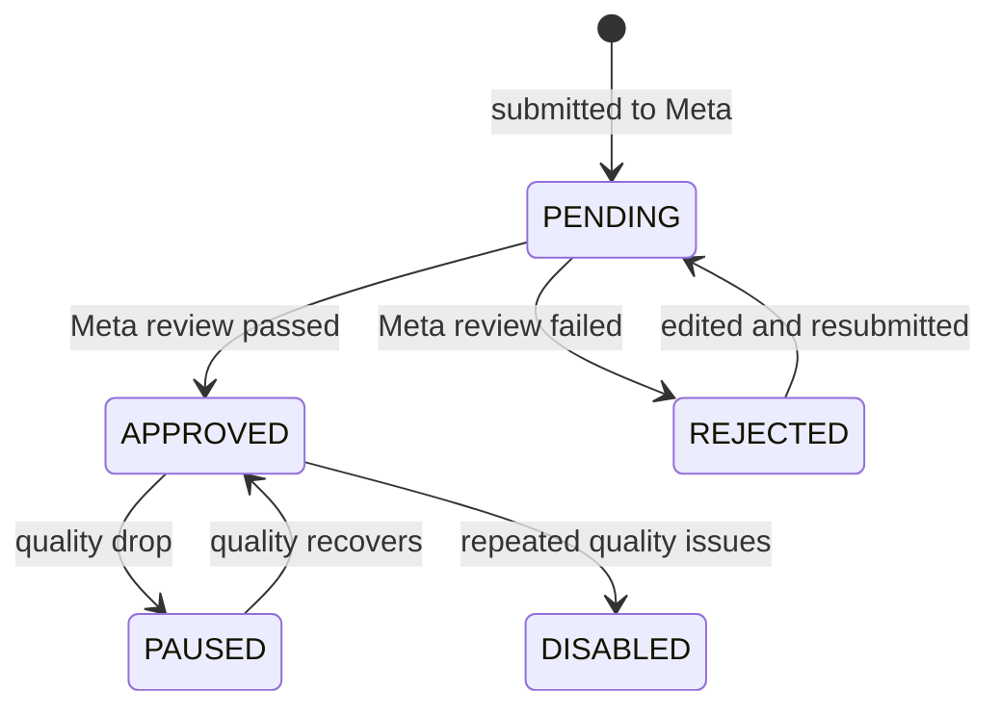

# Message templates

> **Area:** WhatsApp
> **Source:** MVP Architecture v0.1 §6.8, §6.9, §6.12, §6.13, §6.17, §7, §8.3, §8.4, §13 ([source](../_source/mvp-architecture-v0.1.md))
> **Status:** Draft v0.1 · **Owner:** Aman
> **Used by:** [backend/app/integrations/whatsapp/CLAUDE.md](../../backend/app/integrations/whatsapp/CLAUDE.md), [backend/app/domain/campaigns/CLAUDE.md](../../backend/app/domain/campaigns/CLAUDE.md), [backend/app/domain/outbound/CLAUDE.md](../../backend/app/domain/outbound/CLAUDE.md)

## Summary

Templates are the only messages that can be sent outside the 24-hour window, and the only way to send marketing. The MVP needs four: two marketing (`weekly_offer`, `winback`) and two utility (`order_update`, `new_order_alert`). They are created by the platform admin on **each café's WABA**, need Meta approval, and their status and quality are kept in sync by `template_sync`. Approval takes time, so they are submitted during build step 1, not step 4.

## Templates the MVP needs

| Template | Category | Used by | Notes |
|---|---|---|---|
| `weekly_offer` | Marketing | `campaigns` → `campaign_send` | Slow-day offer; carries the redemption code variable and a "Stop offers" button |
| `winback` | Marketing | `campaigns` → `campaign_send` | Offer for lapsed customers (segment "lapsed") |
| `order_update` | Utility | `orders`, via the outbound sender | Order status update when the customer's 24-hour window has closed |
| `new_order_alert` | Utility | `overdue_sweep` | Backup alert to a staff WhatsApp number: order unacknowledged in `PLACED` > 60 s; the same style is used for waiter requests unacknowledged > 60 s |

Marketing templates pass the outbound sender's consent check (`OptedIn` only); utility templates do not need it. See [outbound-sender.md](outbound-sender.md).

## The `templates` table

| Field | Meaning |
|---|---|
| `id` | Internal id |
| `cafe_id` | The café whose WABA owns the template |
| `meta_template_id` | Meta's id for the template |
| `name` | e.g. `weekly_offer` |
| `language` | Template language |
| `category` | Marketing or utility |
| `status` | Approval status mirrored from Meta |
| `quality` | Template quality mirrored from Meta |
| `components` | The template body, buttons and variable placeholders as JSON |

`TEMPLATES ||--o{ CAMPAIGNS : used_by` — each campaign references one template (`campaigns.template_id`).

## Lifecycle

Look at the two sync paths: the webhook gives fast updates, and the daily job plus the manual `/sync` catch anything missed.

| Step | Who / what | Endpoint or job |
|---|---|---|
| Create on WABA | Platform admin | `POST /platform/cafes/{id}/templates` |
| Manual sync | Platform admin | `POST /platform/cafes/{id}/templates/sync` |
| Status / quality changes | Meta → worker | `template_update` webhook event |
| Reconcile | Scheduler | `template_sync` (webhook + daily) |
| Pick for a campaign | Owner | `GET /admin/templates` (approved only), then `POST /admin/campaigns` with template + variables |

## Template status (proposed)

The source only says status is kept in sync with Meta. The states below are an illustration of the expected lifecycle; **the exact Meta status values must be verified against current Meta docs before building.**

Look at `PAUSED`: an approved template can stop being usable mid-campaign, which is why status is synced daily and by webhook.

## Rules / invariants

- Templates are created on the café's own WABA, one set per café (`templates.cafe_id`).
- Owners only see and pick **approved** templates for their café.
- Only the platform admin creates templates; owners never call Meta directly.
- Marketing templates are sent only to `OptedIn` customers, through the single send function.
- The AI can never send a template.
- Submit all four templates during build step 1.

## Open questions

- Exact Meta template status and quality values (the state diagram above is **proposed**).
- What `campaign_send` does if a campaign's template becomes paused or disabled mid-send. **(proposed)** Mark remaining recipients DEFERRED and alert the platform admin.
- Language variants: one row per `name` + `language`; which languages (English, Hindi) the pilot needs.
- The categories of `weekly_offer` and `winback` are inferred from their campaign use; the source names them but does not list categories explicitly.
- Template wording and variables (beyond the redemption code) are not defined.

## Related

- [README.md](README.md) · [outbound-sender.md](outbound-sender.md) · [number-health.md](number-health.md) · [webhooks.md](webhooks.md)
- [../retention/campaigns.md](../retention/campaigns.md) · [../backend/order-lifecycle.md](../backend/order-lifecycle.md) · [../backend/background-jobs.md](../backend/background-jobs.md)
- [../api/platform.md](../api/platform.md) · [../api/admin.md](../api/admin.md) · [../frontend/platform-admin.md](../frontend/platform-admin.md)
- [../delivery/build-order.md](../delivery/build-order.md)
- Context: [backend/app/domain/campaigns/CLAUDE.md](../../backend/app/domain/campaigns/CLAUDE.md)
