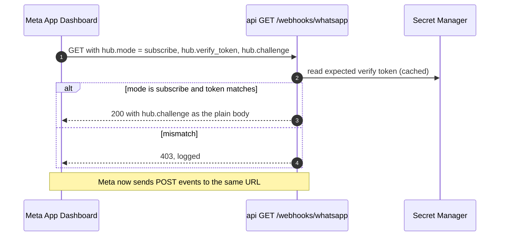
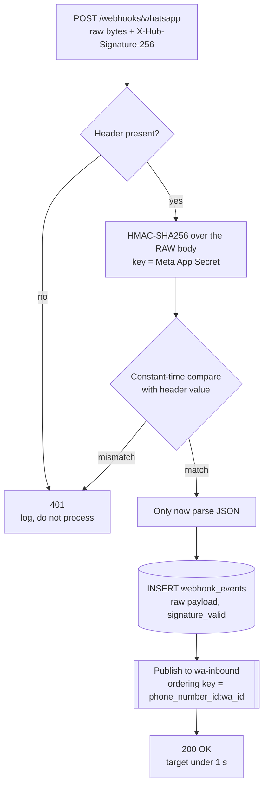
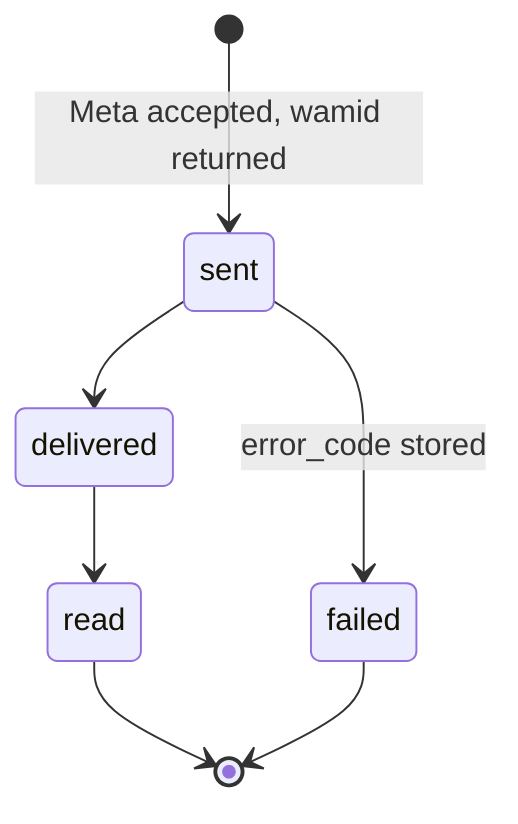

# Webhooks

> **Area:** WhatsApp
> **Source:** MVP Architecture v0.1 §5.3, §6.2, §6.11, §6.12, §6.17, §7, §8.1, §8.5, §10 ([source](../_source/mvp-architecture-v0.1.md))
> **Status:** Draft v0.1 · **Owner:** Aman
> **Used by:** [backend/app/integrations/whatsapp/CLAUDE.md](../../backend/app/integrations/whatsapp/CLAUDE.md), [backend/app/api/CLAUDE.md](../../backend/app/api/CLAUDE.md), [backend/app/core/CLAUDE.md](../../backend/app/core/CLAUDE.md), [backend/tests/CLAUDE.md](../../backend/tests/CLAUDE.md)

## Summary

Meta delivers every inbound message, status update, template change and quality change as a webhook to the public `api` service. The webhook does only four things: verify the signature on the raw body, store the raw event in `webhook_events`, publish it to Pub/Sub `wa-inbound` with a per-customer ordering key, and return `200` in under a second. Everything else (parsing, dedupe, status updates, the conversation) happens in `worker`. Meta retries and duplicates are expected, so every step downstream is idempotent.

## Endpoints

| Method | Path | Service | Auth | Purpose |
|---|---|---|---|---|
| GET | `/webhooks/whatsapp` | `api` | `hub.verify_token` | Meta verification handshake |
| POST | `/webhooks/whatsapp` | `api` | `X-Hub-Signature-256` | Inbound messages and statuses |
| POST | `/webhooks/meta/data-deletion` | `api` | Signed request | Meta data deletion callback |
| — | `/internal/pubsub/inbound` | `worker` | OIDC (Pub/Sub push as `invoker-sa`) | Processes the published event |

Router: `app/api/webhooks.py` (GET verify / POST events). Signature check: `app/core/signature.py`. Parser: `app/integrations/whatsapp/parser.py`.

## GET verify handshake

When the webhook URL is registered in the Meta app, Meta calls it once with a challenge. The service echoes the challenge back only if the verify token matches.

Look at the single decision: the only thing checked is the verify token; no café is resolved here because the handshake is per Meta app, not per café.

The `hub.mode` / `hub.challenge` parameters and the `403` on mismatch are Meta's standard handshake (verify against current Meta docs). Where the verify token is stored is **(proposed)**: Secret Manager, alongside the App Secret. There is one Meta app per environment (`dev`, `prod`), so each environment has its own verify token and App Secret.

## POST events and the signature check

Look at the order: the HMAC is computed on the exact bytes received, before JSON parsing, because re-serialised JSON would not match the signature.

| Step | Detail |
|---|---|
| Signature | HMAC-SHA256 of the **raw** body with the App Secret (from Secret Manager), constant-time compare, before JSON parsing. Meta sends the header as `sha256=` followed by the hex digest (Meta fact, verify). |
| Invalid | `401`, logged, not processed. |
| Store | `webhook_events` row with the raw payload and `signature_valid`. |
| Publish | Pub/Sub topic `wa-inbound`, ordering key `{phone_number_id}:{wa_id}`. Same customer → strictly ordered delivery. |
| Respond | `200 OK`, target under 1 s. Cloud Run `api` keeps `min-instances=1` in production so cold starts don't break this. |
| Rate limit | Per-IP limits on public endpoints (§10). |

Why ordering keys: two quick messages from the same person must never race each other to create two carts. The ordering key serialises them in Pub/Sub; a Postgres advisory lock per conversation serialises them in the worker. See [../adr/0003-per-customer-ordering-and-locks.md](../adr/0003-per-customer-ordering-and-locks.md).

## Worker side: event types

Pub/Sub pushes to `/internal/pubsub/inbound` with an OIDC token. The worker parses the payload into one of four event types.

| Event | Comes from | Worker does |
|---|---|---|
| `message` | Customer sends text, taps a button or list row | Dedupe on `wamid`, resolve café, upsert customer, lock, hand to the conversation engine |
| `status` | Meta reports on an outbound message | Forward-only status update on `messages`; store pricing; update `campaign_recipients` status for campaign sends |
| `template_update` | Template approved, rejected or changed | Update `templates` (see [templates.md](templates.md), `template_sync`) |
| `quality_update` | Number quality rating or messaging tier changed | Store for the owner and platform screens (see [number-health.md](number-health.md), `quality_and_limits`) |

### Inbound message path

1. Insert into `messages` keyed by `wamid` (primary key). If the row already exists, the message is a duplicate: ack and stop.
2. Resolve the café by `phone_number_id` (`cafes.phone_number_id` is unique).
3. Upsert the customer on `(cafe_id, wa_id)` and set `last_inbound_at = now()` (this opens the 24-hour window).
4. Take the per-conversation advisory lock.
5. Mark the message as read and show the typing indicator.
6. Hand to the conversation engine, which replies through the outbound sender.
7. Ack to Pub/Sub.

Full sequence: [../backend/inbound-pipeline.md](../backend/inbound-pipeline.md).

## Dedupe on `wamid`

- `messages.wamid` is the primary key. Inserting a `wamid` that already exists does nothing.
- A Pub/Sub retry after a partial success therefore won't double-reply.
- Duplicates from Meta are acked as "already handled", not treated as errors.

## Status updates are monotonic

Look at the direction: status only ever moves forward along sent → delivered → read, or to failed. A late `delivered` webhook arriving after `read` is ignored.

| Rule | Detail |
|---|---|
| Forward only | Update `messages.status` only if the new status is later in the order sent → delivered → read. Never move backwards. |
| Skipped steps | **(proposed)** If `read` arrives before `delivered`, apply `read`; the later `delivered` is then ignored. |
| Failed | `failed` stores `messages.error_code` (e.g. `131049` per-user marketing cap). Whether `failed` may follow `delivered` is not stated in the source. |
| Pricing | Each status webhook carries a `pricing` object; store `billable` and category on the message (`messages.billable`, `messages.pricing_category`). Feeds [../observability/cost-tracking.md](../observability/cost-tracking.md). |
| Campaigns | Status for a campaign send also moves `campaign_recipients.send_status` (SENT → DELIVERED → READ, or FAILED). See [../retention/campaigns.md](../retention/campaigns.md). |

## Failure handling

- If the worker returns non-2xx, Pub/Sub retries with backoff.
- After N attempts the event goes to `wa-inbound-dlq` and an alert fires (DLQ depth > 0).
- Because of the `wamid` uniqueness check, a retry never double-replies.
- AI calls are bounded by a timeout (e.g. 12 s); on timeout the customer gets a fixed fallback with buttons.

## Retention of raw events

`webhook_events` is a raw log, not a system of record. The `prune_webhook_events` job (Cloud Scheduler, daily) deletes rows older than **30 days**. Message payloads also have retention limits under DPDP (§10); the exact limit for `messages.payload` is not set in the source.

## Meta data-deletion callback

`POST /webhooks/meta/data-deletion` receives Meta's signed request when a user asks Meta to delete their data. After verifying the signed request with the App Secret, it goes through **the same `data_deletion` job** as a customer typing "delete my data". The callback format (a signed request, and a response with a status URL and confirmation code) is Meta's convention; verify against current Meta docs. Details: [../retention/data-deletion.md](../retention/data-deletion.md).

## Rules / invariants

- Signature verified on the raw body, constant-time, before parsing. Invalid → `401`, never processed.
- The webhook handler never calls the LLM, the conversation engine or the Graph API. Store, publish, `200`.
- Ordering key is always `{phone_number_id}:{wa_id}`.
- `cafe_id` comes from `phone_number_id` in the payload, never from message text.
- `wamid` is unique; duplicates are acked silently.
- Message status never moves backwards.
- The App Secret never appears in logs.

## Open questions

- The source sequence writes `webhook_events` only on the valid branch, yet the table has a `signature_valid` column. Decide whether invalid requests are also stored (for forensics) or only logged.
- Ordering key for events with no customer (`template_update`, `quality_update`) and for `status` events (where `wa_id` is the recipient). **(proposed)** Use `{phone_number_id}:{recipient wa_id}` for status and `{phone_number_id}` alone for account-level events.
- One POST can batch several entries/changes. **(proposed)** Split per message before publishing so each customer keeps its own ordering key.
- Storage location of the verify token **(proposed: Secret Manager)**.
- Retention period for `messages.payload`.

## Related

- [README.md](README.md) · [outbound-sender.md](outbound-sender.md) · [templates.md](templates.md) · [number-health.md](number-health.md)
- [../backend/inbound-pipeline.md](../backend/inbound-pipeline.md) · [../backend/background-jobs.md](../backend/background-jobs.md)
- [../api/public.md](../api/public.md) · [../api/internal.md](../api/internal.md)
- [../security/security-controls.md](../security/security-controls.md) · [../database/constraints-and-indexes.md](../database/constraints-and-indexes.md)
- [../adr/0002-ack-fast-process-async.md](../adr/0002-ack-fast-process-async.md) · [../adr/0003-per-customer-ordering-and-locks.md](../adr/0003-per-customer-ordering-and-locks.md)
- Context: [backend/app/integrations/whatsapp/CLAUDE.md](../../backend/app/integrations/whatsapp/CLAUDE.md), [backend/app/core/CLAUDE.md](../../backend/app/core/CLAUDE.md)
